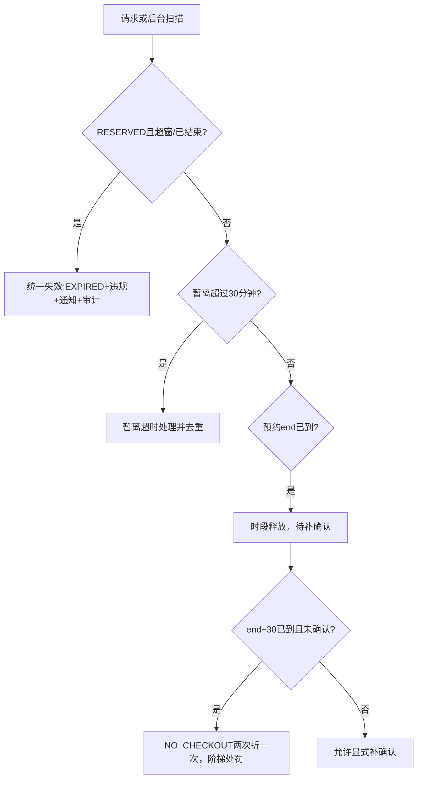

# 接口与关键设计说明书

编号：DESIGN-20261125-1；状态：用于获准缺陷修复的实现设计，人工交叉审查待完成。

目录：[需求动作映射](#1-需求业务动作接口映射) · [公共约定](#2-公共契约) · [关键写契约](#3-关键写接口) · [时序与状态](#4-时序状态与详细逻辑) · [查询和权限](#5-查询数据范围与隐私) · [数据库与恢复](#6-数据库与异常恢复)。

## 1. 需求→业务动作→接口映射

| 需求 | 业务动作 | 接口编号/方法路径 | 核心函数/测试 |
|---|---|---|---|
| FR-001/002/004/PERM-003 | 注册、登录、注销、改密、重置 | AUTH-* / POST /api/auth/register/login/logout/change-password/reset-password；GET me | services.auth/security；test_auth |
| FR-010/011/013/BR-012 | 开放日历/座位筛选详情/区域分配 | CATALOG-* / GET /api/rooms、/seats、/seats/{id} | availability；test_reservations/test_gaps |
| FR-020/023/024、BR-050/052 | 创建/幂等/冲突 | API-BOOK / POST /api/reservations | reservations.create；真实DB并发 |
| FR-021 | 仅换座（改时段保留缺口） | API-MOVE / PATCH /api/reservations/{rid}/seat | change_seat；到达座位同步 |
| FR-022/BR-031/095 | 取消与统一违规 | API-CANCEL / POST /api/reservations/{rid}/cancel | cancel→record_violation |
| FR-030/031、BR-020 | 座位标识签到 | API-CHECK / POST /api/reservations/{rid}/check-in | check_in；扫码/编号验证 |
| FR-035/036/037 | 暂离与门禁返回 | API-LEAVE / POST temporary-leave；API-GATE / POST /api/ops/entry-exit/mock | 状态TEMP_LEAVE；普通return仅可读回已恢复结果 |
| FR-032/BR-025/096/102 | 主动确认/自动结束 | API-END / POST /api/reservations/{rid}/end | end_use/full_sweep；CHG-03 |
| FR-040～043/PERM-013/014 | 本人违规/申诉、管理员审核 | API-APPEAL / POST /api/appeals；PATCH /api/admin/appeals/{id}；对应GET | record_violation、review_appeal |
| FR-050/051/060 | 本人通知、已读、历史 | GET reservations/notifications；POST notifications/{id}/read | user_id隔离/事件键 |
| FR-070～073/BR-060～065 | 房间、时段、校历、座位CSV/维护/禁用、参数 | ADMIN-* / /api/admin/rooms/settings/calendar等 | 设施状态与已有预约事务处理 |
| PERM-015/061 | 全体预约/统计导出 | GET /api/admin/reservations、reports/export.xlsx | 管理专属权限、聚合口径 |
| PERM-024/025/027/NFR | 日志/模拟门禁/备份监控 | OPS-* / /api/ops/* | 角色、读审计、恢复对账 |

全部方法路径、请求字段和响应schema按运行应用OpenAPI生成[接口字段附录](接口字段附录.md)，每个方法单列；附录不得替代以下业务契约。接口确认的学生提供方/调用方/复核人尚未填写，不能声称已冻结人工基线。

## 2. 公共契约

Bearer随机会话通过Authorization传递，过期/撤销/未登录401，账号停用或角色不符403；对象不存在或非本人404，业务状态冲突409，输入422，写锁超时503+Retry-After:1。认证失败detail为{code,message}，常规业务错误detail字符串，Pydantic字段错误detail列表；前端统一提取可读信息。

所有预约输入必须为含时区ISO8601，服务转Asia/Shanghai；时段[start,end)，不跨零点，开始<结束；实际范围沿当前一天上限/开放时段执行，未把候选30分钟～4小时补成硬约束。服务端时间决定状态，前端时间仅提示。

关键写在SQLite BEGIN IMMEDIATE后重查状态/归属/冲突，同事务完成数据变化、站内通知及审计。任意数据库/通知/审计异常整体回滚；EX-06独立通知重试要求仍为待决差异，没有消息队列。禁止日志写密码、明文token、重置码、真实门禁身份。幂等键/指纹只记录业务请求摘要。

## 3. 关键写接口

| 接口 | 请求/权限/前置 | 成功及后置 | 失败与重复/事务 | 正常、失败、重复示例 |
|---|---|---|---|---|
| API-BOOK | 用户/管理员本人；seat_id正数或room_id+zone_type；start/end含时区；头Idempotency-Key 1～64字符或体request_key 8～64 | 201；新增预约、到达占位、确认通知；头键重放200+Idempotent-Replayed；体键保持兼容201 | 非开放422、已占409、禁约403；同键异载荷/用户409；不创建半单；可空键的兼容路径不能保证稳定取回，网页自动生成并保留键到成功 | {seat_id:1,start_time:…+08:00,end_time:…}→201；交叠→409；同键同体→同ID |
| API-MOVE | 本人RESERVED且窗未过，seat_id正数；禁约拒绝 | 200；原座释放，新座预约；Reservation和ArrivalRecord均指新座 | 新座冲突/维护409且原单原座不变；重复同座200 | seat_id:2→200；被占3→409；再次2→同预约 |
| API-CANCEL | 本人RESERVED；未开始；confirm为true；禁约仍允许 | 200 CANCELLED；释放；<=15分钟统一违规阶梯和通知，不再未到 | ACTIVE/已开始409；重复已取消200，无重复违规/通知；事务失败全部回滚 | 开始前10分钟→late且一条违规；ACTIVE→409；再次取消→同状态 |
| API-CHECK | 本人；必需JSON seat_id，或room_id+seat_code；[start−15,min(end,start+15)]窗口，预约end时不再签到 | 200 ACTIVE，到达记录的座位/时间/方式一致，状态审计 | 标识不匹配409，缺字段422，窗未开409；窗已过提交失效/违规后409；同标识重复ACTIVE返回200；过期ACTIVE不得重新占座 | {seat_id:1}→200；{seat_id:2}→409；同1重放→200 |
| API-LEAVE | 本人ACTIVE且end>now | 200 TEMP_LEAVE，记录声明时刻，保留至30分钟或预约结束的权益边界 | 非ACTIVE/过期409；重复声明409，不重新计时 | 正常→200；重复→409；结束后→409 |
| API-GATE | 仅ops，external_id/source、HMAC键、entry/exit、含时区recorded_at，可选reservation_id | 200持久化事件；TEMP_LEAVE的及时entry恢复ACTIVE；ACTIVE未声明exit释放并统一记违规；已声明exit保留 | 同source+event_id重放原结果；延迟>300秒late不自动改；未知/状态不符unmatched；未来事件拒绝；RESERVED入馆不替代座位签到；同事件不同负载不应用 | entry恢复暂离→synced；延迟301秒→late；重复同事件→duplicate且状态不重复改变 |
| API-RETURN | 本人，只作为兼容结果读回；不能自行声明返回 | 仅已由门禁恢复ACTIVE且RETURNED可200重放 | 无有效门禁恢复409；非本人404 | 门禁先恢复→200；直接请求→409；重放仍200 |
| API-END | 本人ACTIVE/TEMP_LEAVE，confirm:true；补确认期限end+30分钟之前 | 200 ended_reservations/duration；COMPLETED且无未签退违规；预约结束后不再联动释放后续单 | confirm:false422；到end+30或暂离超时409并按扫尾处理；重复COMPLETED返回已有结束结果，不重复通知；不触碰下一位 | 提前/宽限内→200；期限后→409；已完成重放→200 |
| API-APPEAL | 用户/管理员本人，violation_id、5～4000字理由、文本证据；发生7天内；禁止ops | 201，待审申诉、违规pending；管理员review结果approved/rejected与非空理由 | 重复待审409；超7天409；他人404；审核同一条并发只有一次成功，其余409；事务含结果/相关处罚/通知/审计 | 本人合法→201；别人→404；重复→409；审核通过→归档该违规并解除其关联限制 |
| ADMIN-STATE | admin，座位状态及原因；维护/关闭/禁用影响未来有效未签到预约；不打断ACTIVE | 200取消数量；受影响预约ADMIN_CANCELLED、维修通知及原因/审计；不计用户违规 | 整批失败整体回滚；同状态重放不重复取消/通知；有历史座位删除409改用禁用保留 | maintenance/closed/disabled→关联未签到单取消；无权403；重复→取消0 |

审核撤销其他早期事件后的全面处罚重算/独立降级尚未批准详细规则，列残余，不虚构完整满足BR-098。影响预览/撤销窗口同样保留差异。

## 4. 时序、状态与详细逻辑

CHG-03已获当前用户确认：end释放时段；30分钟仅补确认，不占座；到end+30自动处理。宽限单可保留ACTIVE状态作为“待确认事实”，但所有资源可用性、占用检查、当前列表和页面须按end区分，不用状态名推断占座。

| 当前 | 事件/条件 | 目标 | 不变量/异常 |
|---|---|---|---|
| 无 | 校验通过创建 | RESERVED | 无座位/本人时段交叠，键唯一 |
| RESERVED | 合法标识且含端点窗口内 | ACTIVE | 仅一条到达事实，座位与预约一致 |
| RESERVED | now>start+15或now>=end | EXPIRED | 一条NO_SHOW，统一阶梯/通知；与取消互斥 |
| RESERVED | 本人开始前取消 | CANCELLED | late计一次；重复无副作用 |
| RESERVED | 设施维护/关闭/禁用 | ADMIN_CANCELLED | 通知审计，不罚用户 |
| ACTIVE | now<end声明暂离 | TEMP_LEAVE | 保留权益不超过end，30分钟计时 |
| TEMP_LEAVE | 模拟入馆时间<=leave+30且<end | ACTIVE | 事件及时/匹配，RETURNED；无手动恢复 |
| TEMP_LEAVE | now>leave+30 | TIMED_OUT | 暂离超时独立规则，去重 |
| ACTIVE/TEMP_LEAVE | now>=end | 原事实待确认 | 资源已释放；不即时计NO_CHECKOUT |
| ACTIVE/TEMP_LEAVE | 补确认截止前主动结束 | COMPLETED | 早退/宽限确认不违规，结束实际占用上限end |
| ACTIVE/TEMP_LEAVE | now>=end+30仍未确认 | TIMED_OUT | 一条NO_CHECKOUT，每2原始事件折1警告 |

违规服务：先按reservation_id+type查重复→定位首次违规固定14天窗口→统计未归档未offset事件→NO_CHECKOUT每2条折1→达到3+2(k−1)触发k天限制→通知/审计→同事务提交。窗口到期归档保留；记录不删、累计不扣除。统一所有入口避免私有路径遗漏。

## 5. 查询、数据范围与隐私

rooms按ID、seats按room/code排序，可按room/zone/facility/目标日期时段筛选；返回公开资源，无占用者学号。本人预约scope=all/current/history，另pending-confirmation表示end已到但未过补确认期；按start/id倒序。管理员预约专属GET支持用户/状态过滤与page/size分页。原本人历史无分页为已知扩展限制，不能谎写分页已做。

日志分页按时间/角色过滤；通知只取本人默认50最多100，支持未读；管理违规/申诉最多500；门禁最多500且只运维可读，读取计审计，不在日志重复存脱敏事件全部内容。详细字段、长度/必填见字段附录；禁止把Pydantic schema当作数据库长度强制约束。

## 6. 数据库与异常恢复

见[数据库设计](数据库设计说明书.md)。SQLAlchemy请求鉴权只读会话不升级写锁；关键业务新会话申请立即事务；其他写入口先结束只读事务再申请写锁。锁超时503重试同键；冲突409不变更；后台异常记录logger后下一轮重试；默认扫描间隔60秒，不承诺秒级实时投递。

外部模拟晚到不自动覆盖终态；门禁不保存生物特征。备份恢复在停止业务服务的隔离副本验证，快照并非RPO0。新部署采用同源SPA/API，静态路径严格限定dist，未知/api仍404，不能将后端错误吞成index.html。
