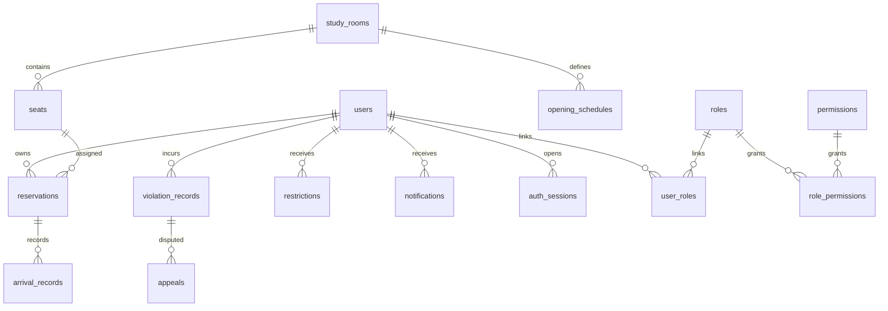

# 数据库设计说明书

版本DB-20261125；从独立SQLite经Alembic迁移0001～0008后读取，未改原业务库。目录：概念关系 → 逐表逻辑/物理结构 → 事务与数据操作。

## 1. 概念结构与关系



区域为seats.zone_type，不单独建zones；暂离在reservations字段；门禁HMAC键与用户为逻辑关联，reservation_id为外键。arrival_records.reservation_id没有唯一约束，ER按真实DB表示1:N而非伪称强制1:1。

## 2. 逐表逻辑与物理结构

SQLite VARCHAR长度声明不自动强制长度；API校验和CHECK分别承担约束。时区日期由LocalDateTime转Asia/Shanghai无时区存储，读出补时区。无版本锁列。

### alembic_version

| 字段 | SQL类型/长度 | 可空 | 主键 | 默认 |
|---|---|---|---|---|
| version_num | VARCHAR(32) | False | True | None |

外键：

```json
[]
```

唯一约束：

```json
[]
```

索引：

```json
[]
```

CHECK：

```json
[]
```

### appeals

| 字段 | SQL类型/长度 | 可空 | 主键 | 默认 |
|---|---|---|---|---|
| id | INTEGER | False | True | None |
| user_id | INTEGER | False | False | None |
| violation_id | INTEGER | False | False | None |
| restriction_id | INTEGER | True | False | None |
| reason | TEXT | False | False | None |
| evidence | TEXT | True | False | None |
| deadline | DATETIME | False | False | None |
| reviewer_id | INTEGER | True | False | None |
| result | VARCHAR(32) | True | False | None |
| reviewed_at | DATETIME | True | False | None |
| review_comment | TEXT | True | False | None |
| created_at | DATETIME | False | False | None |

外键：

```json
[
  {
    "name": "fk_appeals_restriction_id_restrictions",
    "constrained_columns": [
      "restriction_id"
    ],
    "referred_schema": null,
    "referred_table": "restrictions",
    "referred_columns": [
      "id"
    ],
    "options": {
      "ondelete": "SET NULL"
    }
  },
  {
    "name": "fk_appeals_reviewer_id_users",
    "constrained_columns": [
      "reviewer_id"
    ],
    "referred_schema": null,
    "referred_table": "users",
    "referred_columns": [
      "id"
    ],
    "options": {
      "ondelete": "SET NULL"
    }
  },
  {
    "name": "fk_appeals_user_id_users",
    "constrained_columns": [
      "user_id"
    ],
    "referred_schema": null,
    "referred_table": "users",
    "referred_columns": [
      "id"
    ],
    "options": {
      "ondelete": "RESTRICT"
    }
  },
  {
    "name": "fk_appeals_violation_id_violation_records",
    "constrained_columns": [
      "violation_id"
    ],
    "referred_schema": null,
    "referred_table": "violation_records",
    "referred_columns": [
      "id"
    ],
    "options": {
      "ondelete": "CASCADE"
    }
  }
]
```

唯一约束：

```json
[]
```

索引：

```json
[]
```

CHECK：

```json
[
  {
    "sqltext": "result IN ('approved', 'rejected')",
    "name": "ck_appeals_appeal_result"
  },
  {
    "sqltext": "length(trim(reason)) > 0",
    "name": "ck_appeals_reason_not_blank"
  }
]
```

### arrival_records

| 字段 | SQL类型/长度 | 可空 | 主键 | 默认 |
|---|---|---|---|---|
| id | INTEGER | False | True | None |
| reservation_id | INTEGER | False | False | None |
| user_id | INTEGER | False | False | None |
| seat_id | INTEGER | False | False | None |
| arrival_status | VARCHAR(32) | False | False | None |
| arrived_at | DATETIME | True | False | None |
| arrival_method | VARCHAR(32) | True | False | None |
| ended_at | DATETIME | True | False | None |
| end_method | VARCHAR(32) | True | False | None |
| sync_delay_seconds | INTEGER | True | False | None |

外键：

```json
[
  {
    "name": "fk_arrival_records_reservation_id_reservations",
    "constrained_columns": [
      "reservation_id"
    ],
    "referred_schema": null,
    "referred_table": "reservations",
    "referred_columns": [
      "id"
    ],
    "options": {
      "ondelete": "CASCADE"
    }
  },
  {
    "name": "fk_arrival_records_seat_id_seats",
    "constrained_columns": [
      "seat_id"
    ],
    "referred_schema": null,
    "referred_table": "seats",
    "referred_columns": [
      "id"
    ],
    "options": {
      "ondelete": "RESTRICT"
    }
  },
  {
    "name": "fk_arrival_records_user_id_users",
    "constrained_columns": [
      "user_id"
    ],
    "referred_schema": null,
    "referred_table": "users",
    "referred_columns": [
      "id"
    ],
    "options": {
      "ondelete": "RESTRICT"
    }
  }
]
```

唯一约束：

```json
[]
```

索引：

```json
[]
```

CHECK：

```json
[
  {
    "sqltext": "arrival_method IN ('qr', 'manual')",
    "name": "ck_arrival_records_arrival_method"
  },
  {
    "sqltext": "arrival_status IN ('absent', 'on_time', 'late', 'early')",
    "name": "ck_arrival_records_arrival_status"
  },
  {
    "sqltext": "end_method IN ('button', 'auto_timeout', 'admin_release')",
    "name": "ck_arrival_records_end_method"
  }
]
```

### audit_logs

| 字段 | SQL类型/长度 | 可空 | 主键 | 默认 |
|---|---|---|---|---|
| id | INTEGER | False | True | None |
| operator_id | INTEGER | True | False | None |
| op_type | VARCHAR(32) | False | False | None |
| target_type | VARCHAR(32) | False | False | None |
| target_id | VARCHAR(64) | True | False | None |
| occurred_at | DATETIME | False | False | None |
| before_value | TEXT | True | False | None |
| after_value | TEXT | True | False | None |
| ip_address | VARCHAR(45) | True | False | None |
| result | VARCHAR(16) | False | False | None |

外键：

```json
[
  {
    "name": "fk_audit_logs_operator_id_users",
    "constrained_columns": [
      "operator_id"
    ],
    "referred_schema": null,
    "referred_table": "users",
    "referred_columns": [
      "id"
    ],
    "options": {
      "ondelete": "SET NULL"
    }
  }
]
```

唯一约束：

```json
[]
```

索引：

```json
[
  {
    "name": "ix_audit_logs_occurred_at",
    "column_names": [
      "occurred_at"
    ],
    "unique": 0,
    "dialect_options": {}
  }
]
```

CHECK：

```json
[
  {
    "sqltext": "op_type IN ('admin_action', 'violation', 'permission_change')",
    "name": "ck_audit_logs_audit_op_type"
  }
]
```

### auth_sessions

| 字段 | SQL类型/长度 | 可空 | 主键 | 默认 |
|---|---|---|---|---|
| id | INTEGER | False | True | None |
| token_hash | VARCHAR(64) | False | False | None |
| user_id | INTEGER | False | False | None |
| expires_at | DATETIME | False | False | None |
| revoked_at | DATETIME | True | False | None |
| ip_address | VARCHAR(45) | True | False | None |
| user_agent | VARCHAR(255) | True | False | None |
| created_at | DATETIME | False | False | None |

外键：

```json
[
  {
    "name": "fk_auth_sessions_user_id_users",
    "constrained_columns": [
      "user_id"
    ],
    "referred_schema": null,
    "referred_table": "users",
    "referred_columns": [
      "id"
    ],
    "options": {
      "ondelete": "CASCADE"
    }
  }
]
```

唯一约束：

```json
[
  {
    "name": "uq_auth_sessions_token_hash",
    "column_names": [
      "token_hash"
    ]
  }
]
```

索引：

```json
[
  {
    "name": "ix_auth_sessions_user_id",
    "column_names": [
      "user_id"
    ],
    "unique": 0,
    "dialect_options": {}
  }
]
```

CHECK：

```json
[]
```

### calendar_days

| 字段 | SQL类型/长度 | 可空 | 主键 | 默认 |
|---|---|---|---|---|
| day | DATE | False | True | None |
| day_type | VARCHAR(32) | False | False | None |
| note | VARCHAR(128) | True | False | None |

外键：

```json
[]
```

唯一约束：

```json
[]
```

索引：

```json
[]
```

CHECK：

```json
[
  {
    "sqltext": "day_type IN ('weekday', 'weekend', 'holiday', 'exam_week')",
    "name": "ck_calendar_days_day_type"
  }
]
```

### entry_exit_records

| 字段 | SQL类型/长度 | 可空 | 主键 | 默认 |
|---|---|---|---|---|
| id | INTEGER | False | True | None |
| external_id | VARCHAR(64) | False | False | None |
| source_system | VARCHAR(64) | False | False | None |
| masked_user_key | VARCHAR(64) | False | False | None |
| record_type | VARCHAR(32) | False | False | None |
| recorded_at | DATETIME | False | False | None |
| recognition | VARCHAR(32) | True | False | None |
| received_at | DATETIME | False | False | None |
| expires_at | DATETIME | False | False | None |
| sync_status | VARCHAR(16) | False | False | 'pending' |
| sync_delay_seconds | INTEGER | True | False | None |
| reservation_id | INTEGER | True | False | None |
| manual_note | TEXT | True | False | None |

外键：

```json
[
  {
    "name": "fk_entry_exit_records_reservation_id_reservations",
    "constrained_columns": [
      "reservation_id"
    ],
    "referred_schema": null,
    "referred_table": "reservations",
    "referred_columns": [
      "id"
    ],
    "options": {
      "ondelete": "SET NULL"
    }
  }
]
```

唯一约束：

```json
[
  {
    "name": "uq_entry_exit_records_source_system_external_id",
    "column_names": [
      "source_system",
      "external_id"
    ]
  }
]
```

索引：

```json
[
  {
    "name": "ix_entry_exit_records_masked_user_key",
    "column_names": [
      "masked_user_key"
    ],
    "unique": 0,
    "dialect_options": {}
  }
]
```

CHECK：

```json
[
  {
    "sqltext": "record_type IN ('entry', 'exit')",
    "name": "ck_entry_exit_records_entry_exit_type"
  },
  {
    "sqltext": "recognition IN ('face', 'card')",
    "name": "ck_entry_exit_records_recognition_method"
  }
]
```

### login_logs

| 字段 | SQL类型/长度 | 可空 | 主键 | 默认 |
|---|---|---|---|---|
| id | INTEGER | False | True | None |
| user_id | INTEGER | True | False | None |
| student_no | VARCHAR(32) | False | False | None |
| event | VARCHAR(16) | False | False | None |
| success | BOOLEAN | False | False | None |
| reason | VARCHAR(32) | True | False | None |
| occurred_at | DATETIME | False | False | None |
| ip_address | VARCHAR(45) | True | False | None |
| user_agent | VARCHAR(255) | True | False | None |

外键：

```json
[
  {
    "name": "fk_login_logs_user_id_users",
    "constrained_columns": [
      "user_id"
    ],
    "referred_schema": null,
    "referred_table": "users",
    "referred_columns": [
      "id"
    ],
    "options": {
      "ondelete": "SET NULL"
    }
  }
]
```

唯一约束：

```json
[]
```

索引：

```json
[
  {
    "name": "ix_login_logs_occurred_at",
    "column_names": [
      "occurred_at"
    ],
    "unique": 0,
    "dialect_options": {}
  },
  {
    "name": "ix_login_logs_student_no",
    "column_names": [
      "student_no"
    ],
    "unique": 0,
    "dialect_options": {}
  }
]
```

CHECK：

```json
[]
```

### notifications

| 字段 | SQL类型/长度 | 可空 | 主键 | 默认 |
|---|---|---|---|---|
| id | INTEGER | False | True | None |
| user_id | INTEGER | False | False | None |
| type | VARCHAR(32) | False | False | None |
| content | TEXT | False | False | None |
| sent_at | DATETIME | False | False | None |
| channel | VARCHAR(16) | False | False | None |
| is_read | BOOLEAN | False | False | None |
| idempotency_key | VARCHAR(128) | True | False | None |

外键：

```json
[
  {
    "name": "fk_notifications_user_id_users",
    "constrained_columns": [
      "user_id"
    ],
    "referred_schema": null,
    "referred_table": "users",
    "referred_columns": [
      "id"
    ],
    "options": {
      "ondelete": "CASCADE"
    }
  }
]
```

唯一约束：

```json
[
  {
    "name": "uq_notifications_idempotency_key",
    "column_names": [
      "idempotency_key"
    ]
  }
]
```

索引：

```json
[
  {
    "name": "ix_notifications_user_read",
    "column_names": [
      "user_id",
      "is_read"
    ],
    "unique": 0,
    "dialect_options": {}
  }
]
```

CHECK：

```json
[
  {
    "sqltext": "channel = 'in_app'",
    "name": "ck_notifications_in_app_only"
  },
  {
    "sqltext": "type IN ('reservation_confirmed', 'checkin_reminder', 'violation', 'maintenance', 'system', 'temp_leave')",
    "name": "ck_notifications_notification_type"
  }
]
```

### opening_schedules

| 字段 | SQL类型/长度 | 可空 | 主键 | 默认 |
|---|---|---|---|---|
| id | INTEGER | False | True | None |
| room_id | INTEGER | False | False | None |
| day_type | VARCHAR(32) | False | False | None |
| open_time | TIME | False | False | None |
| close_time | TIME | False | False | None |
| effective_from | DATE | True | False | None |
| effective_to | DATE | True | False | None |
| enabled | BOOLEAN | False | False | None |

外键：

```json
[
  {
    "name": "fk_opening_schedules_room_id_study_rooms",
    "constrained_columns": [
      "room_id"
    ],
    "referred_schema": null,
    "referred_table": "study_rooms",
    "referred_columns": [
      "id"
    ],
    "options": {
      "ondelete": "CASCADE"
    }
  }
]
```

唯一约束：

```json
[]
```

索引：

```json
[]
```

CHECK：

```json
[
  {
    "sqltext": "day_type IN ('weekday', 'weekend', 'holiday', 'exam_week')",
    "name": "ck_opening_schedules_day_type"
  },
  {
    "sqltext": "effective_to IS NULL OR effective_from IS NULL OR effective_from <= effective_to",
    "name": "ck_opening_schedules_effective_range"
  },
  {
    "sqltext": "open_time < close_time",
    "name": "ck_opening_schedules_open_before_close"
  }
]
```

### password_reset_tokens

| 字段 | SQL类型/长度 | 可空 | 主键 | 默认 |
|---|---|---|---|---|
| id | INTEGER | False | True | None |
| token_hash | VARCHAR(64) | False | False | None |
| user_id | INTEGER | False | False | None |
| issued_by | INTEGER | True | False | None |
| expires_at | DATETIME | False | False | None |
| used_at | DATETIME | True | False | None |
| created_at | DATETIME | False | False | None |

外键：

```json
[
  {
    "name": "fk_password_reset_tokens_issued_by_users",
    "constrained_columns": [
      "issued_by"
    ],
    "referred_schema": null,
    "referred_table": "users",
    "referred_columns": [
      "id"
    ],
    "options": {
      "ondelete": "SET NULL"
    }
  },
  {
    "name": "fk_password_reset_tokens_user_id_users",
    "constrained_columns": [
      "user_id"
    ],
    "referred_schema": null,
    "referred_table": "users",
    "referred_columns": [
      "id"
    ],
    "options": {
      "ondelete": "CASCADE"
    }
  }
]
```

唯一约束：

```json
[
  {
    "name": "uq_password_reset_tokens_token_hash",
    "column_names": [
      "token_hash"
    ]
  }
]
```

索引：

```json
[]
```

CHECK：

```json
[]
```

### permissions

| 字段 | SQL类型/长度 | 可空 | 主键 | 默认 |
|---|---|---|---|---|
| id | INTEGER | False | True | None |
| code | VARCHAR(64) | False | False | None |
| description | VARCHAR(255) | True | False | None |
| resource | VARCHAR(32) | False | False | None |
| action | VARCHAR(32) | False | False | None |

外键：

```json
[]
```

唯一约束：

```json
[
  {
    "name": "uq_permissions_code",
    "column_names": [
      "code"
    ]
  }
]
```

索引：

```json
[]
```

CHECK：

```json
[]
```

### reservations

| 字段 | SQL类型/长度 | 可空 | 主键 | 默认 |
|---|---|---|---|---|
| id | INTEGER | False | True | None |
| reservation_no | VARCHAR(32) | False | False | None |
| user_id | INTEGER | False | False | None |
| room_id | INTEGER | False | False | None |
| seat_id | INTEGER | False | False | None |
| start_time | DATETIME | False | False | None |
| end_time | DATETIME | False | False | None |
| status | VARCHAR(32) | False | False | None |
| cancel_type | VARCHAR(32) | True | False | None |
| cancel_reason | TEXT | True | False | None |
| cancelled_at | DATETIME | True | False | None |
| expire_reason | VARCHAR(64) | True | False | None |
| remark | TEXT | True | False | None |
| temp_leave_at | DATETIME | True | False | None |
| temp_leave_state | VARCHAR(32) | False | False | None |
| idempotency_key | VARCHAR(64) | True | False | None |
| created_at | DATETIME | False | False | None |
| request_fingerprint | VARCHAR(64) | True | False | None |

外键：

```json
[
  {
    "name": "fk_reservations_room_id_study_rooms",
    "constrained_columns": [
      "room_id"
    ],
    "referred_schema": null,
    "referred_table": "study_rooms",
    "referred_columns": [
      "id"
    ],
    "options": {
      "ondelete": "RESTRICT"
    }
  },
  {
    "name": "fk_reservations_seat_id_seats",
    "constrained_columns": [
      "seat_id"
    ],
    "referred_schema": null,
    "referred_table": "seats",
    "referred_columns": [
      "id"
    ],
    "options": {
      "ondelete": "RESTRICT"
    }
  },
  {
    "name": "fk_reservations_user_id_users",
    "constrained_columns": [
      "user_id"
    ],
    "referred_schema": null,
    "referred_table": "users",
    "referred_columns": [
      "id"
    ],
    "options": {
      "ondelete": "RESTRICT"
    }
  }
]
```

唯一约束：

```json
[
  {
    "name": "uq_reservations_idempotency_key",
    "column_names": [
      "idempotency_key"
    ]
  },
  {
    "name": "uq_reservations_reservation_no",
    "column_names": [
      "reservation_no"
    ]
  }
]
```

索引：

```json
[
  {
    "name": "ix_reservations_user_start",
    "column_names": [
      "user_id",
      "start_time"
    ],
    "unique": 0,
    "dialect_options": {}
  },
  {
    "name": "uq_reservations_active_seat_start",
    "column_names": [
      "seat_id",
      "start_time"
    ],
    "unique": 1,
    "dialect_options": {
      "sqlite_where": "status IN ('RESERVED', 'ACTIVE', 'TEMP_LEAVE')"
    }
  }
]
```

CHECK：

```json
[
  {
    "sqltext": "cancel_type IN ('normal', 'late', 'system')",
    "name": "ck_reservations_cancel_type"
  },
  {
    "sqltext": "status IN ('RESERVED', 'ACTIVE', 'TEMP_LEAVE', 'COMPLETED', 'CANCELLED', 'ADMIN_CANCELLED', 'EXPIRED', 'TIMED_OUT')",
    "name": "ck_reservations_reservation_status"
  },
  {
    "sqltext": "start_time < end_time",
    "name": "ck_reservations_start_before_end"
  },
  {
    "sqltext": "temp_leave_state IN ('none', 'waiting', 'returned', 'timed_out')",
    "name": "ck_reservations_temp_leave_state"
  }
]
```

### restrictions

| 字段 | SQL类型/长度 | 可空 | 主键 | 默认 |
|---|---|---|---|---|
| id | INTEGER | False | True | None |
| user_id | INTEGER | False | False | None |
| ban_days | INTEGER | False | False | None |
| warning_count | INTEGER | False | False | None |
| trigger_condition | VARCHAR(32) | False | False | None |
| start_at | DATETIME | False | False | None |
| end_at | DATETIME | False | False | None |
| status | VARCHAR(32) | False | False | None |
| lifted_at | DATETIME | True | False | None |
| lift_reason | TEXT | True | False | None |
| lifted_by | INTEGER | True | False | None |
| created_at | DATETIME | False | False | None |

外键：

```json
[
  {
    "name": "fk_restrictions_lifted_by_users",
    "constrained_columns": [
      "lifted_by"
    ],
    "referred_schema": null,
    "referred_table": "users",
    "referred_columns": [
      "id"
    ],
    "options": {
      "ondelete": "SET NULL"
    }
  },
  {
    "name": "fk_restrictions_user_id_users",
    "constrained_columns": [
      "user_id"
    ],
    "referred_schema": null,
    "referred_table": "users",
    "referred_columns": [
      "id"
    ],
    "options": {
      "ondelete": "RESTRICT"
    }
  }
]
```

唯一约束：

```json
[]
```

索引：

```json
[]
```

CHECK：

```json
[
  {
    "sqltext": "ban_days >= 1",
    "name": "ck_restrictions_ban_days_positive"
  },
  {
    "sqltext": "status IN ('active', 'lifted', 'expired')",
    "name": "ck_restrictions_restriction_status"
  },
  {
    "sqltext": "start_at < end_at",
    "name": "ck_restrictions_start_before_end"
  }
]
```

### role_permissions

| 字段 | SQL类型/长度 | 可空 | 主键 | 默认 |
|---|---|---|---|---|
| role_id | INTEGER | False | True | None |
| permission_id | INTEGER | False | True | None |

外键：

```json
[
  {
    "name": "fk_role_permissions_permission_id_permissions",
    "constrained_columns": [
      "permission_id"
    ],
    "referred_schema": null,
    "referred_table": "permissions",
    "referred_columns": [
      "id"
    ],
    "options": {
      "ondelete": "CASCADE"
    }
  },
  {
    "name": "fk_role_permissions_role_id_roles",
    "constrained_columns": [
      "role_id"
    ],
    "referred_schema": null,
    "referred_table": "roles",
    "referred_columns": [
      "id"
    ],
    "options": {
      "ondelete": "CASCADE"
    }
  }
]
```

唯一约束：

```json
[]
```

索引：

```json
[]
```

CHECK：

```json
[]
```

### roles

| 字段 | SQL类型/长度 | 可空 | 主键 | 默认 |
|---|---|---|---|---|
| id | INTEGER | False | True | None |
| name | VARCHAR(32) | False | False | None |
| description | VARCHAR(255) | True | False | None |
| enabled | BOOLEAN | False | False | None |

外键：

```json
[]
```

唯一约束：

```json
[
  {
    "name": "uq_roles_name",
    "column_names": [
      "name"
    ]
  }
]
```

索引：

```json
[]
```

CHECK：

```json
[
  {
    "sqltext": "name IN ('user', 'admin', 'ops')",
    "name": "ck_roles_role_name"
  }
]
```

### seats

| 字段 | SQL类型/长度 | 可空 | 主键 | 默认 |
|---|---|---|---|---|
| id | INTEGER | False | True | None |
| room_id | INTEGER | False | False | None |
| code | VARCHAR(32) | False | False | None |
| zone_type | VARCHAR(32) | False | False | None |
| has_power | BOOLEAN | False | False | None |
| by_window | BOOLEAN | False | False | None |
| accessible | BOOLEAN | False | False | None |
| status | VARCHAR(32) | False | False | None |
| status_changed_at | DATETIME | True | False | None |

外键：

```json
[
  {
    "name": "fk_seats_room_id_study_rooms",
    "constrained_columns": [
      "room_id"
    ],
    "referred_schema": null,
    "referred_table": "study_rooms",
    "referred_columns": [
      "id"
    ],
    "options": {
      "ondelete": "RESTRICT"
    }
  }
]
```

唯一约束：

```json
[
  {
    "name": "uq_seats_room_id_code",
    "column_names": [
      "room_id",
      "code"
    ]
  }
]
```

索引：

```json
[]
```

CHECK：

```json
[
  {
    "sqltext": "status IN ('available', 'reserved', 'in_use', 'maintenance', 'closed', 'disabled')",
    "name": "ck_seats_seat_status"
  },
  {
    "sqltext": "zone_type IN ('quiet', 'discussion', 'exam_prep')",
    "name": "ck_seats_zone_type"
  }
]
```

### study_rooms

| 字段 | SQL类型/长度 | 可空 | 主键 | 默认 |
|---|---|---|---|---|
| id | INTEGER | False | True | None |
| name | VARCHAR(64) | False | False | None |
| location | VARCHAR(128) | True | False | None |
| capacity | INTEGER | False | False | None |
| facilities | TEXT | True | False | None |
| status | VARCHAR(32) | False | False | None |
| remark | TEXT | True | False | None |
| created_at | DATETIME | False | False | None |
| floor | VARCHAR(32) | True | False | None |

外键：

```json
[]
```

唯一约束：

```json
[
  {
    "name": "uq_study_rooms_name",
    "column_names": [
      "name"
    ]
  }
]
```

索引：

```json
[]
```

CHECK：

```json
[
  {
    "sqltext": "capacity >= 0",
    "name": "ck_study_rooms_capacity_non_negative"
  },
  {
    "sqltext": "status IN ('open', 'closed')",
    "name": "ck_study_rooms_room_status"
  }
]
```

### system_settings

| 字段 | SQL类型/长度 | 可空 | 主键 | 默认 |
|---|---|---|---|---|
| key | VARCHAR(64) | False | True | None |
| value | TEXT | False | False | None |
| updated_at | DATETIME | False | False | None |
| updated_by | INTEGER | True | False | None |

外键：

```json
[
  {
    "name": "fk_system_settings_updated_by_users",
    "constrained_columns": [
      "updated_by"
    ],
    "referred_schema": null,
    "referred_table": "users",
    "referred_columns": [
      "id"
    ],
    "options": {
      "ondelete": "SET NULL"
    }
  }
]
```

唯一约束：

```json
[]
```

索引：

```json
[]
```

CHECK：

```json
[]
```

### user_roles

| 字段 | SQL类型/长度 | 可空 | 主键 | 默认 |
|---|---|---|---|---|
| user_id | INTEGER | False | True | None |
| role_id | INTEGER | False | True | None |

外键：

```json
[
  {
    "name": "fk_user_roles_role_id_roles",
    "constrained_columns": [
      "role_id"
    ],
    "referred_schema": null,
    "referred_table": "roles",
    "referred_columns": [
      "id"
    ],
    "options": {
      "ondelete": "CASCADE"
    }
  },
  {
    "name": "fk_user_roles_user_id_users",
    "constrained_columns": [
      "user_id"
    ],
    "referred_schema": null,
    "referred_table": "users",
    "referred_columns": [
      "id"
    ],
    "options": {
      "ondelete": "CASCADE"
    }
  }
]
```

唯一约束：

```json
[]
```

索引：

```json
[]
```

CHECK：

```json
[]
```

### users

| 字段 | SQL类型/长度 | 可空 | 主键 | 默认 |
|---|---|---|---|---|
| id | INTEGER | False | True | None |
| student_no | VARCHAR(32) | False | False | None |
| password_hash | VARCHAR(255) | False | False | None |
| name | VARCHAR(64) | False | False | None |
| department | VARCHAR(128) | True | False | None |
| contact | VARCHAR(128) | True | False | None |
| status | VARCHAR(32) | False | False | None |
| created_at | DATETIME | False | False | None |

外键：

```json
[]
```

唯一约束：

```json
[
  {
    "name": "uq_users_student_no",
    "column_names": [
      "student_no"
    ]
  }
]
```

索引：

```json
[]
```

CHECK：

```json
[
  {
    "sqltext": "status IN ('normal', 'disabled')",
    "name": "ck_users_account_status"
  },
  {
    "sqltext": "length(trim(student_no)) > 0",
    "name": "ck_users_student_no_not_blank"
  }
]
```

### violation_records

| 字段 | SQL类型/长度 | 可空 | 主键 | 默认 |
|---|---|---|---|---|
| id | INTEGER | False | True | None |
| user_id | INTEGER | False | False | None |
| violation_type | VARCHAR(32) | False | False | None |
| occurred_at | DATETIME | False | False | None |
| reservation_id | INTEGER | True | False | None |
| arrival_record_id | INTEGER | True | False | None |
| description | TEXT | True | False | None |
| state | VARCHAR(32) | False | False | None |
| period_start | DATETIME | False | False | None |
| period_seq | INTEGER | False | False | None |
| archived_at | DATETIME | True | False | None |
| determined_by | VARCHAR(16) | False | False | None |
| result | VARCHAR(32) | False | False | None |
| restriction_id | INTEGER | True | False | None |
| appeal_status | VARCHAR(32) | False | False | None |
| is_offset | BOOLEAN | False | False | None |
| created_at | DATETIME | False | False | None |

外键：

```json
[
  {
    "name": "fk_violation_records_user_id_users",
    "constrained_columns": [
      "user_id"
    ],
    "referred_schema": null,
    "referred_table": "users",
    "referred_columns": [
      "id"
    ],
    "options": {
      "ondelete": "RESTRICT"
    }
  },
  {
    "name": "fk_violation_records_restriction_id_restrictions",
    "constrained_columns": [
      "restriction_id"
    ],
    "referred_schema": null,
    "referred_table": "restrictions",
    "referred_columns": [
      "id"
    ],
    "options": {
      "ondelete": "SET NULL"
    }
  },
  {
    "name": "fk_violation_records_arrival_record_id_arrival_records",
    "constrained_columns": [
      "arrival_record_id"
    ],
    "referred_schema": null,
    "referred_table": "arrival_records",
    "referred_columns": [
      "id"
    ],
    "options": {
      "ondelete": "SET NULL"
    }
  },
  {
    "name": "fk_violation_records_reservation_id_reservations",
    "constrained_columns": [
      "reservation_id"
    ],
    "referred_schema": null,
    "referred_table": "reservations",
    "referred_columns": [
      "id"
    ],
    "options": {
      "ondelete": "SET NULL"
    }
  }
]
```

唯一约束：

```json
[]
```

索引：

```json
[
  {
    "name": "ix_violation_records_user_period",
    "column_names": [
      "user_id",
      "period_start"
    ],
    "unique": 0,
    "dialect_options": {}
  }
]
```

CHECK：

```json
[
  {
    "sqltext": "appeal_status IN ('none', 'pending', 'approved', 'rejected')",
    "name": "ck_violation_records_appeal_status"
  },
  {
    "sqltext": "result IN ('warning', 'restricted')",
    "name": "ck_violation_records_violation_result"
  },
  {
    "sqltext": "state IN ('active', 'archived')",
    "name": "ck_violation_records_violation_state"
  },
  {
    "sqltext": "violation_type IN ('left_undeclared', 'no_show', 'no_checkout', 'late_cancel', 'temp_leave_timeout')",
    "name": "ck_violation_records_violation_type"
  }
]
```

## 3. 关键操作、事务与迁移

预约创建在BEGIN IMMEDIATE内查开放与座位/本人重叠，写预约/到达/通知；换座同步到达引用；取消、违规/限制、申诉、设施取消按同事务规则。详情见接口与关键设计。部分唯一索引(seat_id,start_time)仅约束相同起点，任意交叠由写锁内区间查询保证。幂等键/通知键/门禁来源事件号分别唯一，NULL可多条。

0001核心表、0002认证、0003权限快照、0004设置校历、0005登录日志、0006通知/门禁扩展、0007楼层/指纹、0008暂离违规类型。当前修复不新增迁移。外键删除RESTRICT保留预约/用户历史，关联清理CASCADE与SET NULL逐表如上；禁止用删除历史数据代替业务归档。

SQLite WAL、foreign_keys=ON、busy_timeout=5000ms；一致快照备份和停服恢复不代表RPO0。测试用独立文件库与多连接，执行证据不包含密码/token。
