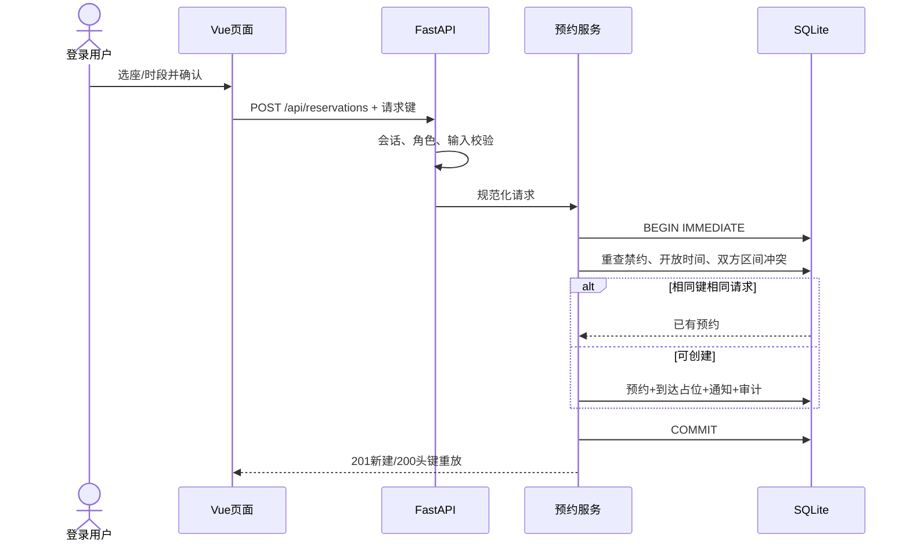

# 软件架构设计方案（当前实现候选基线）

版本：ARCH-20261125-1；状态：实现设计基线，课程人工交叉复核待完成。目录：[总体](#1-总体与技术选择) · [模块](#2-模块职责与依赖) · [数据流](#3-交互与数据流) · [部署](#4-部署与运行) · [边界](#5-一致性与风险)。

## 1. 总体与技术选择

使用已有Vue3/Vite/vue-router与FastAPI/Pydantic/SQLAlchemy2/Alembic/SQLite，符合课程本地单机演示和现有开发成果。保留[讨论稿](软件架构设计方案_讨论稿.md)，接受项与未决项区分见[Q/ADR](../架构确认与决策记录.md)。本标题表示当前可实现的设计索引，不表示已经获得另一学生签署课程基线。

## 2. 模块职责与依赖

| 模块 | 输入输出/职责 | 依赖 |
|---|---|---|
| 认证与用户 | 注册/随机会话/密码策略/重置、角色停用 | bcrypt、AuthSession、Role、LoginLog |
| 资源与可用性 | 房间/楼层/设施/区域、校历时段合并、目标区间冲突 | Room/Seat/Schedule/Calendar、业务参数 |
| 预约履约 | 创建幂等、换座/取消、扫码、暂离、确认结束、超时 | 可用性、Restriction、ArrivalRecord、通知审计 |
| 违规与申诉 | 所有来源统一固定周期累计、阶梯、归档、审核 | Violation/Restriction/Appeal、通知审计 |
| 模拟门禁 | 运维脱敏事件、来源事件号去重、延迟判定、暂离返回/未声明离馆 | HMAC密钥、预约状态、统一违规服务 |
| 管理设施 | 增改/维护关闭禁用、影响预约取消、CSV原子导入 | 预约、通知审计、数据保留策略 |
| 报表与运维 | 聚合计划时长、趋势/xlsx、日志、快照恢复与状态 | 预约/资源数据、SQLite备份、进程内计数 |

API处理HTTP和权限，services负责共享规则，schemas负责字段/输入类型，models映射关系；部分历史管理处理仍在API内，不虚称已完全分层。业务参数与时间由统一服务读取，避免复制判定。

## 3. 交互与数据流

查询只返回公开座位信息或本人业务数据。管理员查全体数据需要专属权限，运维不得借个人申诉入口访问学生流程；门禁明细管理员无权读取。写入事务内任何异常回滚，失效后返回业务错误需先提交应生效的超时状态。

## 4. 部署与运行

使用`webdev_3.12`解释器；依赖固定记录在执行证据中。SQLite文件保存在backend/data，课程演示使用独立course_demo.db，原study_room.db保留。Vite构建dist后由后端提供SPA与/api同源访问；API未知路径不得回退成页面。开发仍可运行Vite代理，不删除原脚本。

应用lifespan后台扫描预约（默认60秒）、可选备份/日志清理；单元测试关闭后台并显式扫描。并发在文件型SQLite多连接验证；备份用SQLite在线一致快照，恢复只对停服隔离库操作。启动方式、端口和演示账号见[运行说明](../本地运行与部署验收.md)。

SQLite连接采用NullPool，避免请求鉴权持有连接时业务独立会话再次申请而耗尽有限池；每连接仍启用WAL/外键/5000ms busy_timeout。真实200HTTP已验证无池等待超时，但P95未达目标；此项不改变区间排他/写事务语义。

## 5. 一致性与风险

八种预约状态、六种座位管理状态，暂离作为预约状态；区域作为座位属性。21张业务表无版本列；幂等键及指纹不替代区间重查。CHG-03自动结束30分钟等待与座位权益要分别验证；同步后的精确规则以需求补充为准。

性能、月度可用率、NTP、完整移动兼容、RPO0未因架构选择被视为达标；模拟只证明逻辑，原通知重试/撤销范围等未决项保留。设计与最终实际路由/DDL/测试结果在接口附录、数据库说明和测试报告中对账。
