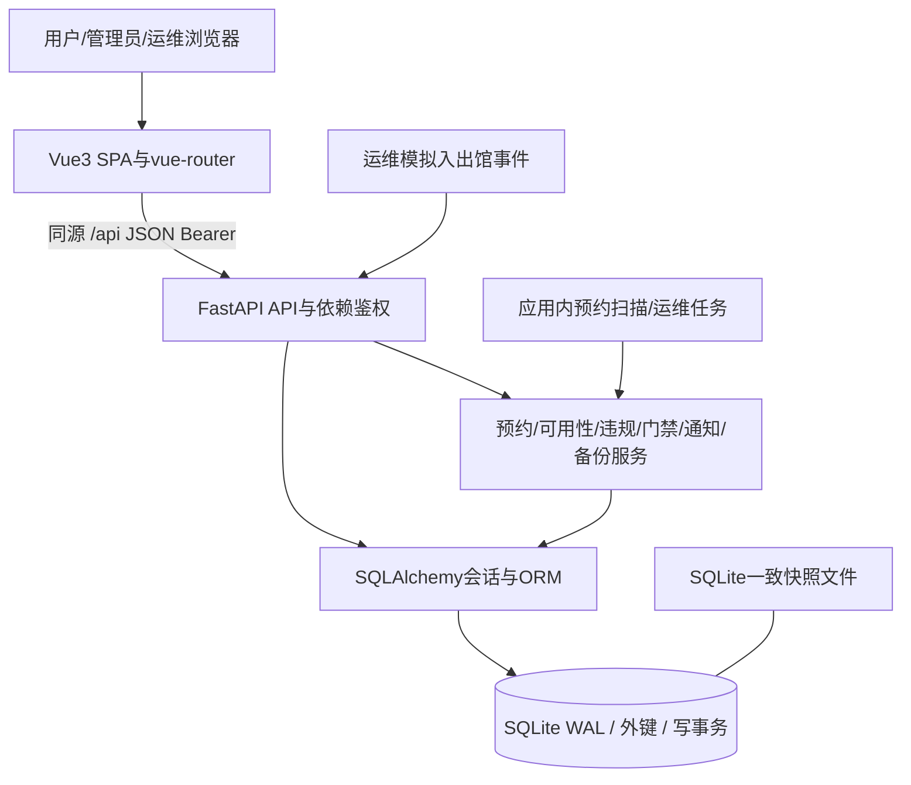

# 软件架构设计方案（本轮讨论原稿）

版本：ARCH-DRAFT-20261125；性质：第二阶段从真实代码恢复的讨论稿，非历史架构稿。目录：[上下文](#1-系统上下文与边界) · [结构](#2-结构与部署) · [决策](#3-候选决策与差异) · [风险](#4-风险和验收)。

## 1. 系统上下文与边界

用户、管理员、运维通过Vue3网页访问FastAPI；数据持久化SQLite。管理员设施治理影响预约、通知、审计；模拟门禁只面向运维，不对接校园生产系统；学校统一认证、候补和教师专属权限不在本期。

## 2. 结构与部署

分层单体，前后端源码分离；开发由Vite代理8000端口，课程演示可构建SPA后由同一后端服务静态文件。未使用Redis、消息队列、分布式服务、Flask或MySQL。主要目录为frontend/src/views、backend/app/api/services/models/schemas、migrations、tests。

请求先验证Bearer随机会话（数据库仅摘要）和账户状态，再校验角色；对象归属在查询中约束user_id。关键写入独立会话中BEGIN IMMEDIATE→校验→写入→通知/审计→提交；冲突409，写锁503并建议相同键重试。

## 3. 候选决策与差异

1. 并发保留SQLite写事务与幂等，需记录替代旧乐观锁；用户已选择，见ADR-01。
2. 门禁只模拟，真实适配排除；保留去重/延迟/权限；修复无入馆返回及门禁代替扫码的问题，见ADR-02。
3. 自动结束改为预约结束后30分钟，座位权益已确定end即释放，30分钟仅补确认，见ADR-03。
4. 修复两套违规入口、扫尾端点、换座关联、设施禁用、个人申诉角色权限；不换栈、不改历史数据。
5. EX-06通知独立成功、RPO0、改时段/撤销政策缺口如实保留，不把讨论建议当确认。

## 4. 风险和验收

SQLite写串行、应用内扫描延迟、HMAC模拟无法证明到场、静态二维码可替签、快照无法保证RPO0；前端localStorage会话需在同源部署中保护，生产HTTPS由部署环境负责。实际性能和兼容性须运行测试；人工交叉审查和课程验收仍由项目组负责。后续基线版单独保存，保留本稿作为变更历史。
