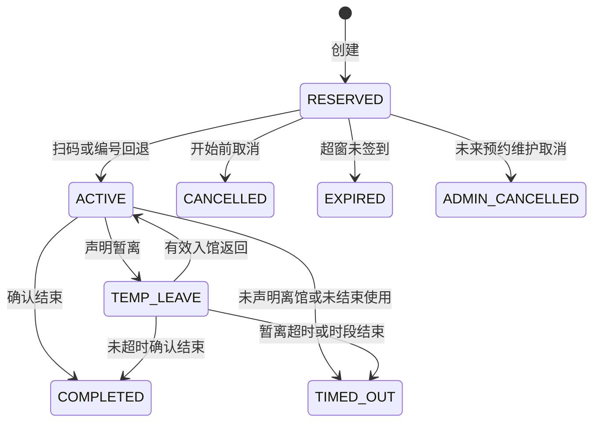
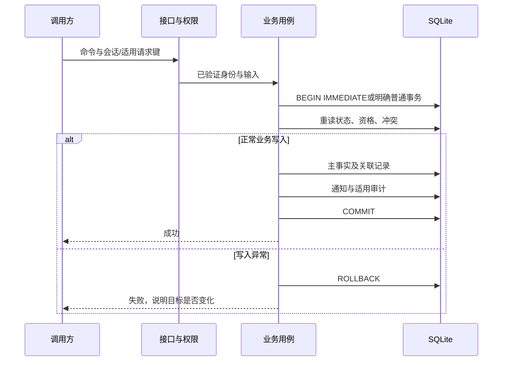

# 智能自习室管理预约系统接口与关键设计说明书

| 项目 | 内容 |
|---|---|
| 文档标识／版本 | IF-DESIGN-1.0／v1.0 |
| 编制日期 | 2026-11-15 |
| 团队 | 全网呼叫奶家人 |
| 团队成员 | 周俊博、张东岩、方梓安 |
| 输入架构基线 | ARCH-BL-1.0 |
| 适用范围 | 已有系统接口契约、关键设计、实现差异及测试准备 |

## 1. 文档定位、依据与检查边界

### 1.1 目的与阅读方法

本说明书将需求中的业务动作落实为可供前后端对接、测试和交叉审查的接口契约，重点描述字段、权限、状态变化、失败副作用、事务、并发、幂等和异常恢复。项目主要功能已有实现，本文件是根据现有资料反向补齐的设计材料，不代表开发前已经完成相同设计或评审。

第2～4章规定通用约定、追溯及响应结构；第5章细化关键业务契约和正常/失败/重复示例；第6章固定关键设计约束；第7章列明差异；第8章给出测试与责任。附录A逐项列出63个接口的方法、请求、响应和行为，附录B列出在线组件字段及约束，二者与正文共同组成接口契约，不可只按路径表对接。

### 1.2 来源及可信度

| 来源 | 用途 | 限制 |
|---|---|---|
| [软件需求规格说明书](软件需求规格说明书.md)，简称SRS | 业务规则、FR/BR、用例、权限及HD决定 | 不通过本文改写需求；残留冲突保留来源 |
| [架构确认与决策记录](架构确认与决策记录.md) | 已有ADR与GAP整改约束 | 沿用原编号，不补造新的已接受决策 |
| [架构基线](软件架构设计方案_基线版.md)、[讨论稿](软件架构设计方案_讨论稿.md) | 结构、状态、事务、DISC事项与质量要求 | 基线形成不等于全部实现达标 |
| [在线接口页面](http://47.98.18.65/docs)、[OpenAPI定义](http://47.98.18.65/openapi.json) | 已部署服务声明的方法、路径、参数、模型和响应 | 自动生成声明不能证明业务正确，也不能完整表达校验器和事务 |
| `backend/app/api/`、`schemas/`、`services/`、模型及前端调用 | 当前实现与输出字段 | 静态结论不等同运行结果 |
| [教师指引](架构设计后确认与分阶段实现操作指引_学生版.md) | 接口契约、关键设计、证据和确认责任 | 按真实过程补齐，不伪造签署与测试 |
| [GitHub Issues](https://github.com/dorian0326/study-room/issues?q=is%3Aissue) | 沿用已有任务规划 | 本轮不新建任务或以关闭状态替代验收 |

本轮仅以GET读取`/docs`和`/openapi.json`，未向运行站点提交预约、认证、门禁、配置等业务请求。通过Python AST静态解析本地路由，确认本地63个业务操作的方法和路径与在线声明一致；这不证明远端提交版本、字段校验或数据库与本地完全相同。在线文档可继续变化，本次信息按读取日期定位。

本轮未执行单元、接口、端到端、并发、性能或恢复测试。以下示例均为**合成设计示例／静态推导的预期**，不是现场抓包或测试通过记录。旧说明书中“缺少需求主版本”“真实门禁属于范围外”等结论不再继承。

### 1.3 规范与现状的区分

“设计约束”依据SRS和架构基线，表示必须达到的规则；“当前实现”表示代码中已经存在的行为；“差异”表示二者不一致或缺少验证。特别是空正文签到、无门禁记录主动返回、门禁代替扫码、乐观锁缺失、取消通知失败及边界竞争，均不因本文列出当前接口而获准改变需求。

接口编号API-001～API-063按本次清单固定，同路径不同方法分别编号。TC-IF-001～018是本说明书新增的测试设计索引，不替代现有测试或任务编号，不表示已有同名自动测试函数。

## 2. 通用协议、权限与错误约定

### 2.1 请求与时间

1. API统一以`/api`为前缀，普通请求与响应使用JSON。正文应发送`Content-Type: application/json`；无正文接口不应猜测字段。Excel响应另见API-063。
2. 受保护接口使用`Authorization: Bearer <access_token>`；令牌为服务器会话凭证，不是JWT声明。不得在URL、样例证据或审计中保存真实密码、令牌与重置码。
3. `integer`、`number`、`boolean`、`string`、`array<T>`分别表示整数、数值、布尔、字符串和数组；JSON使用true/false。类型转换现状依Pydantic，不额外承诺严格类型校验。
4. 省略与null不同：模型字段“必填且可空”仍须出现，值允许null；“可省略”使用默认值。查询参数不发送可选值时应省略，不能以字符串`null`替代。
5. 预约及门禁事件时间要求带时区，例如`2026-11-27T09:00:00+08:00`，服务端转换到Asia/Shanghai；`date`为`YYYY-MM-DD`。
6. `/api/rooms`时间查询使用带时区完整datetime；`/api/seats`及详情则使用`date`加不带时区的本地`HH:MM[:SS]`，三项全有或全无。URL中的`+`需编码为`%2B`。不可把两组时间格式混用。
7. 路径ID为整数；仅声明`integer`而未声明`gt=0`的路径参数不应被写成“框架保证正数”。不存在或归属不符按具体404处理。
8. 不统一假设多余字段均被拒绝：ChangeSeatIn、CheckInIn、BusinessSettings显式forbid；部分其他输入模型沿用默认忽略。模型校验器里的跨字段规则由正文补齐。

### 2.2 权限与对象范围

| 权限或身份 | 单独角色可用范围 | 对象范围 |
|---|---|---|
| 公开 | 健康、注册、登录、凭重置码重置密码 | 不等于其他GET公开 |
| CurrentUser | 三类已登录正常账户 | 违规、申诉、通知和门禁人工申请仍限本人 |
| room:read | 用户、管理员、运维 | 公开资源信息，不含占用人隐私 |
| reservation:own | 用户、管理员 | 本人预约；单独运维角色无此权限 |
| room:manage／settings:manage／user:manage | 管理员 | 分别管理资源、参数、用户 |
| violation:manage／appeal:manage | 管理员 | 全部相应业务记录，需审计 |
| stats:read／data:export | 管理员 | 统计与导出分别授权 |
| audit_log:read | 管理员、运维 | 操作审计 |
| system_log:read | 运维 | 登录日志和运行状态 |
| entry_exit:read／system:backup | 运维 | 门禁明细／备份；单独管理员不可读门禁 |

角色可以组合，权限按角色集合计算。接口先检会话与账号可用性，再检模块权限和对象归属；替换预约、违规、通知ID不能越权。禁约与账号禁用不同：禁约阻止创建及换座，但允许取消已有预约；禁用账号在认证依赖被拒绝。部分CurrentUser入口并未要求reservation:own，此处如实记录，不把角色名称直接替换为权限检查。

### 2.3 HTTP与错误体

| 状态 | 当前典型含义 | 数据副作用 |
|---|---|---|
| 200／201 | 成功／创建；部分幂等重放也为201 | 按具体契约；200可能已执行状态变更 |
| 204 | 成功无正文 | 客户端不可继续强制JSON解析 |
| 400 | 原密码或重置码错误、自移除管理员/自禁用等 | 通常拒绝目标变更，不能省略具体错误 |
| 401 | 缺少、无效、撤销或过期会话；登录凭据错误 | 登录失败仍写失败日志 |
| 403 | 无模块权限、账号禁用或禁约 | 不能一律要求用户重新登录 |
| 404 | 对象不存在、房间归属不符或本人范围不可见 | 不透露他人对象是否存在 |
| 409 | 座位/状态/幂等键冲突、申诉过期或已处理等 | 超窗签到例外：可能提交失效与违规后返回409 |
| 422 | 字段、时间、组合、确认或CSV等校验失败 | 框架拒绝时不进入业务；部分路由先补扫再失败，见下文 |
| 429 | 登录失败阈值触发锁定 | 不能写成401；当前按时间窗口计失败数 |
| 503 | 预约写事务中数据库锁忙/繁忙 | 返回Retry-After: 1；不代表所有管理接口统一有此映射 |
| 500或其他未映射错误 | 未处理异常／数据库或文件故障 | 以事务边界判断，文件与审计不能假设原子 |

当前没有全系统统一的业务错误码模型，以下三种结构均可能出现，不能给所有接口虚构`code`、`request_id`或`rule_id`：

```json
{"detail":"该座位在所选时段已被预约，请重新选择"}
```

```json
{"detail":{"code":"invalid_credentials","message":"学号或密码错误"}}
```

```json
{"detail":[{"type":"missing","loc":["body","seat_id"],"msg":"Field required","input":{}}]}
```

第三个是校验结构示意，具体缺失字段与错误上下文依模型而定。前端`api/client.js`兼容三种detail，204单独处理。当前客户端不通用暴露自定义请求头和响应头，创建可用正文request_key；不能声称已读取幂等重放头并自动处理所有重试。

**副作用特别约定**：资源查询、历史、详情及换座部分路由先调用到期补扫；即使之后返回404/422，已经独立提交的到期处理可能保留。因此“失败不改变数据”默认仅指目标业务写事务，没有依据时不得扩大为全库完全不变。GET在当前实现也可能间接触发到期更新，须纳入审查。

## 3. 业务动作、接口与责任追溯

| 业务与依据 | 接口编号 | ADR／差异关联 | 提供／调用责任；交叉复核 |
|---|---|---|---|
| FR-001～007身份、密码、用户权限 | API-002～011 | ADR-01、权限矩阵 | 张东岩后端及认证页面；周俊博复核需求 |
| FR-010～013房间、座位与状态 | API-031～033 | ADR-03/04、DISC-07 | 周俊博前后端；张东岩复核数据 |
| FR-020～024创建换座取消；BR-050～052 | API-034～038、043 | ADR-02/03/10、DISC-01/06、GAP-A02/06/07 | 周俊博前后端；张东岩复核事务，方梓安复核纪律联动 |
| FR-030～037扫码、超时、暂离和结束 | API-039～042、049～051及后台用例 | ADR-04/06、DISC-02～04、GAP-A05 | 周俊博负责扫码与未签释放，方梓安负责暂离结束门禁；双方对接，张东岩复核 |
| FR-040～043违规、阶梯、申诉 | API-044～046、058～061 | ADR-07、GAP-A06 | 方梓安前后端；周俊博复核规则 |
| FR-050～052站内通知、FR-060个人历史 | API-034、044～048 | ADR-05、GAP-A07 | 方梓安前后端；张东岩复核数据与权限 |
| FR-070～073资源、开放时间和参数 | API-012～025、052～057 | ADR-08、GAP-A08/14 | 张东岩负责房间开放配置，方梓安负责座位；周俊博复核预约影响 |
| 统计与Excel、隐私与审计 | API-062～063、026 | ADR-05/08、GAP-A10 | 方梓安负责报表，张东岩负责日志；交叉复核 |
| FR-075、NFR-012等运维恢复 | API-001、026～030及CLI | ADR-09、DISC-05/09/10、GAP-A09～12 | 张东岩；周俊博、方梓安核对恢复业务 |

沿用既有Issue #4～24、#36～38的业务规划，不创建替代任务体系。具体关联见架构基线§11.2；部分历史需求编号有残留，本文以SRS业务内容核对。接口提供方和前端调用方按上述职责协作，表中安排不表示已经完成双向签字。

## 4. 输出结构与自动文档未覆盖部分

### 4.1 预约输出的两种结构

代码有两个同名ReservationOut，不能混用。本文分别命名为**R-CMD**与**R-FLOW**，仅是文档别名，不表示新增接口字段或修改代码。

| 结构 | 适用接口 | 完整字段（冒号后为类型；?表示值可空） |
|---|---|---|
| R-CMD：`schemas/reservations.py::ReservationOut` | 创建、换座、签到、取消、当前列表元素、预约详情 | id:int、reservation_no:string、user_id:int、room_id:int、room_name:string、seat_id:int、seat_code:string、start_time:datetime、end_time:datetime、status:ReservationStatus、cancel_type:CancelType?、cancelled_at:datetime?、expire_reason:string?、arrived_at:datetime?、checkin_opens_at:datetime、checkin_closes_at:datetime |
| R-FLOW：`schemas/workflows.py::ReservationOut` | 暂离、主动返回 | id:int、reservation_no:string、user_id:int、room_id:int、seat_id:int、start_time:datetime、end_time:datetime、status:ReservationStatus、created_at:datetime、cancelled_at:datetime?、cancel_reason:string?、temp_leave_at:datetime? |
| R-HISTORY：ReservationHistoryOut | `GET /api/reservations`元素 | R-FLOW全部字段，加room_name:string、seat_code:string |

R-CMD的所有字段在序列化结果中均定义，包括值为null的字段；R-FLOW的部分可空字段有默认值。附录B中的在线ReservationOut是R-FLOW，不能拿它描述创建返回。当前列表`GET …/current`按有效状态筛选，不与历史接口scope=current完全等价：后者还要求end_time≥now。

R-CMD完整合成示例，其他章节若给少量字段，均标明为摘录：

```json
{
  "id":101,"reservation_no":"SR20261126090000ABC123","user_id":1,
  "room_id":2,"room_name":"示例自习室","seat_id":12,"seat_code":"A03",
  "start_time":"2026-11-27T09:00:00+08:00","end_time":"2026-11-27T11:00:00+08:00",
  "status":"RESERVED","cancel_type":null,"cancelled_at":null,"expire_reason":null,
  "arrived_at":null,"checkin_opens_at":"2026-11-27T08:45:00+08:00",
  "checkin_closes_at":"2026-11-27T09:15:00+08:00"
}
```

### 4.2 资源及未声明响应的实际结构

| 响应名 | 接口与字段 |
|---|---|
| Health | API-001：status:string、database:string、timezone:string、server_time:datetime字符串；健康检查执行SELECT 1，不证明所有功能正常 |
| PublicRoom | API-031无时段：数组元素id/name/location?/floor?/capacity/facilities?/status/date/opening_hours；opening_hours元素open_time、close_time。字段类型见附录B对应基础类型，PublicRoom未完整暴露到在线组件 |
| RoomWithSeats | API-031带时段：仅开放房间；PublicRoom字段加seats数组，元素id:int、code:string、zone_type、has_power/by_window/accessible:boolean、status:SeatStatus。不附用户身份，不等同/api/seats的全字段 |
| PublicSeat | API-032数组／033单体：id/room_id:int、room_name/code:string、location/floor/facilities:string?、zone_type:ZoneType、has_power/by_window/accessible:boolean、status:SeatStatus、qr_payload:string（studyroom:seat:{id}） |
| EndResult | API-042：ended_reservations:array<int>、duration_minutes:int；时长按当前到达/结束记录计算，不保证扣除暂离时长 |
| ImportResult | API-057：created:int、updated:int、total:int |
| GateResult | API-049：record_id:int、duplicate:boolean、sync_status:string、sync_delay_seconds:int、manual_appeal_required:boolean；reservation_id:int?在部分分支出现，重复分支可不含它 |
| GateManualResult | API-050：record_id:int、status:string，当前为manual_review |
| GateRecord | API-051数组元素：id:int、source_system/masked_user_key:string、record_type:EntryExitType、recorded_at/received_at:datetime、sync_status:string、sync_delay_seconds:int?、reservation_id:int?、manual_note:string? |
| BackupInfo | API-028元素／029单体：name:string、size_bytes:int、created_at:number；created_at为文件mtime Unix秒数，不是ISO datetime |
| UserPage | API-008：total:int、items:array<UserOut> |
| AuditPage／LoginPage | API-026/027：total:int、items分别为array<AuditLogOut>／array<LoginLogOut> |
| Monitor | API-030：uptime_seconds:int、database:{size_bytes:int,wal_bytes:int}、users:int、active_sessions:int、latest_backup:BackupInfo?、requests:{requests:int,by_status:object<string,int>,avg_ms:number,max_ms:number} |
| Report | API-062：period:{start:date,end:date}、definition:{utilization:string,peak:string,violations:string}、utilization:{booked_hours:number,available_hours:number,rate:number}、reservation_count:int、booking_peaks:[{day:date,hour:int,reservations:int}]、violation_trends:[{day:date,type:string,count:int}] |
| ExcelFile | API-063：XLSX二进制；Content-Type为application/vnd.openxmlformats-officedocument.spreadsheetml.sheet，Content-Disposition为attachment及日期文件名。不能按在线空JSON模型解析 |

PublicRoom的id/capacity为int，name为string，status为RoomStatus，date为date；opening_hours为array<{open_time:time,close_time:time}>。其余标?的资源字段允许null。

### 4.3 分页、排序和默认行为

附录A逐接口列参数，这里固定关键差异，避免前端猜测：

- 用户管理page默认1、size默认20上限100，按User.id升序；日志用page_no默认1、size默认50上限200，按日志id降序，时间过滤为[start,end)。
- 个人历史无分页，start_time、id降序；当前预约列表按开始时间升序；个人违规按发生时间降序，个人申诉按创建时间降序。
- 通知limit默认50、1～100，sent_at降序；管理员违规和申诉最多500条，分别按发生时间降序／创建时间升序；无通用分页游标。
- 门禁limit默认100，代码钳制到1～500，并非越界必然422；received_at降序，sync_status是字符串过滤。
- 房间列表按id升序，座位按room_id/code或指定房间code升序；开放时段按day_type/open_time，校历按日期升序，无分页。
- 备份新到旧；统计无分页，默认截止今天、开始为截止前29天；最大日期差按代码为366天，含首尾，不把提示“一年”误写成固定365条日期。

## 5. 关键业务接口契约与示例

所有示例使用合成ID和时间，执行前须准备对应测试数据和固定服务端时钟。失败示例描述目标变更；前置到期补扫的独立副作用按§2.3另算。

### 5.1 创建预约：API-035

依据FR-020/023/024、UC-007、BR-001/010/011/050～052、ADR-02/03/10；测试TC-IF-003/004。调用者需reservation:own，服务端复核正常账号及所有有效禁约。

正文必填start_time、end_time；选择seat_id，或同时room_id＋zone_type。附带seat_id及room/zone时，当前内部ReservationIn以seat_id为准并清空提示值。起止带时区、同日、start<end，开始不早于now，最多提前1天，完整落于合并开放窗口，无本人或座位重叠。时段不强制30分钟粒度；不是按max_active_reservations实现独立日次数额度。

请求头Idempotency-Key可省略，长度1～64且仅字母数字及`._:-`；正文request_key可省略/null，长度8～64。头部优先，正文键按`SHA256(user_id + ':' + request_key)`存储；两种都没有时当前允许创建，重试无法保证去重。指纹包含用户、座位/房间区域及起止时间，不绑定不可变响应快照。

| 场景 | 合成输入与前置 | 当前预期响应／后置 |
|---|---|---|
| 正常 | 用户无禁约，座位12开放；正文见下方，头部Idempotency-Key: reserve-demo-001 | 201，R-CMD；预约、到达占位、确认通知及座位同步同事务提交 |
| 业务失败 | 座位12已有09:30～10:30有效预约，再申请09:00～11:00 | 409，detail为“该座位在所选时段已被预约，请重新选择”；无新预约 |
| 同键重复 | 同用户、头部键及指纹完全相同 | 200，Idempotent-Replayed:true，返回同一预约当前R-CMD；正文键重放则保持201 |
| 同键异载荷 | 保留键、seat_id改为13 | 409，“幂等键已被不同请求使用，请重新提交”；不生成第二预约 |
| 锁忙 | 写锁超时，命中预约封装异常映射 | 503及Retry-After:1；以相同键稍后重试，不生成新意图 |

```json
{"seat_id":12,"start_time":"2026-11-27T09:00:00+08:00","end_time":"2026-11-27T11:00:00+08:00","request_key":"reserve-demo-001"}
```

成功完整结构见R-CMD示例。跨用户复用头部键返回409，不暴露原单。400/401/403/404/422等按实际分支判断，不把所有失败都列409。当前无version输入或条件更新，不宣称满足BR-051。

### 5.2 换座：API-038

依据FR-021、HD-36、ADR-03；TC-IF-005。正文仅seat_id:int>0，额外字段拒绝，时间和日期不能变。本人RESERVED且未超窗、无禁约，新座位可用并通过重叠检查；事务内更新room_id/seat_id及原新座位状态，失败保留原预约。无独立命令幂等键或version。

| 场景 | 输入／条件 | 当前预期 |
|---|---|---|
| 正常 | PATCH /api/reservations/101/seat，正文{"seat_id":13} | 200 R-CMD，seat_id=13，起止与预约号保持 |
| 业务失败 | 座位13冲突 | 409区间冲突，原座位12不丢失；传start_time额外字段为422 |
| 重复 | 同一RESERVED预约再换到13 | 仍重新校验；资源规则未变时200当前结果，不新建预约。已签到或规则改变可409，不保证响应缓存 |

当前换座只更新预约座位及展示，需额外核对已预建ArrivalRecord.seat_id是否同步；不把仅Reservation更新等同所有关联事实已一致。

### 5.3 取消：API-043

依据FR-022、UC-009、HD-20/25/27/40；TC-IF-006。confirm是**查询参数**，bool，默认true，非正文；false返回422。当前只允许本人RESERVED且now<start；已CANCELLED直接返回R-CMD。禁约不阻止取消；已签到改用结束使用。

| 场景 | 输入／条件 | 当前预期 |
|---|---|---|
| 正常 | POST /api/reservations/101/cancel?confirm=true；距离开始20分钟 | 200 R-CMD，CANCELLED/normal，取消通知、释放；无迟取消违规 |
| 临近取消 | 距开始10分钟 | 200，CANCELLED/late，生成迟取消事实；现有阶梯触发缺口见GAP-A06 |
| 业务失败 | now≥start或原状态ACTIVE | 409，“预约已开始，未签到将按超窗规则处理”或状态提示；confirm=false为422 |
| 重复 | 已CANCELLED后再提交相同取消 | 200当前R-CMD，不重复迟取消；其他终态不承诺相同结果 |
| 通知失败 | 注入站内通知flush失败 | 当前同事务回滚；与SRS“取消仍生效、通知重试”不同，不能写成符合 |

SRS UC-009验收标准有“禁止窗口内拒绝”残留，主流程及HD-20/25为允许临近取消记违规。本文保留冲突，不自行扩展为开始后可取消。失败示例JSON形态为`{"detail":"预约已开始，未签到将按超窗规则处理"}`。

### 5.4 扫码签到：API-039

依据FR-030/031、UC-010、HD-43、ADR-04；TC-IF-007/008。正文二选一：`{"seat_id":12}`，或`{"room_id":2,"seat_code":"A03"}`；标识组合必须完整且互斥。带正文才校验座位匹配，空对象无有效组合为422；当前省略正文或null可手动签到，是实现偏差，不作为规范用户路径。

本人预约、正确座位、服务器窗口内、未结束且无其他ACTIVE/TEMP_LEAVE使用者，转ACTIVE并写ArrivalRecord。默认窗口08:45～09:15对应09:00开始预约，包含两端；后台整秒差异另列。

| 场景 | 输入／条件 | 当前预期 |
|---|---|---|
| 正常 | POST /api/reservations/101/check-in，{"seat_id":12}，now=08:45 | 200 R-CMD，ACTIVE及arrived_at；arrival_method=qr |
| 业务失败 | 错扫13 | 409，“扫码座位与本人预约不一致”；不签到 |
| 超窗 | now=09:15:01，预约仍RESERVED | 当前先提交EXPIRED、未到场事实、释放，再返回409“签到窗口已关闭，预约已失效并记录1次违规” |
| 重复 | ACTIVE预约再次提交正确座位 | 200原当前状态，不重置到达；重复时先校验正文，错座仍409 |

不能笼统规定“409全回滚”；这里需要前端刷新结果以读取已提交失效。截止整秒同时扫尾可能提前失效，属于已知待修差异，不作为正确预期。

### 5.5 暂离与返回：API-040/041

依据FR-035～037、HD-15、ADR-04/06；TC-IF-009/010。两接口均无正文，返回R-FLOW，不含R-CMD全部字段。

| 操作／场景 | 输入／条件 | 当前预期与规范边界 |
|---|---|---|
| 暂离正常 | POST …/101/temporary-leave，原ACTIVE、尚未结束 | 200，TEMP_LEAVE、temp_leave_at=now，waiting及暂离通知同事务 |
| 暂离失败 | RESERVED或时段已结束 | 409“只有正在使用的预约可以临时离开”或已结束提示 |
| 暂离重复 | 已TEMP_LEAVE再次提交 | 409，不重启30分钟计时；不称为200幂等重放 |
| 返回正常（现状） | POST …/101/return，waiting、30分钟内且未结束 | 200 R-FLOW，ACTIVE、returned及通知；当前不检查门禁记录 |
| 返回失败 | 超过30分钟或预约已结束 | 409，不恢复占用 |
| 返回重复 | 已恢复ACTIVE后重提 | 409“该预约没有待返回的临时离开记录” |

基线要求有效重新入馆证据，当前主动返回仅凭本人操作不能证明真实返回。将其作为降级需另有触发与审计依据，本文不把现状自动合法化。恰好暂离截止时刻和预约结束时刻分别对齐门禁、返回与扫尾测试。

### 5.6 结束连续使用：API-042

依据FR-032/034、HD-24/29；TC-IF-011。正文`{"confirm":true}`必填；false或缺失分别为业务422／框架422。本人起始段须ACTIVE/TEMP_LEAVE，暂离已超时不能借结束绕过处理。

同用户、同座位、下一段start=上一段end的有效预约构成向后连续链。当前循环对RESERVED或尚未开始段置CANCELLED并通知，已开始使用段置COMPLETED并写结束事实；一次事务释放整链。

| 场景 | 输入／条件 | 当前预期 |
|---|---|---|
| 正常 | POST …/101/end，{"confirm":true}；101使用中、102为相邻后续段 | 200，示例{"ended_reservations":[101,102],"duration_minutes":60}；60是合成数据下预期，非测量结果 |
| 业务失败 | 起始段RESERVED、已完成或暂离超过期限 | 409，目标不结束；confirm=false为422“结束使用前必须明确确认” |
| 重复 | 同一已COMPLETED起始段再次结束 | 409“该预约当前不能结束使用”，不重复通知 |

当前累计分钟按到达时刻至min(now,end)求和取整，并非真实在座时长，不保证扣除暂离；不应与统计报表的预约时长混用。

### 5.7 门禁事件与人工核验：API-049/050

依据HD-15/16/30/31/52、NFR-013/014、ADR-06；TC-IF-010/017。mock入口要求entry_exit:read，不是公开设备入口。正文external_id、masked_user_key、record_type、recorded_at必填；source_system默认mock-gate；reservation_id可选。HMAC密钥不作为请求字段。

| 操作／场景 | 合成输入／条件 | 当前预期 |
|---|---|---|
| mock正常 | external_id=gate-demo-001，source_system=mock-gate，record_type=entry，事件时间在有效窗口，脱敏键匹配 | 200 GateResult，duplicate=false、sync_status=synced；状态变化按当前代码，门禁直接签到偏差另列 |
| mock业务异常 | 事件延迟301秒 | 仍200，sync_status=late、manual_appeal_required=true，保留事件，不自动改预约；不是HTTP失败 |
| mock无法匹配 | 身份或预约/状态不匹配 | 200 unmatched及人工核验提示，不复活终态 |
| mock重复 | 同source_system＋external_id原样重提 | 200 duplicate=true，返回首次同步信息，不重写业务；当前不校验重复载荷指纹 |
| 人工申请正常 | POST /api/ops/entry-exit/manual-appeals，{"record_type":"exit","reason":"门禁故障需要人工核验","reservation_id":101} | CurrentUser本人范围；200，{"record_id":501,"status":"manual_review"}，记录及通知 |
| 人工申请失败 | 指定他人预约 | 404“预约不存在”；不创建申请 |
| 人工申请重复 | 同一正文再次提交 | 当前新建另一记录和通知，无请求键；不保证去重 |

masked_user_key字段只校验16～64字符，不等于已经校验为真实64位HMAC十六进制格式。source/external重复而载荷改变仍返回首次结果，调用方不能借重放覆盖事件。当前未见未来事件时间的充分拒绝逻辑，应纳入负向测试。人工申请接口只留存待核验事件，不代表已有完整处理闭环或自动豁免处罚。

### 5.8 管理维护：API-016/019/020/054/056

依据UC-102、BR-060～065、HD-23、ADR-08；TC-IF-013。调用者room:manage。关闭房间、调整/删除开放时段、座位置maintenance时处理未来RESERVED，取消原因、通知和审计同用例事务；已签到不立即中断。未来按当前实现为start_time>now，不包含等于now。

| 场景 | 输入／条件 | 当前预期 |
|---|---|---|
| 座位维护正常 | PATCH /api/admin/rooms/2/seats/12/status，{"status":"maintenance","reason":"座位电源维修"} | 200 SeatStatusOut，cancelled_reservations为本次取消数；只通知、无补偿和用户违规 |
| 业务失败 | 路径room_id与seat归属不符 | 404“座位不存在”；不改变目标座位 |
| 重复维护 | maintenance状态再提交同命令 | 当前200并重查未来RESERVED；已取消不重复取消/通知，但可能新增审计；不缓存原取消数 |
| 房间关闭正常／重复 | PATCH …/rooms/2/status，{"status":"closed"} | 200 RoomOut；首次open→closed时取消未来预约；重复closed不重新执行同一转换，仍可记审计 |
| 时段缩短／失败／重复 | PUT …/schedules/3，新时段合法／超开放边界／相同合法时段重提 | 200 ScheduleOut并处理冲突／422／200重新核对，不承诺响应缓存 |
| 删除时段重复 | DELETE …/schedules/3后再删 | 首次204、再次404，不按“DELETE一定同响应”描述 |

专用座位状态接口与批量导入使用立即写事务；完整PUT座位虽然也可触发维护取消，当前采用普通事务，不能声称全部入口锁序一致。closed/disabled和删除等语义按GAP-A14逐项验证，不因有status字段便认为已覆盖维护联动。

### 5.9 座位CSV导入：API-057

依据FR-071及座位管理需求；TC-IF-013。正文为JSON字符串content，长度1～2,000,000，**不是multipart上传**。CSV必须含code列，布尔列接受true/false、1/0、yes/no（不区分大小写）；区域和状态按枚举。先解析、校验所有行及重复code，再在事务内按房间＋code新增或更新。

| 场景 | 合成输入／条件 | 当前预期 |
|---|---|---|
| 正常 | {"content":"code,zone_type,has_power\nA03,quiet,true\nA04,quiet,false"} | 200 ImportResult；示例首次为created=2、updated=0、total=2 |
| 业务失败 | CSV两行code均A03，或布尔字段非法 | 422且不部分导入；指出行号或重复编号 |
| 重复 | 同一CSV再次提交 | 当前按code更新，示例created=0、updated=2、total=2，可更新状态时间和审计；不新增重复座位 |

省略列按SeatIn默认值填充，更新已有座位时会覆盖对应字段，不是“只更新CSV出现列”。导入可触发maintenance取消，不修改历史预约归属；状态变化与并发预约的规则仍需验证。

### 5.10 申诉提交与审核：API-046/061

依据FR-040～043、UC-104、BR-098、ADR-07；TC-IF-012。提交为CurrentUser本人违规，reason长5～4000、evidence可空且≤8000；当前服务以发生后7天为期限，moment>deadline才拒绝。管理员审核需appeal:manage，result仅approved/rejected，review_comment长2～4000；不能声称有降级等未实现选项。

| 场景 | 合成输入／条件 | 当前预期 |
|---|---|---|
| 提交正常 | POST /api/appeals，{"violation_id":201,"reason":"门禁记录延迟导致误判","evidence":"申请核对当时入馆记录"} | 201 AppealOut，违规appeal_status=PENDING及申诉同事务 |
| 提交失败 | 超7天或非本人 | 409期限错误／404“违规记录不存在” |
| 提交重复 | 同违规已有pending申诉 | 409“该违规已有待审核申诉”；已处理后能否重提按当前期限/状态逻辑另测，不宣称永久唯一 |
| 审核正常 | PATCH /api/admin/appeals/301，{"result":"approved","review_comment":"核验后确认记录延迟"} | 200 AppealOut；归档对应违规、解除关联ACTIVE限制、通知和审计同事务 |
| 审核失败 | 申诉不存在或已处理 | 404／409；不改其他限制 |
| 审核重复 | 相同结论再次提交 | 409“该申诉已处理”，不当成200重放 |

同用户多项限制不得全部解除。SRS对审核处理语义如有更广要求，保留与当前二选一的差距。手工登记违规API-059在关联预约和类型相同时会复用纪律记录，但无预约关联时重复可能新增；普通事务并发去重能力不能凭顺序查询宣称完成。

### 5.11 认证、账号管理与其他写操作

依据FR-001～007、ADR-01及权限矩阵；TC-IF-001/002。注册Schema长度只是第一层，服务默认学号6～20位字母数字，密码至少8位且含字母数字，并受bcrypt字节上限；不能把password最小长度1当成最终策略。登录失败提示统一，当前按锁定时间窗口累计失败日志，不应仅凭注释写成“成功后重置连续失败计数”。

| 接口 | 正常输入／结果 | 业务失败 | 重复请求 |
|---|---|---|---|
| API-002注册 | 合成学号20260001、姓名测试用户、密码Study1234；201 UserOut | 学号格式/弱密码422、已有学号409 | 相同学号409，不幂等返回旧账号 |
| API-003登录 | 学号密码正确，200 LoginOut，默认expires_in为会话秒数 | 错误401对象detail；禁用403；锁定429 | 可新建多个会话，无登录请求去重 |
| API-004注销 | 受保护POST无正文，204并撤销当前会话 | 无效会话401 | 同令牌再调用401；已达到退出效果不代表相同HTTP响应 |
| API-006改密 | {"old_password":"Study1234","new_password":"NewStudy5678"}，204，撤销本人会话 | 原密码400/wrong_password、弱密码422 | 旧令牌已撤销通常401，不自动重试 |
| API-007重置 | 学号、管理员签发码、新密码；204且旧会话撤销 | 无效/过期/已用码400/invalid_reset_code | 同码再次400，不重用凭证 |
| API-009角色 | {"roles":["user","admin"]}，200 UserOut | 自移除管理员400；目标404 | 相同集合可200、可新增审计，无全局版本检查 |
| API-010状态 | {"status":"disabled"}，200并撤销目标会话 | 自禁用400；目标404 | 同状态可200及审计，不新增账号 |
| API-011签发重置码 | 无正文，200 ResetCodeOut，默认30分钟 | 用户404 | 再签新码并使旧未用码失效；返回秘密不能公开记日志 |
| API-013新建房间／API-053新建座位 | 合法RoomIn／SeatIn；201对应对象 | 名称或房间内code重复409 | 相同唯一名称/code通常409 |
| API-014/054完整更新 | 完整模型含默认字段，200 | 目标404、唯一冲突409 | 同值可成功并记审计；默认值可能覆盖省略字段 |
| API-018创建开放时段 | 合法ScheduleIn，201 | 跨零点/超开放边界422、房间404 | 当前未见业务唯一去重，重复可创建重叠规则 |
| API-022校历upsert | day=2026-11-27且正文同日期、holiday；200 | 日期不一致或非holiday/exam_week为422 | 同日期更新，可新增审计；当前未联动取消既有预约 |
| API-025参数 | BusinessSettings值合法，200 | 额外字段、范围或最早≥最晚422 | 同值通常不新增参数变化审计；省略字段会回到模型默认值 |
| API-015/023/055删除 | 无历史依赖、存在对象，204 | 对象404；房间/座位有历史409 | 首次204后再次404 |
| API-048通知已读 | 本人ID，无正文，200 NotificationOut | 非本人404 | 200，保持is_read=true |
| API-059手工违规 | user_id、type、description，可选reservation_id；201 | 用户或本人关联预约404 | 有关联预约同类型复用；无关联可新增，无通用请求键 |
| API-029备份 | 无正文，201 BackupInfo并尝试审计 | 不支持文件型SQLite409；文件故障不保证统一映射 | 每次新备份，不幂等；审计失败可能已产生文件 |

上述示例中的学号、密码仅为合成测试输入，不是真实账号；不得提交到运行站点创建用户。附录A/B提供各接口精确字段、默认与枚举，本节补足其业务正常/失败/重复行为。

### 5.12 统计与文件下载：API-062/063

依据统计导出需求、NFR-011/014；TC-IF-014/015。start/end为可选date，含首尾；默认end为服务端今天，start=end−29天，要求start≤end，代码日期差≤366天。

当前分子为ACTIVE/TEMP_LEAVE/COMPLETED/TIMED_OUT预约的区间裁剪时长，不是实际入座时长；TIMED_OUT中可能包括未声明离馆或暂离超时。分母按当前开放房间、当前非维护/关闭/停用座位及匹配开放规则累加，没有历史资源快照，重叠开放规则也未按查询服务方式合并，因此历史利用率存在重算口径风险。高峰按开始日期小时统计所有预约记录，趋势按违规发生日期类型统计记录，不等于有效警告次数。

正常GET返回Report；日期倒置为422；重复GET按当前数据重新计算，不能保证快照一致。导出同口径XLSX三表（利用率概览、预约高峰、违规趋势），流式响应和附件头；前端应以Blob接收，不能直接使用当前统一JSON客户端当作文件下载器。敏感导出的专用访问审计缺口沿用GAP-A10。

## 6. 关键详细设计

### 6.1 状态与时间不变量

预约有效状态为RESERVED、ACTIVE、TEMP_LEAVE；终态COMPLETED、CANCELLED、ADMIN_CANCELLED、EXPIRED、TIMED_OUT不再占用。核心转换：创建→RESERVED；扫码→ACTIVE；暂离→TEMP_LEAVE；有效入馆返回→ACTIVE；主动结束→COMPLETED及连续后续段取消；取消→CANCELLED；维护→ADMIN_CANCELLED；未到场→EXPIRED；未签退/暂离超时/未声明离馆→TIMED_OUT。

每次转换在写事务内重读当前状态与服务端时间，不能仅按页面显示判断。本人归属与禁约检查按用例分别执行；取消不检查禁约。重复命令按第5章，不使用统一“重复总返回200”的虚构规则。



图为规范路径，空正文签到、门禁代扫码与主动return现状不混入规范图。默认签到闭区间与暂离截止的边界必须跨所有入口一致；现有后台阈值差异保留为缺陷。日期和参数发生改变时不能无快照便承诺历史规则不变。

### 6.2 数据约束与并发顺序

| 约束 | 实现／设计职责 | 局限 |
|---|---|---|
| 预约start<end | Schema及数据库CHECK | 同日、开放窗口还需业务校验 |
| 同座同起点有效预约唯一 | seat_id＋start_time部分唯一索引 | 不排斥不同起点重叠 |
| 完整时段排他 | 写锁内查询有效预约区间交叉 | 必须真实数据库多连接验证 |
| 本人时段单座 | 写锁内按user_id查询交叉 | 不等于日次数/小时额度 |
| 创建去重 | 可空唯一idempotency_key＋请求指纹 | 无键不能保证重试去重，头部键全库唯一 |
| 门禁去重 | source_system＋external_id唯一 | 重复载荷无指纹核对 |
| 通知去重 | 事件键唯一与同事务查询 | 部分时间型事件键不能替代命令级去重 |
| 到达记录 | reservation_id外键、业务一般一条 | 当前无reservation_id唯一约束，需检查重复和换座同步 |
| 违规去重 | 预约＋类型业务查询 | 多入口/普通事务不能直接视为数据库唯一保证 |

核心预约顺序为：取得立即写事务→读用户和服务端时间→适用补扫/幂等检查→资格、开放和冲突→写事实→通知/相关审计→提交。重叠条件`existing.start < new.end AND existing.end > new.start`，相邻区间不冲突。业务独立Session不升级认证读事务。

SQLite是数据库级写锁方案，没有按座位行加锁的既有实现，也没有Redis锁。普通管理事务与立即写事务并存，不能描述为所有接口遵守同一细粒度锁序。SRS要求的乐观版本尚未实现，后续设计应明确版本对象及`WHERE id=:id AND version=:old_version`条件更新，冲突409；该拟补约束不冒充现有请求字段。

### 6.3 原子性、失败与通知补偿



当前通知直接flush，大多数与业务同事务；通知异常可能导致业务回滚。SRS UC-009要求取消仍生效且通知重试，因此“通知失败不影响取消”是**待落实设计约束**，不是上图已实现行为。后续可通过同库持久待补记录等方案保障可恢复投递，具体方案需单独设计，不在本轮增加表或消息中间件。

超窗签到则先提交EXPIRED等事实再抛409，是明确的业务失败提交例外。查询前补扫和备份文件/审计分离是另外两类边界，测试分别核对，不统一套“非2xx就全回滚”。

### 6.4 后台扫尾与恢复

预约后台默认60秒，启动后执行扫尾、失败记录日志并下轮重试；请求路径expire_due只补部分未签到，不代替完整暂离、提醒和归档。默认备份与日志清理间隔0，即不启用。服务重启可能积压任务，合法状态条件与稳定事件键应保证补扫不重复处罚；需真实竞争验证。

当前expire_due/签到使用严格大于窗口后缘，full_sweep按小于等于截止阈值筛选，整秒可竞争；同时存在预约内_record_violation与discipline.record_violation，前者未完整统一处罚/通知。修正前不能因为数据库有记录便宣布阶梯正确。

恢复仅通过停服CLI，先留当前库、检查目标完整性及迁移兼容、恢复、逐笔对账、重启补扫；没有网页在线恢复接口。在线一致快照不证明RPO=0，文件生成与审计非原子，恢复流程与故障模型按架构基线执行。

### 6.5 配置生效、审计与隐私

BusinessSettings是13项字段模型，PUT省略字段会用默认值，不是PATCH；advance_booking_days可接受到30但创建仍按本期上限1天裁剪，temp_leave_minutes只能30，max_active_reservations不等于已执行独立数量额度。修改参数可能改变旧预约当前计算的窗口，未有PolicyVersion/快照，不能声称历史参数冻结。

校历更新、参数变化与开放时段编辑触发的预约影响不同，不能仅凭同属“配置”便声称全部自动取消冲突预约。普通参数同值更新未发生变化时不新增变化审计；门禁读取、导出、到期清理及恢复记录仍需补齐覆盖。

日志按保留期可清理且主机有文件权限者仍可影响SQLite，不能将追加式接口称为密码学不可篡改。门禁expires_at存在不等于已自动清理；日志清理仅删AuditLog/LoginLog。不得记录真实密码、会话、重置码、人脸、卡号或原始敏感请求。

## 7. 线上声明、现状与基线差异

| 事项 | 已知来源及事实 | 文档处置／验证出口 |
|---|---|---|
| OpenAPI响应不完整 | 创建、资源、门禁、结束等响应Schema为空；XLSX也未正确表达文件 | §4用源码补结构，附录保留“线上未定型”，不自行声称线上声明完整 |
| 自定义校验不可见 | seat/zone组合、签到二选一、同日、时区与校历类别等在校验器 | 正文明确组合和失败，附录字段表不能单独使用 |
| DISC-01／GAP-A01 | BR-051乐观版本与写锁现状不同 | 沿用基线，不给当前接口新增虚构version参数 |
| DISC-02 | 模拟事件接收不等于30秒真实轮询、连续失败检测和恢复 | 真实联调与模拟分开，当前人工申请也不等于已完成审核闭环 |
| DISC-03/04、GAP-A03/04 | 主动return、空正文签到、门禁直接ACTIVE | 现状可追溯，规范仍按入馆证据与扫码，不自动批准替代 |
| DISC-06／GAP-A05 | 取消需求旧验收文字、开始时刻规则、扫尾整秒阈值 | 分别列来源，不以源码决定业务预期 |
| GAP-A06 | 两条违规路径处罚与通知不统一 | 第3次迟取消、两类未到场入口重点对账 |
| GAP-A07 | 通知同事务回滚与取消不阻塞要求不同 | 注入失败，验证业务成功及持久补偿设计；当前缺口不关闭 |
| GAP-A08 | 无历史规则版本 | 参数前后旧预约回归，明确未来方案而不冒充已实现 |
| GAP-A09/10/11 | 到期清理、敏感读取/导出审计覆盖及不可篡改边界 | 逐动作检查清理与访问记录 |
| GAP-A12／DISC-05/10 | 快照与RPO=0、性能/长期监控证据不足 | 不以接口可读、备份存在或均值推导达标 |
| GAP-A13/14 | 到达记录无唯一约束、换座关联待核，维护多个入口锁不同 | 一对多物理事实与业务一条预期分开；换座、维护/停用/导入分别验证 |
| 本次补充线索 | 门禁未来时间及同键异载荷、手工违规并发、配置联动、报表历史口径 | 仅登记审查/测试关注点，不新设已接受ADR，不断言已运行复现 |

## 8. 测试设计、责任与交付检查

### 8.1 测试索引

| 设计编号 | 关联接口／设计 | 最小正常、边界、异常与副作用核查 | 既有测试线索／责任 |
|---|---|---|---|
| TC-IF-001 | API-002～007 | 注册密码策略、登录错误/锁定、撤销与一次性重置码 | test_auth.py；张东岩 |
| TC-IF-002 | 全部受保护接口、API-008～011 | 三角色及双用户替换ID，禁用/禁约区别，管理员门禁拒绝 | test_permissions.py；张东岩，方梓安复核 |
| TC-IF-003 | API-031～038 | 查询两种时间格式、seat/zone、开放与相邻/交叉区间、换座关联 | test_reservations.py、units相关文件；周俊博 |
| TC-IF-004 | API-035、并发约束 | 文件SQLite多连接抢同座/本人、同键重试、异载荷及锁忙 | test_reservations.py、units/test_concurrency_idempotency.py；周俊博、张东岩 |
| TC-IF-005 | API-038 | 只改座位、冲突回滚、原新状态与ArrivalRecord.seat_id一致性 | units/test_change_seat.py；周俊博 |
| TC-IF-006 | API-043 | 15分钟±1秒、开始时刻、重复、禁约取消、取消与未到场互斥 | units/test_cancel_reservation.py；周俊博，方梓安复核 |
| TC-IF-007 | API-039 | 两端±1秒、错座、重复、空正文、已结束、上一位仍使用 | units/test_checkin_expiry.py；周俊博 |
| TC-IF-008 | API-039及双扫尾 | 截止整秒竞争、异常409后数据库已提交、两条违规路径 | test_gaps.py、test_assigned_workflows.py；周俊博、方梓安 |
| TC-IF-009 | API-040/041 | 暂离重复不重置、30分钟边界、结束上限、无门禁return差异 | test_assigned_workflows.py；方梓安 |
| TC-IF-010 | API-049～051 | 重复/迟到/乱序/未来时间、未匹配、人工申请重复及隐私 | test_assigned_workflows.py；方梓安，张东岩复核 |
| TC-IF-011 | API-042 | 显式确认、连续与非连续链、后续释放、重复、超时绕过 | test_assigned_workflows.py；方梓安 |
| TC-IF-012 | API-044～046、058～061 | 3/5/7次、折算、14天、7天两端、并发审核、单限制解除 | test_assigned_workflows.py、test_gaps.py；方梓安 |
| TC-IF-013 | API-012～025、052～057 | 维护三入口竞争、CSV全量失败、重复、默认覆盖、配置联动 | test_admin_config.py、test_assigned_workflows.py；张东岩、方梓安 |
| TC-IF-014 | API-062/063 | 时间范围、分子分母、重叠规则、历史配置、XLSX类型与内容 | test_assigned_workflows.py；方梓安 |
| TC-IF-015 | API-026/027/048/051/063 | 分页边界、本人已读、读取与导出审计、到期清理 | test_logs.py、test_permissions.py；张东岩、方梓安 |
| TC-IF-016 | 关键写事务 | 预约/通知/审计中途故障注入，确认各事务与补扫副作用 | test_models.py、test_gaps.py；张东岩统筹 |
| TC-IF-017 | API-001/028～030、CLI与后台 | 文件失败、审计失败、恢复对账、停机补扫、多进程前验证 | test_backup_monitoring.py、test_health.py；张东岩 |
| TC-IF-018 | 接口清单与Schemas | 本地/线上方法路径、模型字段、空响应、错误声明与调用方差异 | 本次静态检查已比对方法路径；字段/运行仍需复核；全组 |

以上是设计与测试线索，不声称现有测试已经覆盖表内全部场景。本轮未运行测试，TC-IF-001～017状态均为未执行；TC-IF-018仅完成63个方法路径的静态集合比对，不代表接口测试通过。测试预期应来自SRS/基线和明确业务确认，不能仅从当前有缺口的实现反推。

### 8.2 责任与证据

周俊博维护需求、接口索引及预约核心；张东岩负责身份、模型、配置、运维和测试整合；方梓安负责履约门禁、纪律通知、座位与统计。前后端按同一契约交叉核对，涉及其他成员模块时共同确认，实际复核日期与结果另据实记录。

证据需包含代码版本与未提交差异、接口/测试编号、环境、合成账号、操作命令、原始输出、数据库终态、未执行原因与审查结论。复用现有docs/evidence及GitHub任务，不预填不存在的结果文件，不向运行系统做破坏性或写入测试。

本次只更新本说明书；不修改代码、需求、架构文件、测试预期、Issue或运行数据库。线上仅做文档读取，没有保存真实业务凭证。修改共享契约、需求或数据库约束时，先记录影响并按已有Q/ADR和基线变更流程处理。

## 附录A：63个接口的逐项契约

通用失败见§2.3，关键写接口正常/失败/重复及副作用见第5章，事务与隐私见第6章。引用模型的逐字段定义在附录B；不把OpenAPI未声明的业务错误认定为不会发生。

### API-001 GET /api/health

权限：公开。公开；数据库SELECT 1成功才返回健康JSON；不是全功能检查。

正文：无已声明请求体，不能把查询参数放入JSON代替。

成功响应：200 Health。

在线失败声明：未逐项列出；认证、权限及业务错误需结合§2.3与本接口行为，不限于自动声明。

### API-002 POST /api/auth/register

权限：公开。服务端再校验学号与密码策略；默认只注册user；重复学号409。

正文：必填；application/json，RegisterIn。字段见附录B，组合与副作用见正文。

成功响应：201 UserOut。

在线失败声明：422 HTTPValidationError；认证、权限及业务错误需结合§2.3与本接口行为，不限于自动声明。

### API-003 POST /api/auth/login

权限：公开。错误401、禁用403、失败锁定429；失败也写日志，重试可产生新会话。

正文：必填；application/json，LoginIn。字段见附录B，组合与副作用见正文。

成功响应：200 LoginOut。

在线失败声明：422 HTTPValidationError；认证、权限及业务错误需结合§2.3与本接口行为，不限于自动声明。

### API-004 POST /api/auth/logout

权限：CurrentUser。撤销当前会话并记录退出；同令牌再提交401，无正文。

正文：无已声明请求体，不能把查询参数放入JSON代替。

成功响应：204 无正文。

在线失败声明：未逐项列出；认证、权限及业务错误需结合§2.3与本接口行为，不限于自动声明。

### API-005 GET /api/auth/me

权限：CurrentUser。仅当前本人，roles与permissions由服务端返回，不输出哈希。

正文：无已声明请求体，不能把查询参数放入JSON代替。

成功响应：200 UserOut。

在线失败声明：未逐项列出；认证、权限及业务错误需结合§2.3与本接口行为，不限于自动声明。

### API-006 POST /api/auth/change-password

权限：CurrentUser。原密码错误400，成功撤销全部本人会话；再次用旧令牌401。

正文：必填；application/json，ChangePasswordIn。字段见附录B，组合与副作用见正文。

成功响应：204 无正文。

在线失败声明：422 HTTPValidationError；认证、权限及业务错误需结合§2.3与本接口行为，不限于自动声明。

### API-007 POST /api/auth/reset-password

权限：公开。凭一次性重置码；无效/过期/已使用400；成功撤销全部会话。

正文：必填；application/json，ResetPasswordIn。字段见附录B，组合与副作用见正文。

成功响应：204 无正文。

在线失败声明：422 HTTPValidationError；认证、权限及业务错误需结合§2.3与本接口行为，不限于自动声明。

### API-008 GET /api/admin/users

权限：user:manage。q按姓名/学号包含匹配；role过滤；page/size，id升序，总数与items。

| 位置 | 参数 | 类型 | 必填 | 范围／默认 |
|---|---|---|---|---|
| query | q | string / null | 否 | 无额外Schema范围 |
| query | role | RoleName / null | 否 | 无额外Schema范围 |
| query | page | integer | 否 | ≥ 1；默认 1 |
| query | size | integer | 否 | ≥ 1；≤ 100；默认 20 |

正文：无已声明请求体，不能把查询参数放入JSON代替。

成功响应：200 UserPage。

在线失败声明：422 HTTPValidationError；认证、权限及业务错误需结合§2.3与本接口行为，不限于自动声明。

### API-009 PUT /api/admin/users/{user_id}/roles

权限：user:manage。不能移除自己的admin角色400；相同集合可重复写审计。

| 位置 | 参数 | 类型 | 必填 | 范围／默认 |
|---|---|---|---|---|
| path | user_id | integer | 是 | 无额外Schema范围 |

正文：必填；application/json，RolesIn。字段见附录B，组合与副作用见正文。

成功响应：200 UserOut。

在线失败声明：422 HTTPValidationError；认证、权限及业务错误需结合§2.3与本接口行为，不限于自动声明。

### API-010 PATCH /api/admin/users/{user_id}/status

权限：user:manage。不能自禁用400；禁用撤销目标会话；不是违规禁约。

| 位置 | 参数 | 类型 | 必填 | 范围／默认 |
|---|---|---|---|---|
| path | user_id | integer | 是 | 无额外Schema范围 |

正文：必填；application/json，StatusIn。字段见附录B，组合与副作用见正文。

成功响应：200 UserOut。

在线失败声明：422 HTTPValidationError；认证、权限及业务错误需结合§2.3与本接口行为，不限于自动声明。

### API-011 POST /api/admin/users/{user_id}/reset-code

权限：user:manage。重签使旧未用码失效；码为敏感信息；签发与审计并非一个原子提交。

| 位置 | 参数 | 类型 | 必填 | 范围／默认 |
|---|---|---|---|---|
| path | user_id | integer | 是 | 无额外Schema范围 |

正文：无已声明请求体，不能把查询参数放入JSON代替。

成功响应：200 ResetCodeOut。

在线失败声明：422 HTTPValidationError；认证、权限及业务错误需结合§2.3与本接口行为，不限于自动声明。

### API-012 GET /api/admin/rooms

权限：room:manage。全房间，按id升序，无分页。

正文：无已声明请求体，不能把查询参数放入JSON代替。

成功响应：200 array<RoomOut>。

在线失败声明：未逐项列出；认证、权限及业务错误需结合§2.3与本接口行为，不限于自动声明。

### API-013 POST /api/admin/rooms

权限：room:manage。名称冲突409；创建与审计同事务。

正文：必填；application/json，RoomIn。字段见附录B，组合与副作用见正文。

成功响应：201 RoomOut。

在线失败声明：422 HTTPValidationError；认证、权限及业务错误需结合§2.3与本接口行为，不限于自动声明。

### API-014 PUT /api/admin/rooms/{room_id}

权限：room:manage。完整模型更新，省略可选字段按默认覆盖；名称冲突409。

| 位置 | 参数 | 类型 | 必填 | 范围／默认 |
|---|---|---|---|---|
| path | room_id | integer | 是 | 无额外Schema范围 |

正文：必填；application/json，RoomIn。字段见附录B，组合与副作用见正文。

成功响应：200 RoomOut。

在线失败声明：422 HTTPValidationError；认证、权限及业务错误需结合§2.3与本接口行为，不限于自动声明。

### API-015 DELETE /api/admin/rooms/{room_id}

权限：room:manage。含座位或预约历史409；不存在404，重复删除404。

| 位置 | 参数 | 类型 | 必填 | 范围／默认 |
|---|---|---|---|---|
| path | room_id | integer | 是 | 无额外Schema范围 |

正文：无已声明请求体，不能把查询参数放入JSON代替。

成功响应：204 无正文。

在线失败声明：422 HTTPValidationError；认证、权限及业务错误需结合§2.3与本接口行为，不限于自动声明。

### API-016 PATCH /api/admin/rooms/{room_id}/status

权限：room:manage。open→closed时取消start>now的RESERVED；重复closed不重新转换；返回RoomOut无取消数。

| 位置 | 参数 | 类型 | 必填 | 范围／默认 |
|---|---|---|---|---|
| path | room_id | integer | 是 | 无额外Schema范围 |

正文：必填；application/json，RoomStatusIn。字段见附录B，组合与副作用见正文。

成功响应：200 RoomOut。

在线失败声明：422 HTTPValidationError；认证、权限及业务错误需结合§2.3与本接口行为，不限于自动声明。

### API-017 GET /api/admin/rooms/{room_id}/schedules

权限：room:manage。房间404；按day_type/open_time，无分页。

| 位置 | 参数 | 类型 | 必填 | 范围／默认 |
|---|---|---|---|---|
| path | room_id | integer | 是 | 无额外Schema范围 |

正文：无已声明请求体，不能把查询参数放入JSON代替。

成功响应：200 array<ScheduleOut>。

在线失败声明：422 HTTPValidationError；认证、权限及业务错误需结合§2.3与本接口行为，不限于自动声明。

### API-018 POST /api/admin/rooms/{room_id}/schedules

权限：room:manage。校验不跨零点、生效日期及配置开放边界；重复时段未设业务唯一去重。

| 位置 | 参数 | 类型 | 必填 | 范围／默认 |
|---|---|---|---|---|
| path | room_id | integer | 是 | 无额外Schema范围 |

正文：必填；application/json，ScheduleIn。字段见附录B，组合与副作用见正文。

成功响应：201 ScheduleOut。

在线失败声明：422 HTTPValidationError；认证、权限及业务错误需结合§2.3与本接口行为，不限于自动声明。

### API-019 PUT /api/admin/rooms/{room_id}/schedules/{sid}

权限：room:manage。立即写事务，更新后取消不再开放的未来RESERVED；返回ScheduleOut不额外暴露取消数。

| 位置 | 参数 | 类型 | 必填 | 范围／默认 |
|---|---|---|---|---|
| path | room_id | integer | 是 | 无额外Schema范围 |
| path | sid | integer | 是 | 无额外Schema范围 |

正文：必填；application/json，ScheduleIn。字段见附录B，组合与副作用见正文。

成功响应：200 ScheduleOut。

在线失败声明：422 HTTPValidationError；认证、权限及业务错误需结合§2.3与本接口行为，不限于自动声明。

### API-020 DELETE /api/admin/rooms/{room_id}/schedules/{sid}

权限：room:manage。立即写事务，删除后重算未来预约；再次删除404。

| 位置 | 参数 | 类型 | 必填 | 范围／默认 |
|---|---|---|---|---|
| path | room_id | integer | 是 | 无额外Schema范围 |
| path | sid | integer | 是 | 无额外Schema范围 |

正文：无已声明请求体，不能把查询参数放入JSON代替。

成功响应：204 无正文。

在线失败声明：422 HTTPValidationError；认证、权限及业务错误需结合§2.3与本接口行为，不限于自动声明。

### API-021 GET /api/admin/calendar

权限：room:manage。按day升序，无分页。

正文：无已声明请求体，不能把查询参数放入JSON代替。

成功响应：200 array<CalendarDayOut>。

在线失败声明：未逐项列出；认证、权限及业务错误需结合§2.3与本接口行为，不限于自动声明。

### API-022 PUT /api/admin/calendar/{day}

权限：room:manage。路径day必须等于正文；仅holiday/exam_week；upsert，未自动联动已有预约取消。

| 位置 | 参数 | 类型 | 必填 | 范围／默认 |
|---|---|---|---|---|
| path | day | string(date) | 是 | 无额外Schema范围 |

正文：必填；application/json，CalendarDayIn。字段见附录B，组合与副作用见正文。

成功响应：200 CalendarDayOut。

在线失败声明：422 HTTPValidationError；认证、权限及业务错误需结合§2.3与本接口行为，不限于自动声明。

### API-023 DELETE /api/admin/calendar/{day}

权限：room:manage。仅已配置特殊日，缺失/重复404；未自动联动已有预约取消。

| 位置 | 参数 | 类型 | 必填 | 范围／默认 |
|---|---|---|---|---|
| path | day | string(date) | 是 | 无额外Schema范围 |

正文：无已声明请求体，不能把查询参数放入JSON代替。

成功响应：204 无正文。

在线失败声明：422 HTTPValidationError；认证、权限及业务错误需结合§2.3与本接口行为，不限于自动声明。

### API-024 GET /api/admin/settings

权限：settings:manage。返回13项当前值与默认回退；不是完整环境配置。

正文：无已声明请求体，不能把查询参数放入JSON代替。

成功响应：200 BusinessSettings。

在线失败声明：未逐项列出；认证、权限及业务错误需结合§2.3与本接口行为，不限于自动声明。

### API-025 PUT /api/admin/settings

权限：settings:manage。模型有默认值，省略字段回默认，extra拒绝；同值未必新增审计；无历史快照。

正文：必填；application/json，BusinessSettings。字段见附录B，组合与副作用见正文。

成功响应：200 BusinessSettings。

在线失败声明：422 HTTPValidationError；认证、权限及业务错误需结合§2.3与本接口行为，不限于自动声明。

### API-026 GET /api/ops/audit-logs

权限：audit_log:read。时间[start,end)、operator学号、类型过滤；page_no/size；id降序。

| 位置 | 参数 | 类型 | 必填 | 范围／默认 |
|---|---|---|---|---|
| query | start | string(date-time) / null | 否 | 无额外Schema范围 |
| query | end | string(date-time) / null | 否 | 无额外Schema范围 |
| query | operator | string / null | 否 | 无额外Schema范围 |
| query | op_type | AuditOpType / null | 否 | 无额外Schema范围 |
| query | target_type | string / null | 否 | 无额外Schema范围 |
| query | page_no | integer | 否 | ≥ 1；默认 1 |
| query | size | integer | 否 | ≥ 1；≤ 200；默认 50 |

正文：无已声明请求体，不能把查询参数放入JSON代替。

成功响应：200 AuditPage。

在线失败声明：422 HTTPValidationError；认证、权限及业务错误需结合§2.3与本接口行为，不限于自动声明。

### API-027 GET /api/ops/login-logs

权限：system_log:read。时间[start,end)、student_no/event/success；event仅login/logout；id降序。

| 位置 | 参数 | 类型 | 必填 | 范围／默认 |
|---|---|---|---|---|
| query | start | string(date-time) / null | 否 | 无额外Schema范围 |
| query | end | string(date-time) / null | 否 | 无额外Schema范围 |
| query | student_no | string / null | 否 | 无额外Schema范围 |
| query | event | string / null | 否 | pattern "^(login\|logout)$" |
| query | success | boolean / null | 否 | 无额外Schema范围 |
| query | page_no | integer | 否 | ≥ 1；默认 1 |
| query | size | integer | 否 | ≥ 1；≤ 200；默认 50 |

正文：无已声明请求体，不能把查询参数放入JSON代替。

成功响应：200 LoginPage。

在线失败声明：422 HTTPValidationError；认证、权限及业务错误需结合§2.3与本接口行为，不限于自动声明。

### API-028 GET /api/ops/backups

权限：system:backup。备份新到旧，无分页；created_at是文件mtime秒。

正文：无已声明请求体，不能把查询参数放入JSON代替。

成功响应：200 array<BackupInfo>。

在线失败声明：未逐项列出；认证、权限及业务错误需结合§2.3与本接口行为，不限于自动声明。

### API-029 POST /api/ops/backups

权限：system:backup。每次新文件；快照与数据库审计非原子；不支持文件库409，其余文件错误不保证统一映射。

正文：无已声明请求体，不能把查询参数放入JSON代替。

成功响应：201 BackupInfo。

在线失败声明：未逐项列出；认证、权限及业务错误需结合§2.3与本接口行为，不限于自动声明。

### API-030 GET /api/ops/status

权限：system_log:read。只读进程状态，无P95或长期可用率；latest_backup可空；不是在线恢复。

正文：无已声明请求体，不能把查询参数放入JSON代替。

成功响应：200 Monitor。

在线失败声明：未逐项列出；认证、权限及业务错误需结合§2.3与本接口行为，不限于自动声明。

### API-031 GET /api/rooms

权限：room:read。start/end完整datetime成对；date可选；带时段仅开放房间，响应加seats；路由先到期补扫。

| 位置 | 参数 | 类型 | 必填 | 范围／默认 |
|---|---|---|---|---|
| query | date | string(date) / null | 否 | 无额外Schema范围 |
| query | start_time | string(date-time) / null | 否 | 无额外Schema范围 |
| query | end_time | string(date-time) / null | 否 | 无额外Schema范围 |

正文：无已声明请求体，不能把查询参数放入JSON代替。

成功响应：200 array<PublicRoom>；带时段为array<RoomWithSeats>。

在线失败声明：422 HTTPValidationError；认证、权限及业务错误需结合§2.3与本接口行为，不限于自动声明。

### API-032 GET /api/seats

权限：room:read。时间三项全有或全无；布尔/区域过滤，room_id不存在404；按room/code，无分页；先补扫。

| 位置 | 参数 | 类型 | 必填 | 范围／默认 |
|---|---|---|---|---|
| query | room_id | integer / null | 否 | > 0 |
| query | zone_type | ZoneType / null | 否 | 无额外Schema范围 |
| query | available_only | boolean | 否 | 默认 false |
| query | has_power | boolean / null | 否 | 无额外Schema范围 |
| query | by_window | boolean / null | 否 | 无额外Schema范围 |
| query | accessible | boolean / null | 否 | 无额外Schema范围 |
| query | date | string(date) / null | 否 | 无额外Schema范围 |
| query | start_time | string(time) / null | 否 | 无额外Schema范围 |
| query | end_time | string(time) / null | 否 | 无额外Schema范围 |

正文：无已声明请求体，不能把查询参数放入JSON代替。

成功响应：200 array<PublicSeat>。

在线失败声明：422 HTTPValidationError；认证、权限及业务错误需结合§2.3与本接口行为，不限于自动声明。

### API-033 GET /api/seats/{seat_id}

权限：room:read。时间规则同API-032；不存在404；返回二维码内容不含个人信息；先补扫。

| 位置 | 参数 | 类型 | 必填 | 范围／默认 |
|---|---|---|---|---|
| path | seat_id | integer | 是 | 无额外Schema范围 |
| query | date | string(date) / null | 否 | 无额外Schema范围 |
| query | start_time | string(time) / null | 否 | 无额外Schema范围 |
| query | end_time | string(time) / null | 否 | 无额外Schema范围 |

正文：无已声明请求体，不能把查询参数放入JSON代替。

成功响应：200 PublicSeat。

在线失败声明：422 HTTPValidationError；认证、权限及业务错误需结合§2.3与本接口行为，不限于自动声明。

### API-034 GET /api/reservations

权限：reservation:own。scope默认all；current还判断end≥now；按start/id倒序，无分页；先补扫。

| 位置 | 参数 | 类型 | 必填 | 范围／默认 |
|---|---|---|---|---|
| query | scope | string | 否 | pattern "^(all\|current\|history)$"；默认 "all" |

正文：无已声明请求体，不能把查询参数放入JSON代替。

成功响应：200 array<ReservationHistoryOut>。

在线失败声明：422 HTTPValidationError；认证、权限及业务错误需结合§2.3与本接口行为，不限于自动声明。

### API-035 POST /api/reservations

权限：reservation:own。§5.1完整契约；字段组合/时区/同日需校验；无键允许是现状；幂等和锁忙见正文。

| 位置 | 参数 | 类型 | 必填 | 范围／默认 |
|---|---|---|---|---|
| header | Idempotency-Key | string / null | 否 | 最短 1；最长 64；pattern "^[A-Za-z0-9._:-]+$" |

正文：必填；application/json，ReservationCreate。字段见附录B，组合与副作用见正文。

成功响应：201 R-CMD；头部键重放200／正文键重放201。

在线失败声明：422 HTTPValidationError；认证、权限及业务错误需结合§2.3与本接口行为，不限于自动声明。

### API-036 GET /api/reservations/current

权限：reservation:own。按有效状态、开始时间升序，无分页；不等同API-034的current过滤；先补扫。

正文：无已声明请求体，不能把查询参数放入JSON代替。

成功响应：200 array<R-CMD>。

在线失败声明：未逐项列出；认证、权限及业务错误需结合§2.3与本接口行为，不限于自动声明。

### API-037 GET /api/reservations/{rid}

权限：reservation:own。仅本人，非本人同404；先到期补扫；不是管理员全量详情入口。

| 位置 | 参数 | 类型 | 必填 | 范围／默认 |
|---|---|---|---|---|
| path | rid | integer | 是 | 无额外Schema范围 |

正文：无已声明请求体，不能把查询参数放入JSON代替。

成功响应：200 R-CMD。

在线失败声明：422 HTTPValidationError；认证、权限及业务错误需结合§2.3与本接口行为，不限于自动声明。

### API-038 PATCH /api/reservations/{rid}/seat

权限：reservation:own。§5.2；额外正文键拒绝；先补扫，换座失败保留原预约，关联到达座位需核对。

| 位置 | 参数 | 类型 | 必填 | 范围／默认 |
|---|---|---|---|---|
| path | rid | integer | 是 | 无额外Schema范围 |

正文：必填；application/json，ChangeSeatIn。字段见附录B，组合与副作用见正文。

成功响应：200 R-CMD。

在线失败声明：422 HTTPValidationError；认证、权限及业务错误需结合§2.3与本接口行为，不限于自动声明。

### API-039 POST /api/reservations/{reservation_id}/check-in

权限：reservation:own。§5.4；正文可省略是实现差异；超窗409可先提交失效；重复正确扫码200。

| 位置 | 参数 | 类型 | 必填 | 范围／默认 |
|---|---|---|---|---|
| path | reservation_id | integer | 是 | 无额外Schema范围 |

正文：可省略；application/json，CheckInIn / null。字段见附录B，组合与副作用见正文。

成功响应：200 R-CMD。

在线失败声明：422 HTTPValidationError；认证、权限及业务错误需结合§2.3与本接口行为，不限于自动声明。

### API-040 POST /api/reservations/{reservation_id}/temporary-leave

权限：reservation:own。§5.5；仅ACTIVE未结束，重复暂离409，不重启计时。

| 位置 | 参数 | 类型 | 必填 | 范围／默认 |
|---|---|---|---|---|
| path | reservation_id | integer | 是 | 无额外Schema范围 |

正文：无已声明请求体，不能把查询参数放入JSON代替。

成功响应：200 R-FLOW。

在线失败声明：422 HTTPValidationError；认证、权限及业务错误需结合§2.3与本接口行为，不限于自动声明。

### API-041 POST /api/reservations/{reservation_id}/return

权限：reservation:own。§5.5；无门禁即可恢复是现有差异；重复、超时、已结束409。

| 位置 | 参数 | 类型 | 必填 | 范围／默认 |
|---|---|---|---|---|
| path | reservation_id | integer | 是 | 无额外Schema范围 |

正文：无已声明请求体，不能把查询参数放入JSON代替。

成功响应：200 R-FLOW。

在线失败声明：422 HTTPValidationError；认证、权限及业务错误需结合§2.3与本接口行为，不限于自动声明。

### API-042 POST /api/reservations/{reservation_id}/end

权限：reservation:own。§5.6；confirm正文必填；连续链原子处理；重复结束409。

| 位置 | 参数 | 类型 | 必填 | 范围／默认 |
|---|---|---|---|---|
| path | reservation_id | integer | 是 | 无额外Schema范围 |

正文：必填；application/json，EndUseIn。字段见附录B，组合与副作用见正文。

成功响应：200 EndResult。

在线失败声明：422 HTTPValidationError；认证、权限及业务错误需结合§2.3与本接口行为，不限于自动声明。

### API-043 POST /api/reservations/{reservation_id}/cancel

权限：reservation:own。§5.3；confirm为查询默认true；已CANCELLED重放200；开始时刻及后拒绝。

| 位置 | 参数 | 类型 | 必填 | 范围／默认 |
|---|---|---|---|---|
| path | reservation_id | integer | 是 | 无额外Schema范围 |
| query | confirm | boolean | 否 | 默认 true |

正文：无已声明请求体，不能把查询参数放入JSON代替。

成功响应：200 R-CMD。

在线失败声明：422 HTTPValidationError；认证、权限及业务错误需结合§2.3与本接口行为，不限于自动声明。

### API-044 GET /api/violations

权限：CurrentUser。仅本人；按occurred_at降序，无分页，不是所有角色全量违规。

正文：无已声明请求体，不能把查询参数放入JSON代替。

成功响应：200 array<ViolationOut>。

在线失败声明：未逐项列出；认证、权限及业务错误需结合§2.3与本接口行为，不限于自动声明。

### API-045 GET /api/appeals

权限：CurrentUser。仅本人；按created_at降序，无分页。

正文：无已声明请求体，不能把查询参数放入JSON代替。

成功响应：200 array<AppealOut>。

在线失败声明：未逐项列出；认证、权限及业务错误需结合§2.3与本接口行为，不限于自动声明。

### API-046 POST /api/appeals

权限：CurrentUser。§5.10；7天内、本人违规、pending去重；无全局请求键。

正文：必填；application/json，AppealCreate。字段见附录B，组合与副作用见正文。

成功响应：201 AppealOut。

在线失败声明：422 HTTPValidationError；认证、权限及业务错误需结合§2.3与本接口行为，不限于自动声明。

### API-047 GET /api/notifications

权限：CurrentUser。本人；unread_only；limit 1～100；sent_at降序。

| 位置 | 参数 | 类型 | 必填 | 范围／默认 |
|---|---|---|---|---|
| query | unread_only | boolean | 否 | 默认 false |
| query | limit | integer | 否 | ≥ 1；≤ 100；默认 50 |

正文：无已声明请求体，不能把查询参数放入JSON代替。

成功响应：200 array<NotificationOut>。

在线失败声明：422 HTTPValidationError；认证、权限及业务错误需结合§2.3与本接口行为，不限于自动声明。

### API-048 POST /api/notifications/{notification_id}/read

权限：CurrentUser。本人通知404屏蔽他人；重复保持已读，200。

| 位置 | 参数 | 类型 | 必填 | 范围／默认 |
|---|---|---|---|---|
| path | notification_id | integer | 是 | 无额外Schema范围 |

正文：无已声明请求体，不能把查询参数放入JSON代替。

成功响应：200 NotificationOut。

在线失败声明：422 HTTPValidationError；认证、权限及业务错误需结合§2.3与本接口行为，不限于自动声明。

### API-049 POST /api/ops/entry-exit/mock

权限：entry_exit:read。§5.7；运维模拟入口，重复source/external无载荷指纹检查；业务未匹配通常200。

正文：必填；application/json，GateEventIn。字段见附录B，组合与副作用见正文。

成功响应：200 GateResult。

在线失败声明：422 HTTPValidationError；认证、权限及业务错误需结合§2.3与本接口行为，不限于自动声明。

### API-050 POST /api/ops/entry-exit/manual-appeals

权限：CurrentUser。§5.7；CurrentUser可申请，不要求门禁读权限；本人预约；重复可新建。

正文：必填；application/json，ManualGateAppealIn。字段见附录B，组合与副作用见正文。

成功响应：200 GateManualResult。

在线失败声明：422 HTTPValidationError；认证、权限及业务错误需结合§2.3与本接口行为，不限于自动声明。

### API-051 GET /api/ops/entry-exit/records

权限：entry_exit:read。received_at降序；limit钳制1～500，非参数范围422；管理员单角色不可读。

| 位置 | 参数 | 类型 | 必填 | 范围／默认 |
|---|---|---|---|---|
| query | sync_status | string / null | 否 | 无额外Schema范围 |
| query | limit | integer | 否 | 默认 100 |

正文：无已声明请求体，不能把查询参数放入JSON代替。

成功响应：200 array<GateRecord>。

在线失败声明：422 HTTPValidationError；认证、权限及业务错误需结合§2.3与本接口行为，不限于自动声明。

### API-052 GET /api/admin/rooms/{room_id}/seats

权限：room:manage。房间存在，座位code升序，无分页，不含x/y平面坐标。

| 位置 | 参数 | 类型 | 必填 | 范围／默认 |
|---|---|---|---|---|
| path | room_id | integer | 是 | 无额外Schema范围 |

正文：无已声明请求体，不能把查询参数放入JSON代替。

成功响应：200 array<SeatOut>。

在线失败声明：422 HTTPValidationError；认证、权限及业务错误需结合§2.3与本接口行为，不限于自动声明。

### API-053 POST /api/admin/rooms/{room_id}/seats

权限：room:manage。房间内code重复409；创建与审计。

| 位置 | 参数 | 类型 | 必填 | 范围／默认 |
|---|---|---|---|---|
| path | room_id | integer | 是 | 无额外Schema范围 |

正文：必填；application/json，SeatIn。字段见附录B，组合与副作用见正文。

成功响应：201 SeatOut。

在线失败声明：422 HTTPValidationError；认证、权限及业务错误需结合§2.3与本接口行为，不限于自动声明。

### API-054 PUT /api/admin/rooms/{room_id}/seats/{seat_id}

权限：room:manage。完整更新；普通事务，转maintenance会取消未来；不声称与专用PATCH同锁序。

| 位置 | 参数 | 类型 | 必填 | 范围／默认 |
|---|---|---|---|---|
| path | room_id | integer | 是 | 无额外Schema范围 |
| path | seat_id | integer | 是 | 无额外Schema范围 |

正文：必填；application/json，SeatIn。字段见附录B，组合与副作用见正文。

成功响应：200 SeatOut。

在线失败声明：422 HTTPValidationError；认证、权限及业务错误需结合§2.3与本接口行为，不限于自动声明。

### API-055 DELETE /api/admin/rooms/{room_id}/seats/{seat_id}

权限：room:manage。有预约历史409，缺失/重复404，成功204。

| 位置 | 参数 | 类型 | 必填 | 范围／默认 |
|---|---|---|---|---|
| path | room_id | integer | 是 | 无额外Schema范围 |
| path | seat_id | integer | 是 | 无额外Schema范围 |

正文：无已声明请求体，不能把查询参数放入JSON代替。

成功响应：204 无正文。

在线失败声明：422 HTTPValidationError；认证、权限及业务错误需结合§2.3与本接口行为，不限于自动声明。

### API-056 PATCH /api/admin/rooms/{room_id}/seats/{seat_id}/status

权限：room:manage。§5.8；立即写事务，maintenance触发取消；重复可新增审计，取消数是本次值。

| 位置 | 参数 | 类型 | 必填 | 范围／默认 |
|---|---|---|---|---|
| path | room_id | integer | 是 | 无额外Schema范围 |
| path | seat_id | integer | 是 | 无额外Schema范围 |

正文：必填；application/json，SeatMaintenanceIn。字段见附录B，组合与副作用见正文。

成功响应：200 SeatStatusOut。

在线失败声明：422 HTTPValidationError；认证、权限及业务错误需结合§2.3与本接口行为，不限于自动声明。

### API-057 POST /api/admin/rooms/{room_id}/seats/import

权限：room:manage。§5.9；JSON内CSV文本；全量校验，code upsert，省略列默认覆盖，维护联动。

| 位置 | 参数 | 类型 | 必填 | 范围／默认 |
|---|---|---|---|---|
| path | room_id | integer | 是 | 无额外Schema范围 |

正文：必填；application/json，SeatImportIn。字段见附录B，组合与副作用见正文。

成功响应：200 ImportResult。

在线失败声明：422 HTTPValidationError；认证、权限及业务错误需结合§2.3与本接口行为，不限于自动声明。

### API-058 GET /api/admin/violations

权限：violation:manage。可选user_id；occurred_at降序，最多500，无页码。

| 位置 | 参数 | 类型 | 必填 | 范围／默认 |
|---|---|---|---|---|
| query | user_id | integer / null | 否 | 无额外Schema范围 |

正文：无已声明请求体，不能把查询参数放入JSON代替。

成功响应：200 array<ViolationOut>。

在线失败声明：422 HTTPValidationError；认证、权限及业务错误需结合§2.3与本接口行为，不限于自动声明。

### API-059 POST /api/admin/violations

权限：violation:manage。§5.10/11；校验目标及关联预约归属；重复有预约同类型可复用，无关联不保证。

正文：必填；application/json，ManualViolationIn。字段见附录B，组合与副作用见正文。

成功响应：201 ViolationOut。

在线失败声明：422 HTTPValidationError；认证、权限及业务错误需结合§2.3与本接口行为，不限于自动声明。

### API-060 GET /api/admin/appeals

权限：appeal:manage。pending_only默认true；created_at升序最多500，无分页。

| 位置 | 参数 | 类型 | 必填 | 范围／默认 |
|---|---|---|---|---|
| query | pending_only | boolean | 否 | 默认 true |

正文：无已声明请求体，不能把查询参数放入JSON代替。

成功响应：200 array<AppealOut>。

在线失败声明：422 HTTPValidationError；认证、权限及业务错误需结合§2.3与本接口行为，不限于自动声明。

### API-061 PATCH /api/admin/appeals/{appeal_id}

权限：appeal:manage。§5.10；approved/rejected；已处理409；对应限制、通知与审计同事务。

| 位置 | 参数 | 类型 | 必填 | 范围／默认 |
|---|---|---|---|---|
| path | appeal_id | integer | 是 | 无额外Schema范围 |

正文：必填；application/json，AppealReviewIn。字段见附录B，组合与副作用见正文。

成功响应：200 AppealOut。

在线失败声明：422 HTTPValidationError；认证、权限及业务错误需结合§2.3与本接口行为，不限于自动声明。

### API-062 GET /api/admin/reports

权限：stats:read。§5.12；start/end含首尾，默认30天；按当前资源规则重算，非现场真实占用。

| 位置 | 参数 | 类型 | 必填 | 范围／默认 |
|---|---|---|---|---|
| query | start | string(date) / null | 否 | 无额外Schema范围 |
| query | end | string(date) / null | 否 | 无额外Schema范围 |

正文：无已声明请求体，不能把查询参数放入JSON代替。

成功响应：200 Report。

在线失败声明：422 HTTPValidationError；认证、权限及业务错误需结合§2.3与本接口行为，不限于自动声明。

### API-063 GET /api/admin/reports/export.xlsx

权限：data:export。§5.12；同统计口径，XLSX附件流；需Blob读取，访问审计缺口保留。

| 位置 | 参数 | 类型 | 必填 | 范围／默认 |
|---|---|---|---|---|
| query | start | string(date) / null | 否 | 无额外Schema范围 |
| query | end | string(date) / null | 否 | 无额外Schema范围 |

正文：无已声明请求体，不能把查询参数放入JSON代替。

成功响应：200 ExcelFile（二进制，覆盖线上空JSON声明）。

在线失败声明：422 HTTPValidationError；认证、权限及业务错误需结合§2.3与本接口行为，不限于自动声明。


## 附录B：在线组件模型逐字段定义

本附录记录本次线上OpenAPI中53个组件的声明，供附录A引用。必填以required列表为准；`null`表示可空，默认值表示省略时回退。OpenAPI不完整表达的模型校验器和业务约束仍按正文。ReservationOut在此指R-FLOW；R-CMD及未自动声明的实际响应见第4章。

### 模型 AccountStatus

取值：`normal`、`disabled`。

### 模型 AppealCreate

| 字段 | 类型 | 必填 | 范围／默认 |
|---|---|---|---|
| violation_id | integer | 是 | > 0 |
| reason | string | 是 | 最短 5；最长 4000 |
| evidence | string / null | 否 | 最长 8000 |

对象额外字段：未声明拒绝，结合实际Pydantic配置，不假设统一拒绝。

### 模型 AppealOut

| 字段 | 类型 | 必填 | 范围／默认 |
|---|---|---|---|
| id | integer | 是 | 无额外Schema范围 |
| user_id | integer | 是 | 无额外Schema范围 |
| violation_id | integer | 是 | 无额外Schema范围 |
| reason | string | 是 | 无额外Schema范围 |
| evidence | string / null | 是 | 无额外Schema范围 |
| deadline | string(date-time) | 是 | 无额外Schema范围 |
| reviewer_id | integer / null | 是 | 无额外Schema范围 |
| result | AppealResult / null | 是 | 无额外Schema范围 |
| reviewed_at | string(date-time) / null | 是 | 无额外Schema范围 |
| review_comment | string / null | 是 | 无额外Schema范围 |

对象额外字段：未声明拒绝，结合实际Pydantic配置，不假设统一拒绝。

### 模型 AppealResult

取值：`approved`、`rejected`。

### 模型 AppealReviewIn

| 字段 | 类型 | 必填 | 范围／默认 |
|---|---|---|---|
| result | AppealResult | 是 | 无额外Schema范围 |
| review_comment | string | 是 | 最短 2；最长 4000 |

对象额外字段：未声明拒绝，结合实际Pydantic配置，不假设统一拒绝。

### 模型 AppealStatus

取值：`none`、`pending`、`approved`、`rejected`。

### 模型 AuditOpType

取值：`admin_action`、`violation`、`permission_change`。

### 模型 BusinessSettings

| 字段 | 类型 | 必填 | 范围／默认 |
|---|---|---|---|
| advance_booking_days | integer | 否 | ≥ 0；≤ 30；默认 1 |
| max_active_reservations | integer | 否 | ≥ 1；≤ 10；默认 1 |
| checkin_open_before_minutes | integer | 否 | ≥ 0；≤ 120；默认 15 |
| no_show_after_minutes | integer | 否 | ≥ 1；≤ 120；默认 15 |
| late_cancel_minutes | integer | 否 | ≥ 0；≤ 120；默认 15 |
| temp_leave_minutes | integer | 否 | ≥ 30；≤ 30；默认 30 |
| missed_checkout_merge | integer | 否 | ≥ 1；≤ 10；默认 2 |
| violation_window_days | integer | 否 | ≥ 1；≤ 180；默认 14 |
| penalty_base_threshold | integer | 否 | ≥ 1；≤ 50；默认 3 |
| penalty_threshold_step | integer | 否 | ≥ 0；≤ 50；默认 2 |
| penalty_days_per_tier | integer | 否 | ≥ 1；≤ 30；默认 1 |
| opening_earliest | string(time) | 否 | 默认 "06:00:00" |
| opening_latest | string(time) | 否 | 默认 "23:30:00" |

对象额外字段：显式拒绝。

### 模型 CalendarDayIn

| 字段 | 类型 | 必填 | 范围／默认 |
|---|---|---|---|
| day | string(date) | 是 | 无额外Schema范围 |
| day_type | DayType | 是 | 无额外Schema范围 |
| note | string / null | 否 | 最长 128 |

对象额外字段：未声明拒绝，结合实际Pydantic配置，不假设统一拒绝。

### 模型 CalendarDayOut

| 字段 | 类型 | 必填 | 范围／默认 |
|---|---|---|---|
| day | string(date) | 是 | 无额外Schema范围 |
| day_type | DayType | 是 | 无额外Schema范围 |
| note | string / null | 否 | 最长 128 |

对象额外字段：未声明拒绝，结合实际Pydantic配置，不假设统一拒绝。

### 模型 ChangePasswordIn

| 字段 | 类型 | 必填 | 范围／默认 |
|---|---|---|---|
| old_password | string | 是 | 无额外Schema范围 |
| new_password | string | 是 | 无额外Schema范围 |

对象额外字段：未声明拒绝，结合实际Pydantic配置，不假设统一拒绝。

### 模型 ChangeSeatIn

| 字段 | 类型 | 必填 | 范围／默认 |
|---|---|---|---|
| seat_id | integer | 是 | > 0 |

对象额外字段：显式拒绝。

### 模型 CheckInIn

| 字段 | 类型 | 必填 | 范围／默认 |
|---|---|---|---|
| seat_id | integer / null | 否 | > 0 |
| room_id | integer / null | 否 | > 0 |
| seat_code | string / null | 否 | 最短 1；最长 32 |

对象额外字段：显式拒绝。

### 模型 DayType

取值：`weekday`、`weekend`、`holiday`、`exam_week`。

### 模型 EndUseIn

| 字段 | 类型 | 必填 | 范围／默认 |
|---|---|---|---|
| confirm | boolean | 是 | 无额外Schema范围 |

对象额外字段：未声明拒绝，结合实际Pydantic配置，不假设统一拒绝。

### 模型 EntryExitType

取值：`entry`、`exit`。

### 模型 GateEventIn

| 字段 | 类型 | 必填 | 范围／默认 |
|---|---|---|---|
| external_id | string | 是 | 最短 1；最长 64 |
| source_system | string | 否 | 最短 1；最长 64；默认 "mock-gate" |
| masked_user_key | string | 是 | 最短 16；最长 64 |
| record_type | EntryExitType | 是 | 无额外Schema范围 |
| recorded_at | string(date-time) | 是 | 无额外Schema范围 |
| reservation_id | integer / null | 否 | > 0 |

对象额外字段：未声明拒绝，结合实际Pydantic配置，不假设统一拒绝。

### 模型 HTTPValidationError

| 字段 | 类型 | 必填 | 范围／默认 |
|---|---|---|---|
| detail | array<ValidationError> | 否 | 无额外Schema范围 |

对象额外字段：未声明拒绝，结合实际Pydantic配置，不假设统一拒绝。

### 模型 LoginIn

| 字段 | 类型 | 必填 | 范围／默认 |
|---|---|---|---|
| student_no | string | 是 | 无额外Schema范围 |
| password | string | 是 | 无额外Schema范围 |

对象额外字段：未声明拒绝，结合实际Pydantic配置，不假设统一拒绝。

### 模型 LoginOut

| 字段 | 类型 | 必填 | 范围／默认 |
|---|---|---|---|
| access_token | string | 是 | 无额外Schema范围 |
| token_type | string | 否 | 默认 "bearer" |
| expires_in | integer | 是 | 无额外Schema范围 |
| user | UserOut | 是 | 无额外Schema范围 |

对象额外字段：未声明拒绝，结合实际Pydantic配置，不假设统一拒绝。

### 模型 ManualGateAppealIn

| 字段 | 类型 | 必填 | 范围／默认 |
|---|---|---|---|
| record_type | EntryExitType | 是 | 无额外Schema范围 |
| reason | string | 是 | 最短 5；最长 4000 |
| reservation_id | integer / null | 否 | > 0 |

对象额外字段：未声明拒绝，结合实际Pydantic配置，不假设统一拒绝。

### 模型 ManualViolationIn

| 字段 | 类型 | 必填 | 范围／默认 |
|---|---|---|---|
| user_id | integer | 是 | > 0 |
| violation_type | ViolationType | 是 | 无额外Schema范围 |
| reservation_id | integer / null | 否 | > 0 |
| description | string | 是 | 最短 5；最长 4000 |

对象额外字段：未声明拒绝，结合实际Pydantic配置，不假设统一拒绝。

### 模型 NotificationOut

| 字段 | 类型 | 必填 | 范围／默认 |
|---|---|---|---|
| id | integer | 是 | 无额外Schema范围 |
| type | NotificationType | 是 | 无额外Schema范围 |
| content | string | 是 | 无额外Schema范围 |
| sent_at | string(date-time) | 是 | 无额外Schema范围 |
| is_read | boolean | 是 | 无额外Schema范围 |

对象额外字段：未声明拒绝，结合实际Pydantic配置，不假设统一拒绝。

### 模型 NotificationType

取值：`reservation_confirmed`、`checkin_reminder`、`violation`、`maintenance`、`system`、`temp_leave`。

### 模型 RegisterIn

| 字段 | 类型 | 必填 | 范围／默认 |
|---|---|---|---|
| student_no | string | 是 | 最短 1；最长 32 |
| name | string | 是 | 最短 1；最长 64 |
| password | string | 是 | 最短 1；最长 128 |
| department | string / null | 否 | 最长 128 |
| contact | string / null | 否 | 最长 128 |

对象额外字段：未声明拒绝，结合实际Pydantic配置，不假设统一拒绝。

### 模型 ReservationCreate

| 字段 | 类型 | 必填 | 范围／默认 |
|---|---|---|---|
| seat_id | integer / null | 否 | > 0 |
| room_id | integer / null | 否 | > 0 |
| zone_type | ZoneType / null | 否 | 无额外Schema范围 |
| start_time | string(date-time) | 是 | 无额外Schema范围 |
| end_time | string(date-time) | 是 | 无额外Schema范围 |
| request_key | string / null | 否 | 最短 8；最长 64 |

对象额外字段：未声明拒绝，结合实际Pydantic配置，不假设统一拒绝。

### 模型 ReservationHistoryOut

| 字段 | 类型 | 必填 | 范围／默认 |
|---|---|---|---|
| id | integer | 是 | 无额外Schema范围 |
| reservation_no | string | 是 | 无额外Schema范围 |
| user_id | integer | 是 | 无额外Schema范围 |
| room_id | integer | 是 | 无额外Schema范围 |
| seat_id | integer | 是 | 无额外Schema范围 |
| start_time | string(date-time) | 是 | 无额外Schema范围 |
| end_time | string(date-time) | 是 | 无额外Schema范围 |
| status | ReservationStatus | 是 | 无额外Schema范围 |
| created_at | string(date-time) | 是 | 无额外Schema范围 |
| cancelled_at | string(date-time) / null | 否 | 无额外Schema范围 |
| cancel_reason | string / null | 否 | 无额外Schema范围 |
| temp_leave_at | string(date-time) / null | 否 | 无额外Schema范围 |
| room_name | string | 是 | 无额外Schema范围 |
| seat_code | string | 是 | 无额外Schema范围 |

对象额外字段：未声明拒绝，结合实际Pydantic配置，不假设统一拒绝。

### 模型 ReservationOut

| 字段 | 类型 | 必填 | 范围／默认 |
|---|---|---|---|
| id | integer | 是 | 无额外Schema范围 |
| reservation_no | string | 是 | 无额外Schema范围 |
| user_id | integer | 是 | 无额外Schema范围 |
| room_id | integer | 是 | 无额外Schema范围 |
| seat_id | integer | 是 | 无额外Schema范围 |
| start_time | string(date-time) | 是 | 无额外Schema范围 |
| end_time | string(date-time) | 是 | 无额外Schema范围 |
| status | ReservationStatus | 是 | 无额外Schema范围 |
| created_at | string(date-time) | 是 | 无额外Schema范围 |
| cancelled_at | string(date-time) / null | 否 | 无额外Schema范围 |
| cancel_reason | string / null | 否 | 无额外Schema范围 |
| temp_leave_at | string(date-time) / null | 否 | 无额外Schema范围 |

对象额外字段：未声明拒绝，结合实际Pydantic配置，不假设统一拒绝。

### 模型 ReservationStatus

取值：`RESERVED`、`ACTIVE`、`TEMP_LEAVE`、`COMPLETED`、`CANCELLED`、`ADMIN_CANCELLED`、`EXPIRED`、`TIMED_OUT`。

### 模型 ResetCodeOut

| 字段 | 类型 | 必填 | 范围／默认 |
|---|---|---|---|
| reset_code | string | 是 | 无额外Schema范围 |
| expires_in | integer | 是 | 无额外Schema范围 |

对象额外字段：未声明拒绝，结合实际Pydantic配置，不假设统一拒绝。

### 模型 ResetPasswordIn

| 字段 | 类型 | 必填 | 范围／默认 |
|---|---|---|---|
| student_no | string | 是 | 无额外Schema范围 |
| reset_code | string | 是 | 无额外Schema范围 |
| new_password | string | 是 | 无额外Schema范围 |

对象额外字段：未声明拒绝，结合实际Pydantic配置，不假设统一拒绝。

### 模型 RoleName

取值：`user`、`admin`、`ops`。

### 模型 RolesIn

| 字段 | 类型 | 必填 | 范围／默认 |
|---|---|---|---|
| roles | array<RoleName> | 是 | 最少元素 1 |

对象额外字段：未声明拒绝，结合实际Pydantic配置，不假设统一拒绝。

### 模型 RoomIn

| 字段 | 类型 | 必填 | 范围／默认 |
|---|---|---|---|
| name | string | 是 | 最短 1；最长 64 |
| location | string / null | 否 | 最长 128 |
| floor | string / null | 否 | 最长 32 |
| capacity | integer | 否 | ≥ 0；默认 0 |
| facilities | string / null | 否 | 无额外Schema范围 |
| remark | string / null | 否 | 无额外Schema范围 |

对象额外字段：未声明拒绝，结合实际Pydantic配置，不假设统一拒绝。

### 模型 RoomOut

| 字段 | 类型 | 必填 | 范围／默认 |
|---|---|---|---|
| name | string | 是 | 最短 1；最长 64 |
| location | string / null | 否 | 最长 128 |
| floor | string / null | 否 | 最长 32 |
| capacity | integer | 否 | ≥ 0；默认 0 |
| facilities | string / null | 否 | 无额外Schema范围 |
| remark | string / null | 否 | 无额外Schema范围 |
| id | integer | 是 | 无额外Schema范围 |
| status | RoomStatus | 是 | 无额外Schema范围 |

对象额外字段：未声明拒绝，结合实际Pydantic配置，不假设统一拒绝。

### 模型 RoomStatus

取值：`open`、`closed`。

### 模型 RoomStatusIn

| 字段 | 类型 | 必填 | 范围／默认 |
|---|---|---|---|
| status | RoomStatus | 是 | 无额外Schema范围 |

对象额外字段：未声明拒绝，结合实际Pydantic配置，不假设统一拒绝。

### 模型 ScheduleIn

| 字段 | 类型 | 必填 | 范围／默认 |
|---|---|---|---|
| day_type | DayType | 是 | 无额外Schema范围 |
| open_time | string(time) | 是 | 无额外Schema范围 |
| close_time | string(time) | 是 | 无额外Schema范围 |
| effective_from | string(date) / null | 否 | 无额外Schema范围 |
| effective_to | string(date) / null | 否 | 无额外Schema范围 |
| enabled | boolean | 否 | 默认 true |

对象额外字段：未声明拒绝，结合实际Pydantic配置，不假设统一拒绝。

### 模型 ScheduleOut

| 字段 | 类型 | 必填 | 范围／默认 |
|---|---|---|---|
| day_type | DayType | 是 | 无额外Schema范围 |
| open_time | string(time) | 是 | 无额外Schema范围 |
| close_time | string(time) | 是 | 无额外Schema范围 |
| effective_from | string(date) / null | 否 | 无额外Schema范围 |
| effective_to | string(date) / null | 否 | 无额外Schema范围 |
| enabled | boolean | 否 | 默认 true |
| id | integer | 是 | 无额外Schema范围 |
| room_id | integer | 是 | 无额外Schema范围 |

对象额外字段：未声明拒绝，结合实际Pydantic配置，不假设统一拒绝。

### 模型 SeatImportIn

| 字段 | 类型 | 必填 | 范围／默认 |
|---|---|---|---|
| content | string | 是 | 最短 1；最长 2000000 |

对象额外字段：未声明拒绝，结合实际Pydantic配置，不假设统一拒绝。

### 模型 SeatIn

| 字段 | 类型 | 必填 | 范围／默认 |
|---|---|---|---|
| code | string | 是 | 最短 1；最长 32 |
| zone_type | ZoneType | 否 | 默认 "quiet" |
| has_power | boolean | 否 | 默认 false |
| by_window | boolean | 否 | 默认 false |
| accessible | boolean | 否 | 默认 false |
| status | SeatStatus | 否 | 默认 "available" |

对象额外字段：未声明拒绝，结合实际Pydantic配置，不假设统一拒绝。

### 模型 SeatMaintenanceIn

| 字段 | 类型 | 必填 | 范围／默认 |
|---|---|---|---|
| status | SeatStatus | 是 | 无额外Schema范围 |
| reason | string | 否 | 最短 2；最长 500；默认 "管理员设置座位状态" |

对象额外字段：未声明拒绝，结合实际Pydantic配置，不假设统一拒绝。

### 模型 SeatOut

| 字段 | 类型 | 必填 | 范围／默认 |
|---|---|---|---|
| code | string | 是 | 最短 1；最长 32 |
| zone_type | ZoneType | 否 | 默认 "quiet" |
| has_power | boolean | 否 | 默认 false |
| by_window | boolean | 否 | 默认 false |
| accessible | boolean | 否 | 默认 false |
| status | SeatStatus | 否 | 默认 "available" |
| id | integer | 是 | 无额外Schema范围 |
| room_id | integer | 是 | 无额外Schema范围 |

对象额外字段：未声明拒绝，结合实际Pydantic配置，不假设统一拒绝。

### 模型 SeatStatus

取值：`available`、`reserved`、`in_use`、`maintenance`、`closed`、`disabled`。

### 模型 SeatStatusOut

| 字段 | 类型 | 必填 | 范围／默认 |
|---|---|---|---|
| code | string | 是 | 最短 1；最长 32 |
| zone_type | ZoneType | 否 | 默认 "quiet" |
| has_power | boolean | 否 | 默认 false |
| by_window | boolean | 否 | 默认 false |
| accessible | boolean | 否 | 默认 false |
| status | SeatStatus | 否 | 默认 "available" |
| id | integer | 是 | 无额外Schema范围 |
| room_id | integer | 是 | 无额外Schema范围 |
| cancelled_reservations | integer | 否 | 默认 0 |

对象额外字段：未声明拒绝，结合实际Pydantic配置，不假设统一拒绝。

### 模型 StatusIn

| 字段 | 类型 | 必填 | 范围／默认 |
|---|---|---|---|
| status | AccountStatus | 是 | 无额外Schema范围 |

对象额外字段：未声明拒绝，结合实际Pydantic配置，不假设统一拒绝。

### 模型 UserOut

| 字段 | 类型 | 必填 | 范围／默认 |
|---|---|---|---|
| id | integer | 是 | 无额外Schema范围 |
| student_no | string | 是 | 无额外Schema范围 |
| name | string | 是 | 无额外Schema范围 |
| department | string / null | 是 | 无额外Schema范围 |
| contact | string / null | 是 | 无额外Schema范围 |
| status | AccountStatus | 是 | 无额外Schema范围 |
| roles | array<RoleName> | 是 | 无额外Schema范围 |
| permissions | array<string> | 否 | 默认 [] |

对象额外字段：未声明拒绝，结合实际Pydantic配置，不假设统一拒绝。

### 模型 ValidationError

| 字段 | 类型 | 必填 | 范围／默认 |
|---|---|---|---|
| loc | array<string / integer> | 是 | 无额外Schema范围 |
| msg | string | 是 | 无额外Schema范围 |
| type | string | 是 | 无额外Schema范围 |
| input | 未定型 | 否 | 无额外Schema范围 |
| ctx | object | 否 | 无额外Schema范围 |

对象额外字段：未声明拒绝，结合实际Pydantic配置，不假设统一拒绝。

### 模型 ViolationOut

| 字段 | 类型 | 必填 | 范围／默认 |
|---|---|---|---|
| id | integer | 是 | 无额外Schema范围 |
| user_id | integer | 是 | 无额外Schema范围 |
| violation_type | ViolationType | 是 | 无额外Schema范围 |
| occurred_at | string(date-time) | 是 | 无额外Schema范围 |
| reservation_id | integer / null | 是 | 无额外Schema范围 |
| description | string / null | 是 | 无额外Schema范围 |
| state | ViolationState | 是 | 无额外Schema范围 |
| period_start | string(date-time) | 是 | 无额外Schema范围 |
| period_seq | integer | 是 | 无额外Schema范围 |
| result | ViolationResult | 是 | 无额外Schema范围 |
| appeal_status | AppealStatus | 是 | 无额外Schema范围 |

对象额外字段：未声明拒绝，结合实际Pydantic配置，不假设统一拒绝。

### 模型 ViolationResult

取值：`warning`、`restricted`。

### 模型 ViolationState

取值：`active`、`archived`。

### 模型 ViolationType

取值：`left_undeclared`、`temp_leave_timeout`、`no_show`、`no_checkout`、`late_cancel`。

### 模型 ZoneType

取值：`quiet`、`discussion`、`exam_prep`。
