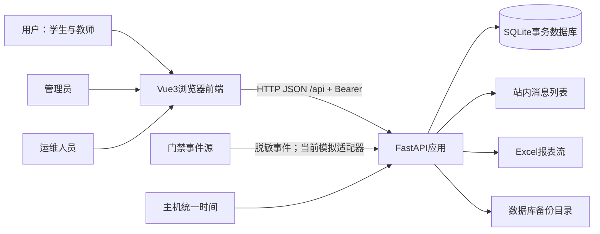
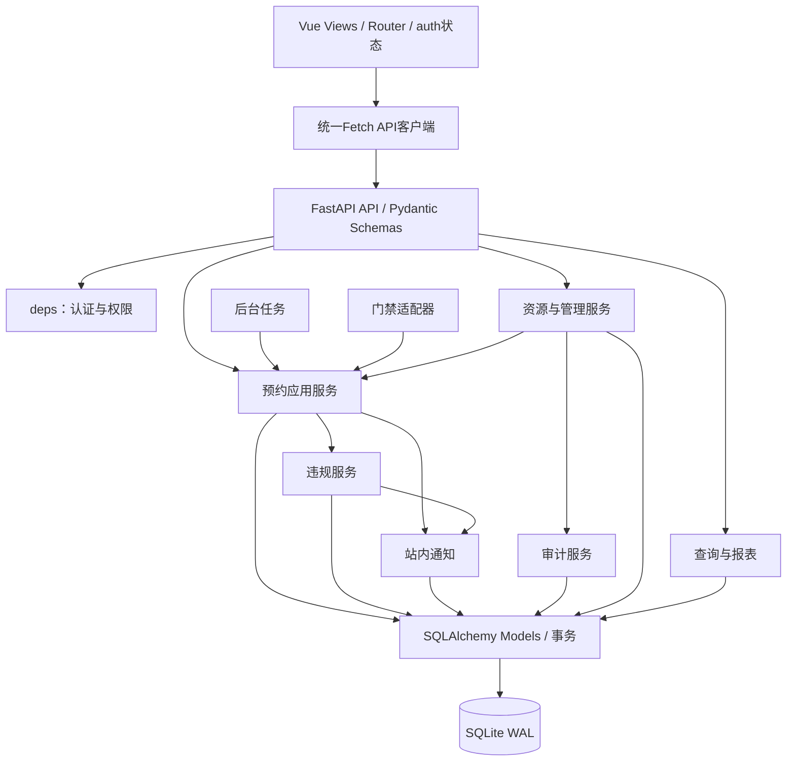
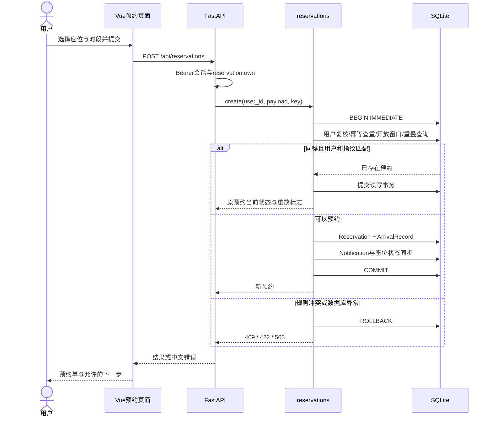
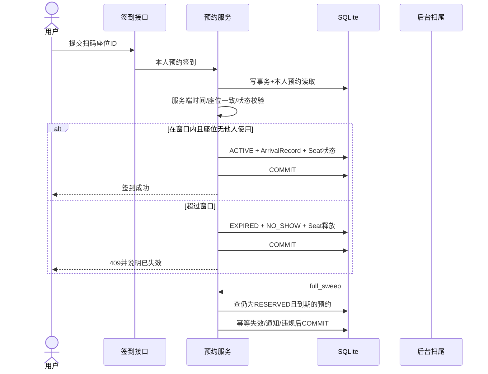
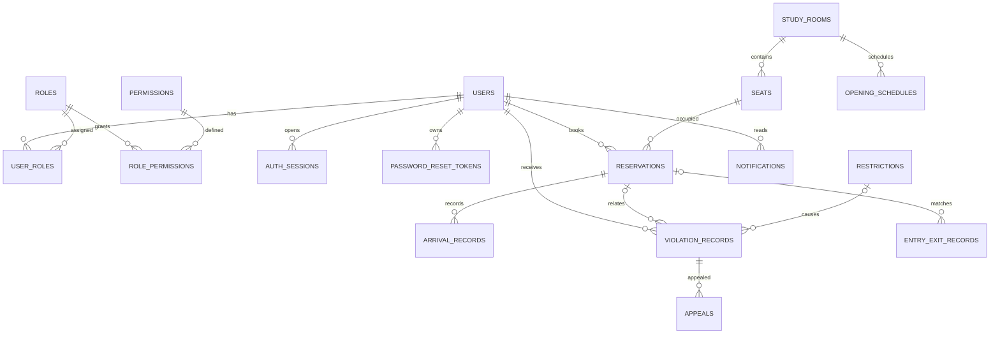

# 智能自习室管理预约系统架构设计报告

> 文档版本：v1.3  
> 编制日期：2026-11-012  
> 项目名称：智能自习室管理预约系统  
> 编制团队：全网呼叫奶家人  
> 团队成员：周俊博、张东岩、方梓安  


---

## 〇、文档导读

本文给出本项目可直接实施和评审的架构方案，覆盖总体结构、模块边界、关键事务、数据模型、接口、部署、测试和演进。系统面向用户预约座位、扫码签到、临时离开、结束使用、违规申诉，也面向管理员的资源维护、规则配置、处罚复核、统计导出以及运维人员的日志、门禁、备份和监控。

系统采用 Python FastAPI + SQLAlchemy + SQLite 的分层模块化单体，Vue3 + Vite 为浏览器前端，Alembic 管理数据库迁移，GitHub Actions 执行持续集成。门禁通过脱敏事件适配器接入，通知固定为站内通知。SRS 已将候补、统一身份认证实际对接、收费、硬件采购和培训列为本期范围外事项，架构不引入这些功能。报告中的人员为架构责任安排，不代表另有已经举行的评审会议或教师签署记录。

## 一、阅读结论、依据与设计边界

### 1.1 已核验内容

| 类别 | 结论 | 依据 |
|---|---|---|
| 范围 | SCOPE-01～SCOPE-10均有后端路由、前端页面或测试对应 | SRS §1.4.1；backend/app、frontend/src |
| 角色 | 只有用户、管理员、运维三类 | SRS HD-14、§4.2；models/enums.py |
| 预约 | 创建、换座、取消、冲突检测、幂等 | SRS UC-007/UC-009；services/reservations.py |
| 履约 | 弹性签到、未签到释放、结束使用、暂离30分钟 | SRS BR-020～026、BR-070～072；reservations.py、gate.py |
| 违规 | 离馆未声明、未到场、未签退/暂离超时、迟取消、阶梯禁约 | SRS BR-090～099；services/violations.py |
| 管理 | 房间、座位、开放时间、校历、业务参数、申诉、报表和Excel导出 | api/admin_*.py、api/reports.py |
| 运维 | 登录/操作日志、门禁记录、在线备份、运行状态 | api/ops_*.py、services/backup.py |
| 安全 | bcrypt密码哈希、会话摘要、权限依赖、门禁HMAC脱敏 | security.py、auth.py、permissions.py、gate.py |
| 数据库 | SQLite外键、WAL、busy_timeout、Asia/Shanghai时间 | db.py、models/base.py、config.py |
| CI | 后端ruff/pytest，前端lint/format/build | .github/workflows/ci.yml |
| 版本字段 | SRS BR-051要求乐观锁版本号；当前实体未定义独立version列 | SRS BR-051与当前Reservation模型审查 |

本文把代码中已经存在的事务和约束如实写成“现有机制”，把SRS要求但代码尚未体现的版本条件更新写成“架构约束”，不把设计目标冒充已完成验收。

### 1.2 不改变的业务边界

1. 用户包含学生和教师，不设置教师特权。
2. 候补及候补转正因HD-41移出本期；释放的座位直接恢复可预约。
3. 开始前大于15分钟取消不违规；小于等于15分钟允许取消并记一次迟取消违规；已签到不可取消。
4. 签到窗口为预约开始前15分钟至开始后15分钟；超窗未签到转预约失效并记未到场违规。
5. 用户点击临时离开后保留座位30分钟，重新入馆记录在期限内到达则恢复使用；未声明离馆直接释放并记违规。
6. 违规固定14天累计，3、5、7、9次分别禁约1、2、3、4天；警告不扣除，周期到期归档而不删除。
7. 维护座位、关闭房间或调整开放时段时，未来未签到预约强制取消并发送维修通知，不补偿；已签到不立即中断。
8. 门禁接口只保存HMAC脱敏用户键和事件元数据，不保存人脸、卡号或学号原文；管理员不能查看门禁明细。
9. 通知为站内通知；外部短信、邮件和推送不进入本期部署。
10. 业务时间统一使用带时区的Asia/Shanghai时间；服务端时间是唯一裁决来源。

### 1.3 需求追溯与架构回应

| 需求 | 架构回应 | 验证 |
|---|---|---|
| FR-001～007 | auth路由、User/Role/Permission、会话、bcrypt、登录锁定和密码重置 | test_auth.py、test_permissions.py |
| FR-010～013 | availability服务按日期、开放窗口、区域和设施属性计算座位状态 | test_reservations.py |
| FR-020～024 | reservations服务事务校验开放时段、重叠、额度、禁约和幂等 | test_reservations.py、test_assigned_workflows.py |
| FR-030～037 | 状态机、ArrivalRecord、暂离字段、后台扫尾和门禁适配器 | assigned_workflows测试 |
| FR-040～043 | violations、restrictions、appeals及管理员复核事务 | gaps、assigned_workflows测试 |
| FR-050～052 | Notification表和业务事件键去重 | 通知/预约测试 |
| FR-060～061 | 本人历史、利用率/峰值/违规报表和XLSX导出 | reports测试 |
| FR-070～073 | 管理房间、座位、开放时间、校历和SystemSetting | admin_config/admin_seats测试 |
| NFR-001～004 | 健康检查、WAL、写锁、索引、并发测试 | health/models/reservations测试 |
| NFR-005、011 | bcrypt、后端权限依赖、对象归属过滤、门禁脱敏 | auth/permissions/gate测试 |
| NFR-006 | timeutil时钟接缝、服务端时区和边界测试 | health/reservations测试 |
| NFR-007～008 | 参数键值表、AuditLog、LoginLog、追加式留痕 | logs/admin测试 |
| NFR-012 | SQLite online backup、完整性检查、轮换和恢复演练 | backup_monitoring测试 |

## 二、架构关注点与质量属性

| 编号 | 风险 | 设计回应 | 观察判据 |
|---|---|---|---|
| AF-01 | 抢座超售 | BEGIN IMMEDIATE写事务、事务内重查重叠、有效状态唯一索引、冲突映射 | 同一座位时段有效预约数为1 |
| AF-02 | 网络重试重复写入 | 用户+幂等键+请求指纹；通知使用稳定事件键 | 同键重放返回原结果 |
| AF-03 | 客户端时钟篡改 | 所有窗口由服务端时钟在事务内复核 | 修改浏览器时间不能绕过规则 |
| AF-04 | 门禁乱序/迟到 | source_system+external_id去重；超过300秒或无法匹配进入人工核验 | 旧事件不能复活终态预约 |
| AF-05 | 违规重复或处罚错误 | reservation_id+类型去重、周期起点、序号、折算标记、独立Restriction | 3/5/7/9次阶梯稳定 |
| AF-06 | 越权和隐私泄露 | require_permission统一拦截，查询按user_id和角色范围过滤 | 三角色矩阵和双用户越权全部拒绝 |
| AF-07 | 维护误取消或漏通知 | 座位状态、未来预约取消、通知、审计同事务 | 已签到不被立即中断 |
| AF-08 | 参数变更影响历史事实 | SystemSetting白名单；现有窗口读取当前参数；规则快照列入改进 | 参数变更回归及历史规则检查 |
| AF-09 | 管理争议无证据 | AuditLog追加前后值、操作者、IP、结果 | 关键动作均有日志 |
| AF-10 | 数据库故障 | online backup、完整性检查、保留14份、停机恢复 | 恢复库可通过校验和对账 |
| AF-11 | SQLite写锁瓶颈 | 快速事务、读写会话、busy_timeout、503重试；压力后可换PostgreSQL | 逐步加压测P95和锁等待 |
| AF-12 | 移动端扫码兼容性 | BarcodeDetector可用则摄像头扫描，否则手输座位ID或编号 | 390px和无API环境仍可签到 |

质量目标直接采用SRS：可用性≥99.5%、P95接口≤2秒、目标并发≥200、超售0、服务端时间偏差≤1秒、密码bcrypt、关键操作100%留痕、RPO=0。课程演示环境不能替代生产长期监控和隔离压力测量。

## 三、候选架构及比较

### 3.1 方案A：简单分层单体

前端请求进入FastAPI，路由直接调用SQLAlchemy和少量大服务。优点是开发快、部署简单；风险是预约、违规、门禁和管理操作会互相读写，权限和状态机分散，三人并行时容易产生边界冲突。

### 3.2 方案B：分层模块化单体（选定）

一个FastAPI部署单元内按认证、资源、预约履约、违规、门禁、通知、管理、报表、运维划分模块；每个模块有API、应用服务、模型和数据访问边界；跨模块核心用例使用本地事务编排。它保留SQLite事务和低部署成本，同时支持三人按领域并行、接口契约和独立测试。

### 3.3 方案C：微服务

认证、预约、资源、违规、通知分别部署并拥有独立数据库。服务间一致性、消息重试、补偿、链路追踪和运维环境会明显增加，不适合本项目的SQLite、三人团队和课程交付周期。

| 维度 | 方案A | 方案B | 方案C |
|---|---:|---:|---:|
| 开发启动成本 | 低 | 中低 | 高 |
| 本地事务 | 高但易混杂 | 高且边界清晰 | 需分布式一致性 |
| 团队并行 | 低 | 高 | 中 |
| 可测试性 | 中 | 高 | 高但复杂 |
| 运维成本 | 低 | 低 | 高 |
| 课程交付 | 高 | 高 | 低 |
| 未来演进 | 低 | 高 | 已拆分 |

选定方案B。未来若压力测试证明SQLite写锁无法满足目标，只替换数据库和基础设施实现，不改变应用服务和接口语义。

## 四、目标架构与模块划分

### 4.1 总体结构

浏览器Vue3前端通过/api访问FastAPI。FastAPI负责CORS、路由、Pydantic请求模型、Bearer会话、权限依赖、错误处理和指标中间件。应用服务负责状态机和事务；SQLAlchemy负责持久化；SQLite启用外键、WAL和busy_timeout。reservation_worker和ops_worker由FastAPI lifespan启动。

外部依赖为图书馆门禁/人脸系统、时间基准服务、浏览器摄像头和未来可选的统一认证。门禁当前通过脱敏mock接口接收，真实协议由适配器替换。

### 4.2 模块和数据所有权

| 模块 | 负责内容 | 主要数据 | 边界 |
|---|---|---|---|
| identity-access | 注册、登录、会话、密码、角色和权限 | User、Role、Permission、AuthSession、PasswordResetToken、LoginLog | 只提供身份和授权，不写预约或违规 |
| resource | 房间、座位、开放时间、校历、实时可用性 | StudyRoom、Seat、OpeningSchedule、CalendarDay | 提供资源查询；不能直接写Reservation |
| reservation-fulfillment | 创建、换座、取消、签到、结束、暂离、自动释放 | Reservation、ArrivalRecord | 是预约状态和占用唯一写入口 |
| discipline | 三类违规、周期归档、处罚和申诉 | ViolationRecord、Restriction、Appeal | 统一计算警告和限制 |
| gate-integration | 进出事件、脱敏匹配、重复/迟到降级 | EntryExitRecord | 只能通过公开预约能力改变状态 |
| notification | 站内通知、事件键、已读 | Notification | 不反向修改业务事实 |
| administration | 用户、资源、配置、维护、申诉 | 通过各模块公开服务写入 | 维护必须调用强制取消和审计 |
| reporting | 利用率、峰值、违规趋势、XLSX | 只读查询 | 不写业务表 |
| operations | 日志、门禁只读、状态、备份恢复 | AuditLog、LoginLog、备份文件、指标 | 运维动作也写审计 |
| infrastructure | 事务、时钟、配置、迁移和错误 | SystemSetting及基础设施 | 不放业务规则 |

### 4.3 依赖规则

1. 路由和定时器只能调用应用用例，不能拼跨模块业务SQL。
2. 跨模块用例由应用层统一开启本地事务；仓储不自行提交。
3. 预约模块是Reservation状态和座位占用唯一写入口。
4. 违规模块是ViolationRecord和Restriction唯一计算入口。
5. 门禁适配器只输入脱敏DTO，不绕过幂等、权限和状态机。
6. 报表只读，先按权限过滤再聚合。
7. 所有业务时间来自统一时钟；禁止无时区时间参与裁决。
8. 迁移脚本是数据库结构唯一演进渠道。
9. 禁止万能接口和跨模块直接更新表。
10. 已有通知与核心事实同事务提交；关键状态操作按设计补齐审计。认证失败日志使用独立事务，文件备份与数据库审计不构成一个原子事务。

### 4.4 团队分工

| 成员 | 负责模块/功能 | 交付物和复核 |
|---|---|---|
| 周俊博（队长） | 需求统筹；房间/座位查询与状态；创建预约、冲突、幂等、换座、取消；扫码签到和未签到释放 | availability、reservations、用户预约页面、关键事务测试；张东岩复核CI/事务，方梓安复核违规联动 |
| 张东岩 | 脚手架、CI、SQLite模型和数据字典；认证、密码和权限；日志、备份、监控；房间/开放时间/系统参数管理；测试整合 | main/db/models/auth/permissions/ops/admin_config和CI；周俊博复核需求，方梓安复核管理流程 |
| 方梓安 | 结束使用、临时离开、门禁同步降级；违规、处罚和申诉；站内通知；个人历史；座位布局/导入；报表和Excel | gate/violations/notifications/reports和相应页面；周俊博复核状态机，张东岩复核数据和测试 |
| 全组 | 架构、迁移、权限、并发、验收材料 | 队长最终整合 |

## 五、关键技术方案与事务边界

### 5.1 预约创建

预约使用同日半开区间[start,end)。事务步骤为：认证用户；补偿到期预约；检查幂等键和请求指纹；检查开始时间、提前天数、开放窗口、禁约、座位状态、座位重叠、用户重叠；当前以同一时段单座约束落实占用上限，没有独立日次数和小时额度；在写锁内重新检查；写Reservation、ArrivalRecord、确认通知并同步座位展示状态；提交。相同幂等键返回原结果，不同指纹返回409。锁繁忙返回503并要求相同键重试。任何异常回滚全部写入。

当前实现使用BEGIN IMMEDIATE、重叠查询和有效状态唯一索引。SRS BR-051要求的独立version字段是后续扩展约束：更新时必须使用id+version条件，成功后递增，影响行数为0返回409，不能取代事务和数据库约束。

### 5.2 状态机

| 当前 | 事件 | 条件 | 结果 |
|---|---|---|---|
| 无 | 创建 | 规则通过 | RESERVED |
| RESERVED | 扫码 | 开始前15至开始后15分钟 | ACTIVE |
| RESERVED | 取消 | >15分钟 | CANCELLED，无违规 |
| RESERVED | 取消 | ≤15分钟 | CANCELLED，迟取消违规 |
| RESERVED | 超窗扫尾 | 开始后超过15分钟 | EXPIRED，未到场违规 |
| RESERVED | 维护 | 未来未开始 | ADMIN_CANCELLED，维修通知 |
| ACTIVE | 临时离开 | 用户确认 | TEMP_LEAVE，保留30分钟 |
| TEMP_LEAVE | 入馆 | 期限内 | ACTIVE |
| TEMP_LEAVE | 超时 | 无入馆 | TIMED_OUT，暂离违规 |
| ACTIVE | 结束 | 用户确认 | COMPLETED |
| ACTIVE | 出馆 | 未声明暂离 | TIMED_OUT，离馆违规 |
| ACTIVE/TEMP_LEAVE | 时段结束 | 未结束 | TIMED_OUT，未签退违规 |
| 任意终态 | 重复命令 | — | 保持终态，幂等返回或409 |

命令必须锁定预约、校验当前状态并使用服务端时钟。签到、取消、结束、门禁和扫尾竞争时只允许一个合法转换成功。

### 5.3 违规与处罚

ViolationRecord保存用户、类型、时间、预约/到达关联、周期起点、序号、归档状态、结果和折算标记。固定14天窗口内，3+2(k-1)次触发第k档k天禁约；不扣减警告。未签退每2次折算1次。申诉期限7天，批准后归档违规、解除未到期Restriction、发送通知并记审计。相同预约和类型去重，后台重跑不重复处罚。

### 5.4 门禁

门禁事件使用HMAC生成masked_user_key，source_system+external_id唯一。接收后计算延迟、查重、匹配用户和唯一预约。超过300秒、无法匹配或状态不一致只保存记录并进入人工核验；合法入馆恢复暂离或完成签到；暂离出馆保持保留；未声明出馆将预约转TIMED_OUT并记录违规。所有结果和通知在同事务内提交。

### 5.5 后台任务

reservation_worker每60秒执行未签到超时、预约结束、暂离超时、提醒和违规归档；请求查询也补做expire_due。ops_worker按配置在线备份和清理日志。任务按状态条件和事件键幂等，重复执行不会重复处罚或通知。

### 5.6 管理维护

座位维护、房间关闭、开放时间缩短采用相同取消模式；房间和时段调整使用admin_force_cancel，座位维护当前为本地实现，目标收拢至统一应用服务，只处理未来且未签到的预约，设置ADMIN_CANCELLED、原因和维修通知，写AuditLog；ACTIVE用户继续使用。维护、预约取消、通知和审计同事务提交。

### 5.7 通知和审计

Notification固定channel=in_app，事件键唯一。预约确认、签到提醒、违规、维修、暂离和门禁同步都使用稳定键。AuditLog追加记录操作人、目标、前后值、IP、结果和时间；LoginLog记录认证事件。任何用户不可查看他人通知，管理员不可查看门禁明细。

## 六、数据架构

### 6.1 聚合

| 聚合 | 实体 | 关系 |
|---|---|---|
| 身份 | User、Role、Permission、AuthSession、PasswordResetToken、LoginLog | User拥有角色和会话 |
| 资源 | StudyRoom、Seat、OpeningSchedule、CalendarDay | 房间包含座位和开放规则 |
| 预约 | Reservation、ArrivalRecord | 预约拥有签到、暂离和结束事实 |
| 纪律 | ViolationRecord、Restriction、Appeal | 违规产生限制，申诉关联违规 |
| 门禁 | EntryExitRecord | 事件关联最多一条预约 |
| 消息 | Notification | 用户收到并更新已读 |
| 审计/配置 | AuditLog、SystemSetting | 各模块追加审计，管理员维护参数 |

### 6.2 重点约束

users.student_no唯一；room.name唯一；seat(room_id,code)唯一；opening_time<closing_time；reservation起止顺序正确、reservation_no和幂等键唯一、有效预约座位/开始时间唯一索引、用户和开始时间索引；notifications事件键唯一且channel只能in_app；entry_exit(source_system,external_id)唯一；审计/登录按时间索引；枚举由数据库CHECK约束保证。

### 6.3 事务范围

创建预约覆盖用户资格、座位冲突、预约、到达记录、通知和座位状态；取消覆盖预约、违规、通知和释放；签到覆盖预约、到达记录和座位状态；暂离/门禁/超时覆盖门禁事实、预约、违规、通知和释放；维护覆盖座位、未来预约、通知和审计；申诉覆盖结论、违规、限制、通知和审计；配置覆盖参数和审计。报表和状态展示为只读可重算查询。

### 6.4 保留与隐私

违规14天后归档不删除；日志默认保留180天；门禁记录只保存脱敏键、事件元数据和到期时间；密码和令牌只保存哈希/摘要；导出仅管理员可用；敏感导出的访问审计列为交付约束；不提供清空历史的万能接口。

## 七、接口设计

### 7.1 统一规则

API使用/api前缀、Bearer会话和后端授权；写命令使用幂等键；时间带时区；401/403/404/409/422/503分别表示认证、权限、可见性、状态冲突、参数/业务错误和写锁繁忙；错误不暴露SQL和敏感身份；分页、导出范围和门禁读取均有上限。

### 7.2 用户接口

| 路径 | 说明 |
|---|---|
| POST /auth/register、/auth/login、/auth/logout、/auth/change-password、/auth/reset-password | 注册、登录、注销、改密和重置 |
| GET /auth/me | 本人和权限 |
| GET /rooms、/seats、/seats/{id} | 房间、开放时间、座位筛选、详情和实时状态 |
| GET/POST /reservations | 本人历史、创建预约 |
| PATCH /reservations/{id}/seat | 仅未签到换座 |
| POST /reservations/{id}/check-in | QR座位校验和弹性签到 |
| POST /reservations/{id}/temporary-leave、/return、/end、/cancel | 暂离、返回、结束和取消 |
| GET /violations、POST/GET /appeals | 本人违规和7天内申诉 |
| GET /notifications、POST /notifications/{id}/read | 站内消息 |

### 7.3 管理与运维接口

管理包含/admin/users、/admin/rooms、/admin/rooms/{id}/seats、schedules、calendar、settings、violations、appeals、reports和reports/export.xlsx。运维包含/ops/entry-exit/mock、/records、/manual-appeals、/backups、/status及日志查询。权限分别由user:manage、room:manage、settings:manage、violation:manage、appeal:manage、stats:read、data:export、entry_exit:read、system:backup、system_log:read和audit_log:read控制。

## 八、前端架构

Vue3单页应用使用Vue Router和集中auth状态。API客户端统一加Bearer令牌并把FastAPI错误转换为中文。用户页面包括首页、房间/座位、预约、签到、通知、违规和申诉；管理页面包括用户、房间配置、座位布局/导入/维护、报表和申诉；运维页面包括日志、门禁、备份和状态。路由守卫只隐藏页面，后端权限是最终裁决。签到优先用BarcodeDetector，无API时手输座位ID或房间+编号；二维码只编码座位标识，不包含用户数据。

## 九、部署、配置和恢复

开发使用Python3.11、Node20、Uvicorn和SQLite；测试每个用例使用临时SQLite并运行Alembic；演示后端默认8000、前端5173。配置统一使用STUDYROOM_前缀：DATABASE_URL、TIMEZONE、SQLITE_BUSY_TIMEOUT_MS、RESERVATION_SWEEP_INTERVAL_SECONDS、BCRYPT_ROUNDS、LOGIN_MAX_FAILURES、BACKUP_INTERVAL_SECONDS、BACKUP_DIR、BACKUP_KEEP、LOG_RETENTION_DAYS和GATE_HMAC_SECRET。非dev/test环境拒绝默认门禁密钥。

备份使用sqlite3 online backup API，默认保留14份；恢复前执行完整性检查。恢复必须停机，校验备份、恢复数据库、核对迁移版本和关键表后再启动。RPO=0是SRS目标，需通过隔离故障演练测量，不以一次备份列表展示替代。

## 十、可测试性和评审场景

### 10.1 测试接缝

时钟可替换；数据库由make_engine和依赖覆盖切换为临时SQLite；门禁由mock DTO输入；通知由数据库事件键去重；后台任务可显式调用sweep/full_sweep；权限通过require_permission替换；报表由build_report和BytesIO测试；备份使用临时文件恢复。这样不启动真实浏览器和门禁，也能验证核心规则。

### 10.2 必须评审的场景

1. 100个请求抢同一座位只成功一条。
2. 幂等重放返回原预约的当前状态，不新增记录。
3. 开始前/后15分钟签到边界和超窗1秒。
4. 迟取消、正常取消和已签到取消拒绝。
5. 暂离入馆恢复、超时处罚、未声明出馆处罚。
6. 门禁重复、迟到、无法匹配和已完成预约旧事件。
7. 维护未来预约取消、已签到继续使用、通知和审计。
8. 3/5/7/9次处罚阶梯、未签退折算、14天归档。
9. 用户、管理员、运维权限和双用户对象越权。
10. 站内通知重试、在线备份、恢复完整性和客户端时间篡改。
11. 390px视口和无BarcodeDetector手动签到。

验证命令为：backend执行pytest、ruff check、ruff format --check；frontend执行npm run lint、format:check、build；全量使用python scripts/dev.py test。测试证据记录环境、提交版本、命令、输出和数据库核对。演示环境不能替代长期可用性、200并发和NTP偏差测量。

## 十一、开发约束与演进安排

1. 新功能必须标注SRS FR/BR/NFR/AC编号和所属模块。
2. 改动预约、签到、暂离、门禁、违规时必须写明事务、状态转换、幂等键和回滚语义。
3. 管理动作必须审计；禁止万能状态更新和任意设置违规次数。
4. 新表必须有Alembic迁移、约束、权限和清理策略。
5. 前端状态是快照，不能直接写回座位可用状态。
6. 外部集成必须有适配器和人工核验降级。
7. 关键事务由功能负责人之外的队员复核；CI未通过不合并。
8. AI生成修改必须限定文件范围、保留测试证据并由人工审查。

演进顺序：认证/迁移/权限 → 资源和预约 → 签到/暂离/扫尾 → 门禁 → 违规/申诉/通知/审计 → 管理资源和报表 → 备份监控与压力兼容性。若压力验证表明SQLite写锁不能满足目标，迁移PostgreSQL而保持应用服务和接口契约。

## 十二、架构决策记录

| ADR | 决策 | 责任人/设计日期 |
|---|---|---|
| ADR-01 | FastAPI + Vue3 + SQLite分层模块化单体 | 周俊博、张东岩、方梓安 / 2026-11-12 |
| ADR-02 | SQLite外键、WAL、busy_timeout，预约使用BEGIN IMMEDIATE | 张东岩、周俊博 / 2026-11-12 |
| ADR-03 | 半开时间区间、事务内重查、唯一约束和幂等键 | 周俊博 / 2026-11-12 |
| ADR-04 | RESERVED/ACTIVE/TEMP_LEAVE/COMPLETED/CANCELLED/ADMIN_CANCELLED/EXPIRED/TIMED_OUT状态机 | 周俊博、方梓安 / 2026-11-12 |
| ADR-05 | 通知仅站内，业务事件键去重 | 方梓安 / 2026-11-12 |
| ADR-06 | 门禁HMAC脱敏，迟到/无法匹配进入人工核验 | 方梓安、张东岩 / 2026-11-12 |
| ADR-07 | 固定14天窗口、无上限阶梯、归档不删除 | 方梓安、周俊博 / 2026-11-12 |
| ADR-08 | 维护只取消未来预约、只通知不补偿、已签到不立即中断 | 全组 / 2026-11-12 |
| ADR-09 | online backup、完整性检查、停机恢复 | 张东岩 / 2026-11-12 |
| ADR-10 | BR-051版本字段作为演进约束；当前以写锁和约束保障单库并发 | 周俊博、张东岩 / 2026-11-12 |


## 十三、架构视图与关键流程展开

### 13.1 系统上下文视图



用户在资源查询界面选择日期、时间和座位，预约结果写入统一数据库；管理员管理资源和纪律；运维查看运行信息和门禁。系统不向浏览用户公开占用者姓名，不把门禁生物特征导入本系统。门禁mock路由由运维权限保护，真实设备上线需要独立机器身份适配，不能直接把运维账号令牌分发给设备。

### 13.2 分层组件视图



本图表达目标依赖方向。当前路由中已有部分直接ORM操作，属于同一部署单元内的实现方式；后续修改应逐步汇入应用服务，不能把“模块化单体”理解为现有代码已经完成严格领域隔离。数据库仍共享，事务仍本地执行，逻辑模块不各自创建数据库。

### 13.3 目录与模块映射

| 代码位置 | 架构职责 | 主要维护者 |
|---|---|---|
| backend/app/main.py | 应用组装、异常处理、中间件、任务生命周期 | 张东岩 |
| backend/app/config.py、db.py、timeutil.py | 环境配置、数据库、统一时钟 | 张东岩 |
| backend/app/security.py、deps.py、permissions.py | 密码、令牌、认证与授权依赖 | 张东岩 |
| backend/app/models | 核心实体、认证/配置/日志模型和约束 | 张东岩，功能负责人协同 |
| backend/app/schemas | API请求响应校验与业务输入结构 | 各模块负责人 |
| backend/app/services/availability.py | 开放窗口、座位搜索、实时状态 | 周俊博 |
| backend/app/services/reservations.py | 创建、换座、取消、签到和履约编排 | 周俊博、方梓安 |
| backend/app/services/reservation_worker.py | 扫尾任务入口和循环重试 | 周俊博、方梓安 |
| backend/app/services/gate.py、violations.py、notifications.py | 门禁、纪律、站内消息 | 方梓安 |
| backend/app/services/admin_force_cancel.py | 房间关闭和开放时间变更影响处理 | 张东岩、方梓安 |
| backend/app/services/backup.py、ops_worker.py、logs.py | 在线备份、任务调度、日志保留 | 张东岩 |
| backend/app/api/admin_seats.py、reports.py | 座位布局/CSV导入、统计/XLSX | 方梓安 |
| backend/migrations/versions | 0001～0008数据库演进 | 张东岩 |
| frontend/src/views/WorkflowsView.vue、CheckInView.vue | 预约操作和扫码履约界面 | 周俊博、方梓安 |
| frontend/src/views/AdminConfigView.vue、AdminUsersView.vue | 配置、账号角色和权限界面 | 张东岩 |
| frontend/src/views/AdminSeatsView.vue、AdminReportsView.vue、AdminAppealsView.vue | 座位、报表、申诉管理界面 | 方梓安 |
| frontend/src/views/AdminLogsView.vue、AdminOpsView.vue、AdminGateView.vue | 日志、备份监控、门禁工作台 | 张东岩、方梓安 |
| scripts/dev.py、.github/workflows/ci.yml | 本地一键启动和持续集成 | 张东岩 |

### 13.4 创建预约时序



事务所用业务会话与认证查询会话区分，避免把认证已开启的读事务强行升级为立即写事务。该做法与write_transaction的独立Session实现一致。持锁期间只做数据库和本地计算，不访问门禁网络或发送外部消息。

### 13.5 换座事务

换座只接收seat_id，不接收新的开始结束时间；ChangeSeatIn禁止多余字段。处理时先检查本人预约处于RESERVED且未超窗，再检查禁约和新座位开放窗口，排除本预约后重查座位冲突和本人冲突。成功后更新seat_id、room_id，同步原座位和新座位状态。失败则整体回滚，原座位和原预约保持。预约号和幂等请求身份不变化；旧创建请求重放返回同一预约的当前座位。

连续时段使用相邻半开区间，不视为冲突。例如09:00～10:00与10:00～11:00可连续预约；09:30～10:30与09:00～10:00重叠，应拒绝。跨日期预约和无时区时间必须在输入校验阶段拒绝。

### 13.6 签到与自动失效时序



超窗状态应先提交，再返回业务错误，不能因抛错回滚刚产生的失效事实。正常窗口包含两端，但如果预约本身已经结束，则不能继续签到；相邻预约虽不冲突，提前签到也不能占据上一位尚在使用的座位。ArrivalStatus中的EARLY/LATE仅表达到达相对开始时间，不表示窗口内早到或晚到会产生处罚。

### 13.7 临时离开与结束连续使用

临时离开要求ACTIVE且尚未到预约结束。系统记录temp_leave_at和WAITING，保留至“声明时间+30分钟”和预约结束两者中更早的时刻。重新入馆事件必须落在该期限内；到期释放不能被事后旧事件逆转。暂离出馆事件只记录离馆，不重启30分钟计时。

结束使用必须携带confirm=true。end_use先定位本人ACTIVE/TEMP_LEAVE预约，再沿“同用户、同座位、下一段开始=当前段结束”的关系找到连续预约链。已经开始的使用段写COMPLETED和结束事实；尚未开始的后续段写CANCELLED并说明“结束连续使用释放”。同一事务内释放整个链、计算记录中的使用分钟并发送总结通知，不对用户主动提前结束加罚。

暂离已经超时则不能通过结束按钮绕过超时判定。任意两段之间有时间空隙，或座位/用户不同，不纳入连续链。

### 13.8 申诉和多限制

申诉由用户选择具体violation_id并填写理由和证据文本，服务端按user_id复核，不信任页面传入的归属。7天内可提交，无待处理重复申诉时创建Appeal并把关联违规改为PENDING。管理员只能在未处理状态下给出approved/rejected和必填处理说明。

批准后仅解除申诉关联的限制，不能把该用户所有Restriction一次性置无效；创建/换座仍查询所有当前生效限制，只要任意限制生效就拒绝。驳回保持原违规和禁约，写明理由。原始记录保留，通过Appeal及AuditLog说明修正，不删除历史事件。

## 十四、数据模型详细说明

### 14.1 ER关系视图



图中ArrivalRecord使用一对多表示当前物理外键允许的基数；业务流程预期每个预约一条到达记录。区域以Seat.zone_type保存，不单独建立Zone表；暂离字段放在Reservation，不单独建暂离流水表；候补没有表。身份与角色是多对多关系，界面“用户/管理员/运维”表示权限集合，不能依赖单一角色字符串判断所有场景。

### 14.2 身份和认证数据字典

| 实体/字段 | 类型与约束 | 设计用途 |
|---|---|---|
| users.id | 整数主键 | 内部稳定关联键 |
| student_no | String(32)，唯一非空，非空白检查 | 学号/工号身份；当前格式校验为6～20位字母数字 |
| name、department、contact | 姓名必填，部门/联系可空 | 本人与授权管理员可见 |
| password_hash | String(255)，非空 | bcrypt哈希，不提供读取接口 |
| status | normal / disabled | 账号可用性，与违规禁约区分 |
| roles、permissions | 多对多中间表 | 模块×动作权限与角色对应 |
| auth_sessions.token_hash | String(64)，唯一 | SHA-256令牌摘要 |
| auth_sessions.expires_at、revoked_at | 带时区时间逻辑值 | 默认12小时，注销/改密可提前撤销 |
| password_reset_tokens | 用户、签发人、摘要、过期/使用时间 | 默认30分钟一次性，重签使旧码失效 |
| login_logs | 用户、尝试学号、事件、成功、原因、时间、IP、客户端 | 失败也独立提交留痕，支持锁定判断 |

密码至少8位且含字母和数字，编码后不能超过bcrypt的72字节限制。首次管理员由CLI创建；注册接口只发普通用户角色。改密和密码重置都撤销该用户所有会话，避免旧设备持续访问。前端令牌放localStorage是当前实现，部署需要同源HTTPS和脚本注入防护，不把这种存储方式写成HttpOnly Cookie或JWT。

### 14.3 资源和开放时间数据字典

| 实体 | 核心字段 | 约束与说明 |
|---|---|---|
| StudyRoom | name、location、floor、capacity、facilities、status、remark | 名称唯一，容量非负，open/closed |
| Seat | room_id、code、zone_type、has_power、by_window、accessible、status、status_changed_at | 房间内编号唯一，区域quiet/discussion/exam_prep |
| OpeningSchedule | room_id、day_type、open_time、close_time、effective_from/to、enabled | 按工作日/周末/节假日/考试周与生效日期查规则 |
| CalendarDay | day主键、day_type、note | 特殊日期覆盖普通星期推算 |
| SystemSetting | key主键、JSON value、updated_at、updated_by | 只存覆盖值，其余采用BusinessSettings默认值 |

可用性服务优先取CalendarDay，否则按星期区分工作日/周末；取enabled且有效期覆盖的规则，裁剪到06:00～23:30，再合并重叠或相邻开放窗口。预约必须完整落在同一个合并窗口内。资源关闭或维护优先于占用展示，释放不能把maintenance/closed/disabled误改为available。

六类SeatStatus为available、reserved、in_use、maintenance、closed、disabled。TEMP_LEAVE是预约状态，座位列表把它映射为in_use；本人预约页通过TEMP_LEAVE和计时显示暂离，避免重复维护两个互相矛盾的事实。座位布局采用编号和设施属性组织，不声称有当前表中不存在的持久化x/y坐标。

### 14.4 预约与履约数据字典

| 字段 | 用途与约束 |
|---|---|
| reservation_no | SR+时间+随机片段的唯一预约号，用于人工追溯 |
| user_id、room_id、seat_id | RESTRICT外键；保留有历史的资源引用 |
| start_time、end_time | 必须带时区输入，数据库CHECK保证start<end |
| status | 八类状态，三种有效占用状态 |
| cancel_type、cancel_reason、cancelled_at | normal/late/system及取消事实 |
| expire_reason | no_show、temp_leave_timeout、period_end、left_undeclared等原因 |
| temp_leave_at、temp_leave_state | 暂离起点和none/waiting/returned/timed_out |
| idempotency_key、request_fingerprint | 全库唯一键及SHA-256请求内容摘要 |
| ArrivalRecord.arrival_status | absent/on_time/late/early，到达分类而非直接处罚 |
| arrived_at、arrival_method | 实际到达时间；qr或manual |
| ended_at、end_method | button、auto_timeout或admin_release |
| sync_delay_seconds | 到达事实与门禁同步延迟的辅助字段 |

当前有效状态唯一索引只覆盖seat_id+start_time，不能独立阻止“开始时刻不同但区间重叠”；完整排他性必须依赖写锁内重叠查询。禁止把该索引解释成时间范围排他约束。当前没有ActiveSlotClaim时间片表，也没有Redis或分布式锁。

LocalDateTime在写入前统一转为北京时间无时区值存储，读出再附Asia/Shanghai，拒绝无时区datetime。API返回带+08:00的时间，前端负责显示而不负责裁决。

### 14.5 纪律、通知和门禁字典

| 实体 | 字段重点 | 说明 |
|---|---|---|
| ViolationRecord | type、occurred_at、reservation_id、arrival_record_id、description | 原始违规与证据关联 |
| 周期字段 | state、period_start、period_seq、archived_at、is_offset | 固定窗口、有效累计和原始未签退折算 |
| Restriction | ban_days、warning_count、trigger_condition、start_at/end_at、status | 处罚触发事实，多个限制可并存 |
| 解除字段 | lifted_at、lift_reason、lifted_by | 不覆盖原处罚起因 |
| Appeal | violation_id、restriction_id、reason、evidence、deadline、reviewer、result、comment | 关联具体违规和限制；审核结果可追溯 |
| Notification | user_id、type、content、sent_at、channel、is_read、idempotency_key | 站内投递就是入库；不含外部发送器状态 |
| EntryExitRecord | source_system、external_id、masked_user_key、record_type、recorded_at、received_at | 来源查重、事件时间与接收时间分离 |
| 同步字段 | sync_status、sync_delay_seconds、reservation_id、manual_note、expires_at | pending/synced/late/unmatched/manual_review |

基础纪律仍是SRS三类治理事件；代码另外细分late_cancel和temp_leave_timeout，用于保留迟取消和暂离超时来源，不能因此改写成新的四级处罚体系。枚举有五种事件类型，不代表有五档固定处罚。

## 十五、接口契约、权限和报表补充

### 15.1 创建与重放示例

请求为POST /api/reservations，Authorization从登录会话获得：

```json
{
  "seat_id": 12,
  "start_time": "2026-11-27T09:00:00+08:00",
  "end_time": "2026-11-27T10:00:00+08:00",
  "request_key": "reserve-zhou-20261127-001"
}
```

客户端可改用Idempotency-Key请求头，优先级高于request_key；正文键会先按用户ID计算摘要。请求指纹包含用户、座位或房间区域、开始和结束时间。当前请求头键全库唯一，应用同时比对用户，另一用户复用该键返回409，不泄露原预约。

首次创建返回201；头部幂等重放返回200和Idempotent-Replayed:true；正文键重放保持201兼容已有接口。无键也可以创建，但不具有跨网络重试的完整去重保证，因此用户预约页面应在一次意图的重试过程中保持同一个键。重放返回同一预约的当前状态，不是不可变的首次响应快照。

换座请求PATCH /api/reservations/{id}/seat只允许：

```json
{"seat_id": 13}
```

签到请求POST /api/reservations/{id}/check-in支持二选一：

```json
{"seat_id": 13}
```

或：

```json
{"room_id": 2, "seat_code": "A03"}
```

结束请求为：

```json
{"confirm": true}
```

当前认证错误detail为含code/message的对象，预约错误detail多为字符串，Pydantic错误为列表；前端client.js兼容三种。架构统一HTTP状态语义，不虚构当前所有接口都具有request_id、rule_id和统一错误对象。

### 15.2 权限矩阵落地

| 能力 | 用户 | 管理员 | 运维 | 对象边界 |
|---|---|---|---|---|
| 公开房间和座位 | 是 | 是 | 是 | 当前实现要求登录 |
| 本人预约/签到/暂离/结束 | 是 | 是 | 否 | user_id必须为本人 |
| 管理用户、房间、座位和配置 | 否 | 是 | 否 | 管理员全部业务范围 |
| 全部违规与申诉处理 | 否 | 是 | 否 | 不公开给其他用户 |
| 本人违规/申诉/通知 | 是 | 本人 | 仅本人通知及通用会话能力 | 需区分接口实际授权差异 |
| 统计/XLSX | 否 | 是 | 否 | 不含门禁明细 |
| 业务审计日志 | 否 | 是 | 是 | 只读 |
| 登录日志/运行监控 | 否 | 否 | 是 | 只读 |
| 门禁明细/模拟接收 | 否 | 否 | 是 | 脱敏、限定用途 |
| 在线备份 | 否 | 否 | 是 | system:backup |
| 恢复 | 否 | 否 | 服务器CLI操作 | 停机执行 |

PERMISSIONS是代码中的权限映射权威，迁移0003写入角色权限快照，测试校验两者一致。更改角色在下次后端请求读取User.roles后生效；当前require_permission按角色名判断，并没有把Role.enabled作为完整权限关闭开关。对象归属必须由每个查询再过滤，不能因拥有模块权限而自动获得全量数据。

### 15.3 座位CSV导入

前端读取CSV文本并提交SeatImportIn.content，最大2,000,000字符；后端解析每行、校验编号、区域、布尔设施字段和状态，然后在BEGIN IMMEDIATE内批量写入，同一CSV内编号重复或任一行不合法则拒绝导入；已有编号更新、新编号新增，写入失败整体回滚。导入不是上传任意数据库文件，不接受跨房间修改其他资源。操作审计记录导入行为和数量。导出XLSX属于报表能力，与CSV导入格式分开。

### 15.4 报表统计口径

报表JSON和Excel共用build_report，日期输入含首尾日期，内部换成北京时间[start日00:00,end次日00:00)；默认最近30天，按接口上限拒绝过长范围。

| 指标 | 当前代码计算口径 | 使用解释 |
|---|---|---|
| booked_hours | ACTIVE、TEMP_LEAVE、COMPLETED、TIMED_OUT预约在范围内的计划时长之和 | 不是ArrivalRecord精确实坐时长 |
| available_hours | 当前开放房间、当前非维护/关闭/禁用座位数×查询日期有效开放时长 | 没有历史资源状态快照 |
| rate | booked_hours / available_hours，分母0时为0 | 反映实现口径下的计划使用比率 |
| reservation_count | 与查询区间相交的全部状态预约数 | 包含取消记录 |
| booking_peaks | 按预约开始日期和小时统计记录数 | 不是每分钟实际人数 |
| violation_trends | 按违规发生日期和类型统计记录数 | 原始记录数，不等于有效警告累计 |

Excel包含“利用率概览”“预约高峰”“违规趋势”三个工作表，保留日期和定义、冻结表头并设置列宽。不能把当前报表写成真实人流分析、历史库存重建或精确扣除暂离时长的统计系统。若需要实坐小时，必须在同一需求口径下使用ArrivalRecord与暂离事件，不直接更换报表定义。

## 十六、实现一致性、风险处置与交付判据

### 16.1 设计与现有实现差异

以下内容是明确的架构整改约束，有责任人和验证出口，不作为悬置业务问题，也不宣称已完成代码修正。

| 编号 | 核验事实 | 设计处置 | 负责人/验证 |
|---|---|---|---|
| GAP-A01 | 无独立version列，预约靠SQLite写锁与唯一索引 | 保留当前正确性机制，补version条件更新满足BR-051 | 周俊博、张东岩；旧版本更新409 |
| GAP-A02 | BusinessSettings有max_active_reservations，但核心create主要检查本人时段重叠 | 按SRS最终“同一时段单座、相邻可连续”口径解释；不能宣称已实现独立日次数/小时额度 | 周俊博；并发同人、相邻和非重叠测试 |
| GAP-A03 | 签到API允许无请求体，门禁入馆也可将RESERVED变ACTIVE | 正式用户路径采用QR/编号校验；无体兼容和门禁到达需受控，不应作为不受限远程签到 | 周俊博、方梓安；窗口与本人座位负向用例 |
| GAP-A04 | /return可由本人手动恢复 | 正式返回以门禁为依据；兼容入口限制为补偿场景并留痕 | 方梓安；无门禁直接恢复测试 |
| GAP-A05 | expire_due严格大于窗口，full_sweep使用小于等于阈值 | 统一闭区间边界，截止整秒签到与扫描不能因入口不同相互矛盾 | 周俊博、方梓安；截止整秒双入口竞争 |
| GAP-A06 | _record_violation与record_violation是两条路径，前者主要记事实，未完整复用阶梯和违规通知 | 预约迟取消/请求补偿失效统一汇入discipline服务，确保不同入口处罚一致 | 周俊博、方梓安；迟取消第3次和两种超时路径 |
| GAP-A07 | 当前站内通知直接flush，与业务同事务，无Outbox/重试队列 | 正常以同库提交保证可查；写通知失败当前会回滚业务，若要满足SRS通知失败不阻塞需增加持久待补通知机制 | 方梓安；注入通知失败、恢复和去重 |
| GAP-A08 | 当前设置表只有当前值，无PolicyVersion或预约规则快照 | 不能承诺旧预约保留旧签到参数；规则变更须受控，并补快照后验证历史重现 | 张东岩、周俊博；变更前后旧预约测试 |
| GAP-A09 | 门禁expires_at已保存，但日志清理只删AuditLog/LoginLog | 补受控门禁到期清理与访问审计；不把字段存在说成已自动清理 | 方梓安、张东岩；到期与权限审计 |
| GAP-A10 | 门禁读取和报表导出代码没有完整写入专用访问审计 | 增加相应审计，保证敏感读取/导出可追踪 | 方梓安；访问后日志对账 |
| GAP-A11 | 审计无修改接口但服务可清理180天以前日志，文件管理员仍可改SQLite | 不将追加式应用审计写成密码学不可篡改；定期备份、保留期控制和主机权限共同保护 | 张东岩；日志清理和备份校验 |
| GAP-A12 | 默认定时备份关闭，备份是周期快照 | 当前不保证整机/磁盘损毁RPO=0；保留目标，增加持久化故障边界和备份恢复实测 | 张东岩；隔离故障逐笔对账 |
| GAP-A13 | ArrivalRecord无reservation_id唯一约束；暂离只保存当前一轮起点 | 业务保证单记录并评估唯一约束；重复暂离完整历史靠事件/审计扩展 | 张东岩、方梓安；重复记录和多轮暂离 |
| GAP-A14 | 多个管理路径直接操作ORM，维护取消主要过滤未来RESERVED | 收拢到统一应用服务，按BR-060/061/062逐项验证进行中、未来和永久停用语义 | 张东岩、方梓安；维护/停用/删除矩阵 |

### 16.2 可靠性与故障边界

SQLite WAL和本地事务解决的是同一数据库文件的并发和事务恢复，不能自动提供跨机器高可用。预约扫描与后端共进程，进程停止时扫描也停止；重启后full_sweep补扫到期数据。60秒是调度间隔，不是“任何情况下60秒内必定释放”的性能保证，锁等待和任务耗时还需计入。服务中断导致用户无法签到的争议进入人工申诉，不能通过伪造客户端时间修复历史。

备份轮换按份数而非天数，14份不等于14天；实际覆盖时长取决于备份频率。CLI restore先保存当前库，再校验指定备份并覆盖目标库，不提供在线HTTP恢复接口。恢复后核验预约、到达、违规、限制、通知和审计关联，避免只检查“能登录”就宣布恢复成功。

可用性按监控总时段与不可用时段计算；P95按真实请求耗时排序，不用平均数替代；200并发应同时包含读取与写入比例、身份、数据规模、锁超时和重试数，不能把100个抢座正确性测试当作200并发性能验收。

### 16.3 演进影响评估

| 变化 | 受影响模块 | 保持的契约 |
|---|---|---|
| 改变签到窗口参数 | BusinessSettings、设置服务、预约输出和边界测试 | 本人、座位一致、状态机和服务端时间 |
| 新增设施筛选 | Seat字段、Alembic、PublicSeat、查询、前端筛选 | 预约事务仍重查实际可用性 |
| 接真实门禁 | gate适配器、机器认证、DTO映射、隐私审计 | source+event去重、迟到降级、状态匹配 |
| SQLite换PostgreSQL | db、迁移、锁实现、数据库专属索引和并发测试 | 半开区间、幂等、状态机、HTTP契约 |
| 独立报表进程 | 只读数据接入、报表任务和授权 | 不写业务事实、指标定义一致 |
| 外部通知渠道进入新范围 | 新渠道适配、持久发送任务、重试 | 本期站内可查与业务提交不依赖外部网络 |

### 16.4 交付检查表

- 需求范围使用SRS最终HD决策，候补、黑名单、教师特权和补偿没有混入设计。
- 三名成员的模块职责、共同接口和复核责任明确，队长负责需求统筹，张东岩侧重测试整合。
- 架构图、状态表、数据表、接口和权限矩阵使用同一套实体与状态名称。
- 预约并发、幂等、取消、签到、暂离、门禁和处罚都有事务边界与失败语义。
- 当前已有机制与目标约束分开表述，未编造压测、会议、教师审核或生产接入证据。
- 数据库迁移、权限、回归、备份恢复和移动兼容均有可执行验证入口。
- 所有已识别实现差异有确定责任人和验证出口，按16.1表纳入开发与集成工作。


### 16.5 质量验证责任与交付记录

| SRS指标 | 架构支持 | 实测证据要求 | 负责人 |
|---|---|---|---|
| NFR-001 月度可用性≥99.5% | 健康入口、进程守护、后台失败重试和补扫 | 连续月度探测、故障起止及停机统计 | 张东岩 |
| NFR-002 P95≤2秒 | 简化部署、本地事务、索引、短写事务 | 独立压测记录请求分布、P50/P95/P99、吞吐及错误率 | 张东岩、周俊博 |
| NFR-003 ≥200并发 | WAL读写并行、锁等待与可重试结果 | 隔离身份和资源逐步加压；区分在线、在途请求和写并发 | 张东岩 |
| NFR-004 超售0 | 事务内资源/用户重叠复核、唯一约束 | 并发前后数据库核对，包含部分重叠与相邻时段 | 周俊博 |
| NFR-005 自适应哈希 | bcrypt默认成本12、无明文密码字段 | 哈希前缀与成本检查、日志敏感信息检查 | 张东岩 |
| NFR-006 时间偏差≤1秒 | 服务端统一时区、时钟接缝 | 主机NTP状态和相对可信基准的误差记录 | 张东岩 |
| NFR-007 关键参数可配置 | BusinessSettings白名单及设置表 | 逐参数读写和行为验证，区分被固定的暂离30分钟与可调项 | 张东岩、各功能负责人 |
| NFR-008 关键操作留痕 | AuditLog与LoginLog | 状态、角色、维护、参数、申诉、导出和门禁访问逐笔对账 | 全组 |
| NFR-009 核心路径≤3步 | 默认时段选座提交、扫码界面 | 以已登录用户实际业务动作计数，单列首次授权摄像头 | 周俊博、方梓安 |
| NFR-010 浏览器兼容 | 响应式Vue页面和编号输入回退 | Chrome/Edge/移动Safari等测试记录及小屏溢出检查 | 方梓安 |
| NFR-011 非授权访问0 | 后端角色与对象归属双重校验 | 角色矩阵、双用户ID替换、导出/门禁越权 | 张东岩、方梓安 |
| NFR-012 RPO=0 | 事务、WAL和一致快照提供基础能力 | 定义进程故障/磁盘故障边界，记录故障前后已确认事务对账；当前周期备份不保证该目标 | 张东岩 |

当前metrics.py保存进程内请求数、状态码分类、平均耗时和最大耗时，不保存分位直方图；多进程计数各自独立，重启会清零。因此P95和月度可用率需要独立采样与持久监控，不能从现有avg_ms直接推导。性能验收使用独立测试库和隔离用户，不向实际使用中的系统施压。

### 16.6 精确运维接口和恢复步骤

日志查询为GET /api/ops/audit-logs和GET /api/ops/login-logs，按时间、操作者/学号和类型过滤，页大小上限200。不是一个可以任意操作日志的通用接口。门禁GET /api/ops/entry-exit/records上限500，Notification列表上限100；预约历史和部分资源列表当前仍无统一分页，容量扩大时必须补分页，避免把“全列表返回”当作已完成分页设计。

备份恢复的操作步骤由张东岩维护，周俊博复核恢复后预约一致性，方梓安复核违规、通知与门禁关联：

1. 运维创建在线备份并登记名称、大小、时间和所对应的应用版本。
2. 排定恢复窗口，停止HTTP业务入口及后台扫尾、备份和清理任务。
3. CLI执行恢复前先对当前库再备份；指定文件只能取备份目录内的文件名。
4. restore_backup验证备份integrity_check，释放ORM连接，通过SQLite backup API覆盖目标数据库。
5. 核对Alembic版本，只有应用发布确需升级时才执行相应迁移，不盲目改变历史备份结构。
6. 检查用户角色、资源数、预约/到达记录关系、重叠有效预约、限制时段、通知事件键和审计连续性。
7. 启动后端，执行到期补扫，核验health、登录、查询、测试预约及备份列表，登记恢复结果。

恢复属于CLI和服务器权限流程，没有网页“在线恢复”按钮；当前恢复CLI也没有自动追加业务AuditLog，因此恢复记录需由运维保留，自动恢复审计列入完善项。恢复前自动备份可能触发保留份数轮换，运维要保留本次选定文件，避免目标旧备份被轮换删除。


## 附录A：术语表

| 术语 | 含义 |
|---|---|
| 有效预约 | RESERVED、ACTIVE、TEMP_LEAVE三种占用状态 |
| 半开区间 | 包含开始、不包含结束的时间区间 |
| 幂等键 | 标识一次业务意图，重复请求返回原结果 |
| 预约失效 | 超过签到窗口仍未签到的终态 |
| 超时结束 | 未签退、暂离超时或未声明离馆后的终态 |
| 处罚阶梯 | 第k档阈值3+2(k-1)，禁约k天 |
| 脱敏门禁键 | 由密钥和学号计算的HMAC摘要 |
| 审计日志 | 追加记录操作者、目标、前后值、时间和结果 |
| ADR | 架构决策记录 |

## 附录B：主要参考文件

- 附件/02 需求阶段/SRS.md
- backend/app/main.py、db.py、config.py
- backend/app/models/entities.py、auth.py、config.py、logs.py
- backend/app/services/reservations.py、availability.py、gate.py、violations.py、notifications.py、backup.py
- backend/app/api/auth.py、reservations.py、admin_*.py、reports.py、ops_*.py
- frontend/src/router/index.js、frontend/src/views
- .github/workflows/ci.yml
- backend/tests

## 附录C：风险控制

| 风险 | 控制措施 | 负责人 |
|---|---|---|
| SQLite写锁瓶颈 | 压力测试、缩短事务、busy_timeout，必要时迁移PostgreSQL | 张东岩 |
| 当前无独立version字段 | 保留写锁/约束；后续增加version条件更新和回归测试 | 周俊博 |
| 门禁协议或授权变化 | 适配器、HMAC脱敏、人工核验、运维只读 | 方梓安 |
| BarcodeDetector兼容性 | 二维码+可见编号、手动输入回退 | 方梓安 |
| 长期指标缺数据 | 运行指标、隔离压力、月度可用性统计 | 张东岩 |
| 管理操作争议 | 事务通知、审计、无补偿规则、申诉流程 | 全组 |

**报告编制：全网呼叫奶家人团队**  
**周俊博｜张东岩｜方梓安**


