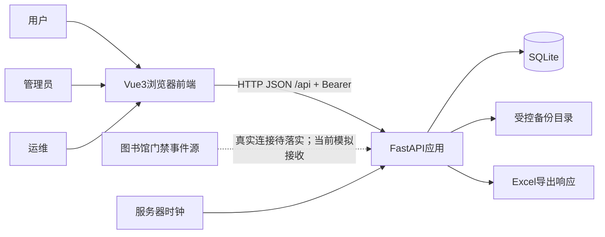
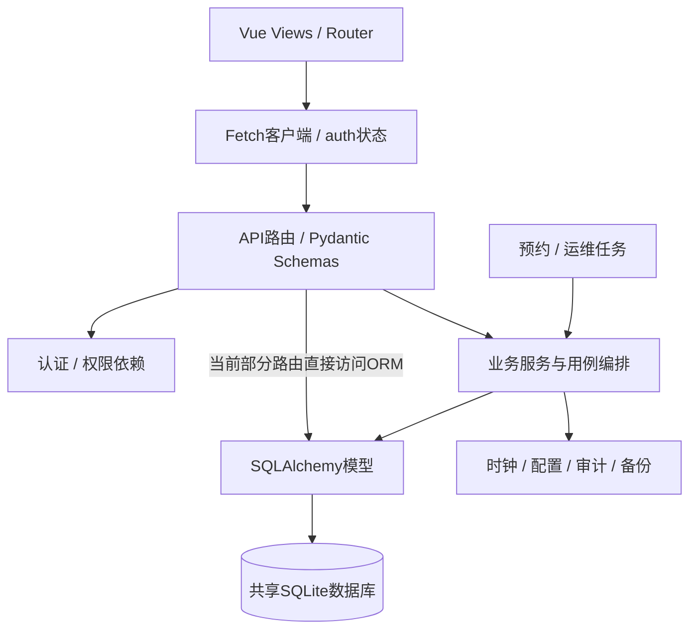
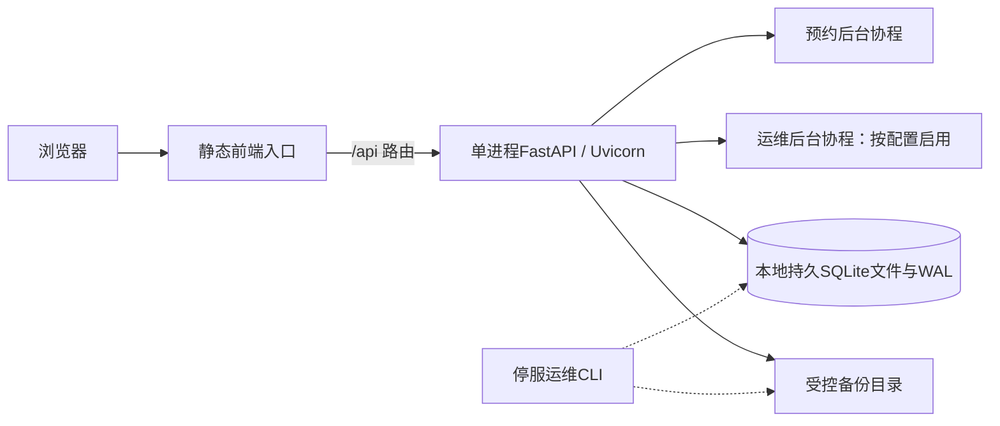
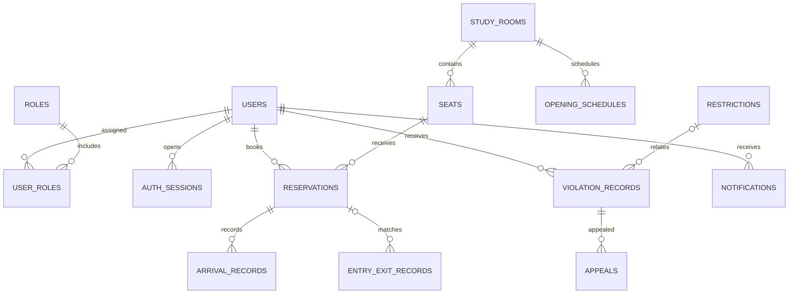
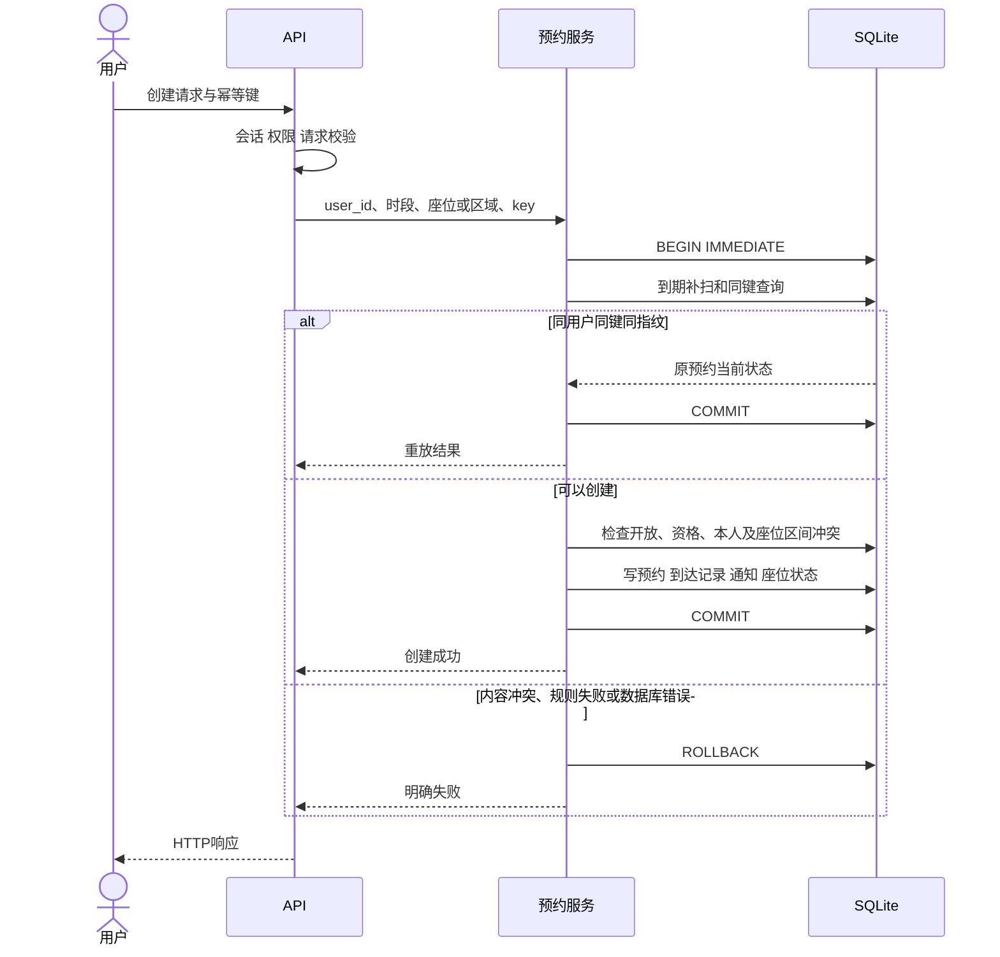

# 智能自习室管理预约系统软件架构设计方案（基线版）

| 项目 | 内容 |
|---|---|
| 基线标识 | ARCH-BL-1.0 |
| 文档版本 | v1.0 |
| 基线日期 | 2026-11-12 |
| 编制团队 | 全网呼叫奶家人 |
| 队长／基线维护人 | 周俊博 |
| 团队成员 | 周俊博、张东岩、方梓安 |
| 文档状态 | 架构设计基线，附实现差异与验证边界 |
| 编制依据 | SRS半定稿、已有架构确认与决策记录、本次反向梳理的讨论稿及源码检查 |
| 代码参照 | HEAD：671ca454a8fd4a69e0c7f619a5f540d277b930c0；另含2026-11-26本地工作区，不能仅以HEAD代表全部输入 |

## 1. 基线说明与适用边界

### 1.1 基线目的

本基线固定智能自习室管理预约系统的总体架构、模块职责、数据与事务约束、接口边界、权限、部署和质量验证要求，作为后续接口设计、测试准备、缺口处理及课程交付的共同依据。

项目已完成主要功能开发，本文件在现有系统基础上补齐设计基线。它与[架构讨论稿](软件架构设计方案_讨论稿.md)共同反映本次梳理过程，不代表开发前已经形成同名文件，也不倒写分阶段开发历史。旧基线候选文档中“未找到需求资料”等过时描述不再沿用。

基线采用已有需求与决策支持的确定方案，人员及职责采用团队本次提供的分工。文档编制由队长周俊博在本次协作中授权；既有业务决定和ADR仍以对应来源为依据，不据此虚构三名成员另行开会、逐项签字或完成交叉审查。

### 1.2 设计、实现与验证三种状态

| 状态 | 本文含义 | 表述要求 |
|---|---|---|
| 基线设计约束 | 后续实现与验证应遵循的规则 | 使用“采用”“应”“必须”；与需求发生冲突时登记变更 |
| 当前实现 | 静态源码及配置中已经发现的机制 | 使用“当前代码”“已定义”；不自动推定运行成功或验收通过 |
| 验证结果 | 有真实执行与原始记录支持的结论 | 本轮未运行系统或测试，不新增“通过”结论 |

本基线固定设计方向，同时保留第12章差异；**架构基线形成不等于需求全部满足或系统已经验收**。未落实的约束不因写入基线而成为已完成功能。

### 1.3 权威输入及版本定位

| 输入 | 作用 | 使用规则 |
|---|---|---|
| [软件需求规格说明书](软件需求规格说明书.md)，简称SRS | 业务范围、规则、用例、权限和质量指标 | 保留原文，不通过本文隐式修改需求 |
| [架构确认与决策记录](架构确认与决策记录.md) | ADR-01～ADR-10及架构约束来源 | 沿用已有编号，不删除原Q/ADR，不追加无确认依据的“已接受”决策 |
| [软件架构设计方案_讨论稿](软件架构设计方案_讨论稿.md) | 候选方案比较及DISC-01～DISC-10讨论索引 | 本文固定有依据的方案，保留未解决差异，不宣称所有DISC已关闭 |
| [教师操作指引](架构设计后确认与分阶段实现操作指引_学生版.md) | 基线、接口、测试和证据的组织要求 | 按真实过程补齐，不补造历史材料 |

## 2. 范围与确定的架构方案

### 2.1 系统边界

本期系统覆盖三类角色：用户（学生与教师合并）、管理员、运维。

- 用户：资源查询、座位状态、创建预约、换座、取消、扫码签到、临时离开、结束使用、预约历史、违规申诉和站内通知。
- 管理员：用户与权限、房间与座位、开放时间与校历、业务参数、违规与申诉、统计报表及Excel导出。
- 运维：系统与登录日志、授权范围内审计、门禁记录、备份、运行监控及服务器端恢复。

候补和自动转正已由HD-41移出本期；统一身份认证实际对接、收费及硬件采购等既有非目标不纳入架构实施范围。门禁事件接入属于本期需求，模拟实现与真实对接分别验收。

### 2.2 固定的技术与结构

| 基线项 | 确定方案 | 依据与实现边界 |
|---|---|---|
| 总体形态 | 浏览器／服务器、前后端分离，后端按业务职责组织的分层单体 | ADR-01；单一后端部署，共享数据库 |
| 前端 | Vue3、Vue Router、Vite，统一Fetch客户端 | `frontend/package.json`及`frontend/src/` |
| 后端 | Python≥3.11、FastAPI、Pydantic、Uvicorn | `backend/pyproject.toml`及应用入口 |
| 数据访问 | SQLAlchemy 2.x ORM、本地事务、Alembic迁移 | 无已实现的独立仓储层承诺 |
| 数据库 | SQLite文件库，外键、WAL与忙等待 | ADR-02；写容量需通过隔离测试核验 |
| 身份认证 | bcrypt密码哈希、随机Bearer会话令牌、摘要存库 | 服务器端会话；不描述为JWT |
| 一致性 | 本地事务、区间重叠检查、唯一约束、业务幂等；保留SRS乐观锁设计要求 | ADR-02/03/10；版本条件更新尚未落实 |
| 站内通知 | 同库保存通知、事件键去重、本人查询和已读 | ADR-05；不增加外部短信邮件依赖 |
| 门禁 | 脱敏事件适配、来源去重、延迟判断和人工核验 | ADR-06；真实轮询、设备身份与授权仍需落实 |
| 报表 | 后端查询聚合，openpyxl生成XLSX | 管理员授权；不声称已有PDF导出 |
| 后台任务 | Web生命周期内运行预约与运维协程 | 课程部署按单后端进程约束；多进程需另验 |
| 恢复 | SQLite online backup一致快照、完整性检查、停服CLI恢复 | ADR-09；不代表周期备份达到RPO=0 |

本基线不引入微服务、分布式锁、Redis或消息队列。讨论稿比较的路由主导单体和微服务不作为本期实施方案；只有明确的容量、发布或可靠性证据触发时再评估架构变更。

## 3. 架构视图与依赖规则

### 3.1 系统上下文

门禁源与本系统之间传输脱敏事件，不引入人脸图像、特征模板或原始卡号。通知通过数据库与浏览器列表完成站内呈现。服务器时钟是时间裁决来源；浏览器时间不参与资格、处罚或超时决定。

### 3.2 组件与分层

API、Schemas、Services、Models和基础设施是当前主要分层。部分管理路由和门禁服务直接操作共享实体，本基线明确其用例责任与事务约束，不将其描述为已实现严格领域隔离。

后续改动必须遵守以下依赖规则：

1. HTTP层负责输入、认证授权、状态码及响应转换；业务规则在相关服务或明确的用例编排入口集中维护。
2. 跨模块状态变化由一个用例事务协调；被调用的通知、审计等辅助函数不得擅自提前提交核心事务。
3. 预约状态与占用规则归预约履约模块；门禁和管理流程不得形成与之冲突的第二套状态规则。
4. 纪律累计、折算和限制计算归纪律服务；调用方不能各自计算处罚。
5. 报表只读聚合；通知只记录和呈现结果，不能反向决定预约事实。
6. 统一从服务端时钟取值；数据库结构演进通过迁移，不绕过迁移手改生产表结构。
7. 现有直接ORM访问与目标职责边界不一致时按任务评估，不为满足文档图示发起整体重构。

### 3.3 部署视图

此图规定课程部署的逻辑边界，不代表实际服务器已经部署静态入口、代理或HTTPS。本地联调用Vite 5173代理到后端8000；正式部署应明确静态资源与`/api`的同源路由和访问来源。当前CORS配置允许本地5173，实际部署需核对访问路径。

数据库和备份应置于持久、受控目录，禁止暴露为静态下载路径。后端使用单进程是本基线的部署约束；扩为多进程或多主机前，必须重新验证后台任务去重、指标汇总和数据库文件访问方式。

## 4. 模块划分、数据职责与人员分工

### 4.1 模块契约

下表代码路径除另行说明外，均相对项目根目录。

| 模块 | 职责／主要数据 | 实现入口 | 对外边界 |
|---|---|---|---|
| 身份与权限 | 用户、角色权限、登录、会话、改密与重置；User/Role/Permission/AuthSession | `backend/app/api/auth.py`、`api/admin_users.py`、`services/auth.py`、`deps.py`、`permissions.py` | 提供可信身份和权限，行级归属仍由业务查询验证 |
| 资源与配置 | 房间、座位、开放时段、校历、业务参数；StudyRoom/Seat/OpeningSchedule/CalendarDay/SystemSetting | `backend/app/services/availability.py`、`api/admin_config.py`、`api/admin_seats.py`、`services/settings.py` | 查询给出指定时段状态；管理变更必须处理预约影响 |
| 预约与履约 | 创建、换座、取消、扫码、暂离、结束、超时；Reservation/ArrivalRecord | `backend/app/services/reservations.py`、`api/reservations.py`、`services/reservation_worker.py` | 维护占用不变量与合法状态转换 |
| 门禁接入 | 脱敏用户匹配、事件去重、延迟识别与人工核验；EntryExitRecord | `backend/app/services/gate.py`、`api/gate.py` | 按需求范围提供入出馆证据，不自行扩展签到方式 |
| 纪律与申诉 | 违规、周期归档、阶梯限制、审核；ViolationRecord/Restriction/Appeal | `backend/app/services/violations.py`、`api/admin_violations.py` | 原始事实保留，限制变更可追溯 |
| 通知与历史 | 预约/签到/违规/维护/暂离通知、历史和已读；Notification | `backend/app/services/notifications.py`、`api/reservations.py` | 本人范围，业务事件去重 |
| 管理与统计 | 资源维护、CSV导入、申诉管理、利用率与趋势、XLSX | `backend/app/api/admin_seats.py`、`api/reports.py`、`services/admin_force_cancel.py` | 授权操作；统计不直接修改业务事实 |
| 运维与审计 | 日志、健康、请求指标、备份恢复；AuditLog/LoginLog/备份文件 | `backend/app/api/ops_logs.py`、`api/ops_system.py`、`services/backup.py`、`metrics.py`、`cli.py` | 运维授权、停服恢复、保留操作记录 |
| 基础设施 | 配置、时区、会话、事务和迁移 | `backend/app/db.py`、`config.py`、`timeutil.py`、`models/`、`backend/migrations/` | 提供技术能力，业务参数含义由需求定义 |

同一行缩写为`api/…`、`services/…`的路径均以`backend/app/`为前缀。逻辑职责不等同数据库物理隔离；当前所有模块共享同一库。

### 4.2 团队责任

| 成员 | 负责范围 | 架构与验证责任 |
|---|---|---|
| 周俊博（队长） | 需求统筹；房间和座位搜索、详情与实时状态；创建、冲突、并发幂等、换座、取消、扫码及未签释放 | 维护基线和需求追溯；预约状态与并发不变量；整合差异处理 |
| 张东岩 | 脚手架和CI、模型与数据字典、注册登录密码、角色权限、日志备份监控、房间开放时间和参数配置；较多测试整合 | 数据约束、运行环境、权限安全、备份恢复及测试证据组织 |
| 方梓安 | 结束与暂离、门禁、违规处罚申诉、通知、个人历史、座位布局导入维护、统计Excel | 履约与门禁联动、纪律周期、维护一致性和报表口径 |

交叉复核安排：张东岩复核预约事务与数据库约束；周俊博复核履约、门禁及违规的需求一致性；方梓安复核管理配置和运维事件对预约、通知的影响。该安排不代表相应审查已经完成。

## 5. 数据架构与不变量

### 5.1 数据分组

| 数据域 | 主要对象 | 关键关系和保存原则 |
|---|---|---|
| 身份 | User、Role、Permission、AuthSession、PasswordResetToken | 用户与角色多对多；密码哈希、令牌摘要；不输出秘密字段 |
| 资源 | StudyRoom、Seat、OpeningSchedule、CalendarDay | 房间含座位及开放规则；区域为座位属性，无独立区域服务 |
| 预约 | Reservation、ArrivalRecord | 预约关联用户和座位；到达与结束事实独立保存 |
| 纪律 | ViolationRecord、Restriction、Appeal | 违规关联预约、限制及申诉；归档不删除 |
| 门禁 | EntryExitRecord | 事件来源唯一键；发生与接收时间分开保存；可关联预约 |
| 通知 | Notification | 用户范围、类型、内容、事件键及已读 |
| 运维配置 | AuditLog、LoginLog、SystemSetting | 业务与认证留痕；参数修改可追溯 |

### 5.2 核心关系图

该图是核心关系摘要，不替代完整物理数据字典。到达记录业务上通常每预约一条，但当前外键没有唯一约束，物理关系按一对多表达；不能将业务预期写成数据库已经保证一对一。

### 5.3 必须保持的不变量

1. 同座位重叠时段至多一条有效预约，同用户重叠时段至多占用一个座位。
2. 有效占用状态为`RESERVED`、`ACTIVE`、`TEMP_LEAVE`；其他终态不继续占用对应预约区间。
3. 预约使用半开区间`[start,end)`，开始早于结束；相邻区间可衔接，交叉区间必须拒绝。
4. 冲突判断采用`existing.start < new.end AND existing.end > new.start`，并限定有效状态。
5. 当前`seat_id + start_time`部分唯一索引只兜底同起点冲突，不能代替完整区间检查。
6. 幂等键相同但用户或请求指纹不同必须拒绝，不返回其他用户预约；相同意图重试不得新增重复预约或通知。
7. 预约号唯一，房间内座位编号唯一；用户、角色、资源关联与枚举范围受模型约束。
8. `Seat.status`不独自决定未来可用性，必须结合查询时段、预约、房间和开放规则；暂离以预约状态表达，座位显示映射为使用中。
9. 维护、关闭和停用优先于释放后的普通可用展示，不能释放预约时把维护座位误改为空闲。
10. 限制、违规和审计保留历史；单项申诉通过不能无依据解除其他有效限制。

### 5.4 时间、隐私与数据保留

业务统一使用带时区的Asia/Shanghai时间。当前`LocalDateTime`在写库前转换为北京时间无时区值，读出再附时区；输入拒绝无时区datetime。不能把SQLite描述为原生持久化带时区时间。

门禁保存HMAC脱敏用户键及必要元数据，不保存人脸特征、原始卡号；真实接入的授权及保留依据按SRS HD-30核对。当前门禁记录到期时间沿用日志保留配置、默认180天，该默认值不能代替学校规定或完整清理验证。违规周期默认14天，到期归档不删除；日志默认180天；备份默认保留14份。

## 6. 关键事务、并发与幂等

### 6.1 事务策略

核心预约写入使用独立业务Session，在事务开始时执行`BEGIN IMMEDIATE`，取得SQLite写锁后检查再写入。认证依赖的读会话与该事务区分，避免升级已有读事务产生竞态或误提交。

SQLite启用外键、WAL和默认5000毫秒忙等待。WAL改善读写并行，不改变主要写入串行化的事实。锁忙、冲突和参数失败应返回可解释结果；客户端不得遇到任意错误便无键重试。

SRS BR-051指定版本号/时间戳乐观锁，该设计要求保留。后续落实时必须明确受保护实体、版本来源、条件更新、递增与冲突响应；**单条预约的版本号不能独自防止两个新建预约互相重叠**，仍需区间检查和事务兜底。当前尚无独立版本条件更新，不标为已满足BR-051。

### 6.2 用例事务范围

| 用例 | 同一用例事务中的事实 | 原子性与失败要求 |
|---|---|---|
| 创建 | 用户资格、到期补扫、冲突检查、预约、到达记录、确认通知、座位同步 | 任一核心写失败整体回滚，不残留半成品 |
| 换座 | 本人状态、新座位检查、预约关联、原新座位同步 | 失败保留原座位与原预约时间 |
| 取消 | 取消状态、释放、取消通知、适用迟取消违规 | 正常取消不记违规；已取消不再触发未到场 |
| 签到 | 身份/座位/窗口检查、到达事实、ACTIVE状态与显示同步 | 超窗失效若已形成，应先提交事实再返回错误 |
| 暂离／门禁／超时 | 事件、预约状态、到达结束事实、适用违规、通知与释放 | 重复或迟到事件不得复活终态或重复处罚 |
| 资源维护 | 资源状态、未来受影响预约强制取消、通知与审计 | 已签到者不立即中断，取消不加用户违规 |
| 申诉审核 | 处理结果、违规状态、关联限制、通知和审计 | 不能仅返回审核成功而遗漏关联变化 |

表中明确用例涉及的事实与当前同库事务组织。通知失败需要单独区分：SRS UC-009异常流程要求取消仍生效、通知进入重试；当前通知直接flush，与取消同事务，写失败可能回滚取消，不能把当前原子写法认定满足该异常要求。基线保留“业务取消成功、通知可持久补偿”的需求约束，具体待补通知机制另行设计，当前没有已实现的Outbox或重试队列。各入口是否完整实现、审计是否覆盖全部路径，需要对应测试与审查。在线备份文件与数据库审计不属于同一原子事务。

### 6.3 创建与幂等时序

当前请求头`Idempotency-Key`优先，正文`request_key`其次；正文键与用户ID组合后计算摘要。头部同键重放为200，正文同键重放保留201兼容行为，响应设置`Idempotent-Replayed`。指纹包含用户、座位或区域选择和起止时间；重放返回同一预约当前值。

基线要求客户端对同一创建意图及其网络重试保持稳定键，新意图换键。当前后端允许两种键均不传，不宣称所有创建已强制去重；这一差距保留在实现检查中。错误码统一设计须保留当前兼容行为，改变响应语义时先同步调用方。

## 7. 状态机与跨模块业务规则

### 7.1 预约状态定义

| 状态 | 含义 | 是否有效占用 |
|---|---|---|
| `RESERVED` | 已预约、尚未签到 | 是 |
| `ACTIVE` | 已签到 | 是 |
| `TEMP_LEAVE` | 已声明暂离、等待有效返回或超时 | 是 |
| `COMPLETED` | 已结束使用 | 否 |
| `CANCELLED` | 用户取消或连续使用释放的未开始段 | 否 |
| `ADMIN_CANCELLED` | 管理员强制取消 | 否 |
| `EXPIRED` | 超窗未签到失效 | 否 |
| `TIMED_OUT` | 未签退、暂离超时或未声明离馆导致超时结束 | 否 |

采用已有ADR-04与代码枚举的八状态表示。座位六状态为可用、已预约、使用中、维护中、关闭、停用；SRS历史状态命名和数量残留不通过本文删除，映射差异在第12章保留。

### 7.2 关键转换与裁决

| 原状态 | 命令／事件 | 设计约束与结果 |
|---|---|---|
| 无 | 创建 | 通过开放、时间、资格、本人及座位冲突检查后为RESERVED |
| RESERVED | 换座 | 仅变更座位，不改日期时段，重新校验并保留预约身份 |
| RESERVED | 开始前取消 | >15分钟不违规；≤15分钟记迟取消；均转CANCELLED；开始时刻边界差异见第12章 |
| RESERVED | 扫码／编号回退签到 | 本人、座位匹配、窗口内且无他人使用，转ACTIVE |
| RESERVED | 超窗仍未签到 | EXPIRED，释放并记录未到场 |
| 未来RESERVED | 维护 | ADMIN_CANCELLED，维修通知，无补偿与用户违规 |
| ACTIVE | 临时离开 | TEMP_LEAVE，记录声明时间，默认保留30分钟且不超过预约结束 |
| TEMP_LEAVE | 有效重新入馆记录 | 依据事件时间判定返回，转ACTIVE |
| TEMP_LEAVE | 超时或时段结束 | TIMED_OUT，按相应规则释放、通知和记违规 |
| ACTIVE | 未声明而出馆 | TIMED_OUT，释放并记未声明离馆违规 |
| ACTIVE／TEMP_LEAVE | 确认结束 | 已开始段COMPLETED，连续未开始段按用例释放 |
| 终态 | 迟到／重复事件 | 不恢复有效占用；按契约返回当前结果或冲突 |

签到窗口默认开始前15分钟至开始后15分钟，两端包含，但已经结束的预约不继续允许签到。开始前可提前签到不代表允许占据上一名仍在使用的座位。窗口内早到、晚到的到达分类不直接构成处罚。

### 7.3 扫码、门禁与返回证据

按SRS HD-43，签到以扫码为规定方式，损坏时允许输入座位编号作为回退；回退仍须验证本人、座位与时间。门禁按HD-15用于暂离返回及出馆证据，不在本基线新增“门禁可代替扫码”的业务许可。

当前代码允许空正文签到、入馆事件直接使未签到预约ACTIVE，并提供不依赖入馆记录的主动返回接口。这些行为如实列为实现差异；本文不通过描述代码而批准其替代需求。若拟作为门禁故障下的降级措施，需明确触发、留痕与权限依据，另记录实际决定。

### 7.4 门禁处理与异常降级

门禁事件由来源系统及事件号去重，分别记录发生时间与接收时间，按脱敏键匹配用户与预约。超过300秒的延迟事件不自动改变预约；无法匹配身份、时间或状态时保存事件并提示人工核验。重复事件不得重复处罚或通知。

目标接入按SRS HD-52采用30秒HTTP轮询，最大可接受同步延迟按NFR-013为5分钟。当前只确认模拟事件接收与迟到分支，未实现或未核验真实轮询、外部连续失败检测和完整不可用降级；不得因已有“late”分支而宣称门禁可用性已满足。

真实接入必须明确机器身份、密钥配置、事件编号与时间口径、授权保留、重试及恢复后的事件顺序。禁止直接把人工运维账号令牌作为已批准的设备认证方案。

### 7.5 违规、限制与申诉

处罚采用固定14天周期，起点按首次违规记录；周期内警告不扣减，达到3、5、7、9次分别禁约1、2、3、4天，继续按第k档阈值`3+2(k−1)`、禁约k天推进。未签退按默认每2次折算一次警告；原始事件和折算标记均保留。到期归档而不删除原始违规。

迟取消、暂离超时等代码事件细分保留来源，不改写为新的分级处罚体系。禁约影响创建和换座，不阻止用户取消已有预约；取消成功后不再对同一预约追加未到场处罚。

用户提交具体违规申诉，服务器核验归属、期限和重复待处理状态。当前管理员处理结果为批准或驳回；批准时归档对应违规、解除关联有效限制、通知并写审计。SRS若要求其他处理能力，需另行核对，不能把现有二选一响应直接认定覆盖全部处理语义。多限制并存时仍检查所有有效限制。

### 7.6 管理维护与结束连续使用

维护只处理受影响的未来未签到预约，强制取消、通知、无补偿、不计用户违规；已签到者不立即中断。房间关闭、时段缩短和座位维护应具有一致规则，但当前房间/时段使用`admin_force_cancel`、座位维护有独立实现，需分别验证。

结束使用要求显式确认。当前沿同用户、同座位、相邻起止时刻查连续预约链：已开始的段完成，尚未开始的后续段取消释放；不同座位或有时间空隙不合并。使用时长、释放通知与违规互斥需实际检查，不能以有确认按钮代替全链路验收。

## 8. 接口、前端与安全设计

### 8.1 接口契约原则

统一使用`/api`前缀，时间以带时区格式传输，认证使用Bearer会话。关键写接口应明确状态、对象归属、请求键、失败是否改变数据以及重复请求结果。GET与POST等方法不能代替业务契约，同路径不同方法分别授权。

代表接口如下，精确字段和异常示例由后续接口文档细化：

| 接口组 | 已核查路径示例 | 核心契约 |
|---|---|---|
| 身份 | `POST /api/auth/login`、`POST /api/auth/logout`、`GET /api/auth/me` | 令牌签发/撤销、账号状态与失败日志 |
| 查询 | `GET /api/rooms`、`GET /api/seats`、`GET /api/seats/{seat_id}` | 时段、开放、资源状态及脱敏 |
| 预约 | `POST /api/reservations`、`PATCH /api/reservations/{rid}/seat` | 资格、排他、幂等及仅改座位 |
| 履约 | `POST /api/reservations/{id}/check-in`、`…/temporary-leave`、`…/return`、`…/end`、`…/cancel` | 动作分别校验状态与时间；当前偏差见第12章 |
| 用户数据 | `GET /api/reservations`、`POST /api/appeals`、`GET /api/notifications` | 本人范围及状态过滤 |
| 管理 | `/api/admin/rooms`、`/api/admin/settings`、`/api/admin/appeals` | 按方法分别校验权限、事务、通知与审计 |
| 报表 | `GET /api/admin/reports`、`GET /api/admin/reports/export.xlsx` | 统计与导出权限、时间口径 |
| 门禁 | `POST /api/ops/entry-exit/mock`、`GET /api/ops/entry-exit/records` | 模拟边界、来源去重、隐私 |
| 运维 | `GET/POST /api/ops/backups`、`GET /api/ops/status`、`GET /api/health` | 备份与状态授权；恢复为停服CLI |

`{id}`及省略前缀只用于展示动作，实际参数名以路由为准。当前错误`detail`可能为字符串、对象或校验列表，前端兼容三种；不虚构统一业务错误码、请求追踪字段或全部接口自动重试能力。部分查询列表尚无统一分页，后续容量扩展需明确分页、排序和上限。

### 8.2 权限与敏感数据

| 能力 | 用户 | 管理员 | 运维 |
|---|---|---|---|
| 房间座位公开信息 | 可 | 可 | 可 |
| 本人预约履约 | 可 | 按reservation:own可 | 单独运维角色不可 |
| 资源与参数管理 | 不可 | 按对应权限可 | 不可 |
| 违规／申诉管理、统计与导出 | 不可 | 按对应权限可 | 不可 |
| 审计日志 | 不可 | 可 | 可 |
| 登录／系统状态与日志 | 不可 | 单独管理员角色无该权限 | 可 |
| 门禁记录与备份 | 不可 | 单独管理员角色不可 | 可 |

角色允许组合，权限按角色集合计算；表格针对单独角色。后端`permissions.py`与认证依赖实施模块权限，业务查询还必须过滤本人对象。前端菜单、按钮和路由守卫不能作为后端授权替代。

密码使用bcrypt，令牌保存摘要，改密/重置应撤销已有会话。公开接口不输出密码、令牌摘要和门禁原始身份。敏感查询、导出及运维读取需满足审计要求，当前是否完整覆盖仍待对账。

### 8.3 前端边界

`frontend/src/views/`按功能组织，Vue Router控制导航，`api/client.js`统一Fetch与错误提示，`auth.js`管理认证状态。当前令牌位于`localStorage`，不描述为HttpOnly Cookie；部署应采用可信同源入口并控制脚本注入风险。

扫码页面需要摄像头能力，缺少浏览器支持时使用可见座位编号回退；回退不降低服务器身份与座位验证。实时状态指服务端计算后的查询结果，不声称已部署WebSocket或推送。移动端布局和核心路径步数必须实际走查。

## 9. 配置、运维、恢复与可观测性

### 9.1 关键配置基线

| 配置项 | 代码默认值／现状 | 运维约束 |
|---|---|---|
| 环境变量前缀 | `STUDYROOM_` | 配置覆盖及运行环境需登记 |
| 数据库 | `sqlite:///./data/study_room.db` | 相对后端启动工作目录；确认实际绝对路径 |
| 业务时区 | `Asia/Shanghai` | 同时核验主机时间源，时区不证明已校时 |
| SQLite忙等待 | 5000毫秒 | 不视为性能目标或无限重试 |
| 预约扫尾 | 60秒；0关闭 | 请求只补做部分检查，不能代替全部后台任务 |
| 备份／日志清理间隔 | 均默认0，关闭 | 启用前登记周期、目录、权限与故障处理 |
| 日志保留 | 默认180天 | 对照需求与学校规则，不混同违规统计周期 |
| 备份目录／份数 | `./data/backups`／14份 | 保留目录权限，防止恢复目标被轮换删除 |
| 门禁密钥 | 开发配置存在默认值 | 非dev/test环境必须独立配置，否则拒绝启动 |

业务参数由`SystemSetting`覆盖默认值，按允许字段更新并记审计。代码存在本期固定上限，关键参数100%可配置仍需清单核验；参数变更对已有预约的生效时间与历史规则不应由各调用方自行猜测。

### 9.2 后台任务与故障处理

FastAPI lifespan启动预约后台任务，配置启用时再启动备份和日志清理任务。预约任务异常记录后继续下一轮，启动可补扫；状态条件、事件键和写事务用于重复处理控制。单进程重启、长时间停机、补扫与用户命令竞争均应验证。

后台60秒扫描不保证每个截止时刻立即落库，不能把定时器间隔等同无延迟业务承诺。多进程会各自启动任务、持有指标；扩容前需实际验证重复任务与锁等待。

### 9.3 恢复流程

恢复由张东岩负责，周俊博核对预约一致性，方梓安核对违规、限制、通知与门禁关联：

1. 登记应用版本、迁移版本、备份名称与恢复目的，保全选定备份，避免轮换删除。
2. 停止HTTP入口和预约、备份、清理后台任务；CLI的覆盖确认并不能自动保证服务已停。
3. 对当前库留存备份；检查目标备份完整性及版本兼容。
4. 使用现有CLI恢复能力。当前`restore`要求显式覆盖参数，并在恢复前创建一份当前备份。
5. 核对用户权限、资源、预约/到达关联、重叠占用、限制、通知键及审计连续性。
6. 重新启动、执行到期补扫，检查健康、登录、查询和测试业务；保留恢复前后对账与结果。

创建在线备份得到一致快照；恢复前执行完整性校验。当前CLI恢复未自动形成完整业务审计记录，应保留独立运维记录，不能声称所有恢复动作已自动审计。

### 9.4 指标与故障模型

当前进程内指标只有请求量、状态码分类、平均和最大耗时，重启清零，无P95直方图或长期持久化。P95须独立采样，月度可用率须持续监控。

WAL及事务机制主要支撑数据库事务一致性，不能直接保证主机介质损坏后零丢失。RPO=0保留为需求目标，按进程崩溃、主机故障、介质丢失分别说明故障边界和恢复证据；周期快照不足以单独达标。

## 10. 质量属性与验证基线

### 10.1 验收目标及证据

| SRS项 | 固定目标 | 必需证据 | 当前结论 |
|---|---|---|---|
| NFR-001 | 月度可用性≥99.5% | 连续监控、故障起止及月度统计 | 本轮未验证 |
| NFR-002 | P95≤2秒 | 固定请求分布、独立负载记录、原始响应样本 | 本轮未压测；平均值不能替代 |
| NFR-003 | ≥200并发 | 先定义在线用户和请求/写入并发，逐步加压并记录错误率 | 本轮未验证 |
| NFR-004 | 超售0 | 真实多连接竞争、数据库终态与失败后重试对账 | 未以源码代替结果 |
| NFR-005 | bcrypt等自适应哈希 | 源码核查及脱敏数据库抽样 | 代码使用bcrypt，运行库未抽样 |
| NFR-006 | 时间偏差≤1秒 | 可信基准、校时状态、边界测试 | 统一时区已见代码，偏差未测 |
| NFR-007/008 | 关键参数100%可配置、关键操作100%留痕 | 参数与业务/审计动作清单、变更回归、逐项对账 | 覆盖未证明 |
| NFR-009/010 | 核心路径≤3步、主流移动浏览器可用 | 明确步数定义、真实设备与浏览器矩阵 | 本轮未走查 |
| NFR-011/014 | 敏感越权0、用途及访问审计满足需求 | 三角色、双用户、字段/对象级检查与授权材料 | 权限代码存在，完整目标未验证 |
| NFR-012 | RPO=0 | 隔离故障模型、故障前确认事务与恢复后逐笔对账 | 周期快照存在能力差距 |
| NFR-013 | 门禁延迟≤5分钟及需求规定的降级 | 真实轮询、超时/迟到注入、恢复处理记录 | 当前为模拟接收，未真实联调 |

数值沿用SRS，不在测试后选择有利口径，不以课程演示替代长期监控或生产容量结论。

### 10.2 关键不变量测试清单

| 场景 | 验证预期 |
|---|---|
| 多人抢同座同区间、不同起点但交叉区间 | 使用同一文件型SQLite、多个独立连接；最终有效预约最多一条；检查冲突及锁忙可重试结果 |
| 同用户不同座位同时预约 | 同时段不得形成两条有效占用，不能只验证座位唯一索引 |
| 同键同载荷、不同载荷、跨用户复用 | 重放同一预约；不同意图明确冲突，不泄露他人结果 |
| 写入中途异常 | 预约、到达、通知与座位状态无部分提交 |
| 取消15分钟两侧及开始时刻 | 与需求口径分别对账；取消与未到场处罚互斥 |
| 签到窗口两端及外侧、扫码错座、空正文 | 窗口和归属正确；空正文现有差异单列，不能按实现反推验收预期 |
| 门禁重复、迟到、乱序和直接返回 | 不重复处罚、不复活终态；证据不足路径列明差异 |
| 暂离截止、时段结束、后台重启竞争 | 最终单一合法状态，释放、通知及违规一致 |
| 维护三类入口并发创建 | 无维护后新占用；未来受影响预约取消，已签到不中断 |
| 阶梯、14天边界、未签退折算和单项申诉 | 周期与限制正确，其他有效限制保持 |
| 角色与双用户替换ID | 未授权管理和他人数据访问被拒绝；门禁明细管理员不可读 |
| 备份恢复及运行回归 | 完整性检查后逐笔对账，不以存在备份文件作为恢复通过 |

已有测试文件作为测试准备资产复用；`backend/tests/units/`包含未提交文件，目录名不能替代测试层级判定。并发不变量必须用真实数据库多连接验证，Mock或顺序调用不足以支撑并发结论。

### 10.3 CI与证据管理

当前CI配置包含后端ruff检查、格式检查和pytest；前端Vitest、lint、格式检查和构建。这里只确认配置存在，本轮未执行这些命令，也未查验最新远端流水线状态。

每次实际验证保留代码版本及工作区差异、环境、命令、合成数据、预期来源、原始输出、终态及交叉复核。证据使用现有`docs/evidence/`组织，具体路径随实际执行登记；本文不预写不存在的结果文件，也不更改已有任务或证据目录。

## 11. ADR、需求与已有任务追溯

### 11.1 决策纳入范围

| 已有ADR | 基线采用内容 | 附带约束 |
|---|---|---|
| ADR-01 | FastAPI＋Vue3＋SQLite分层模块化单体 | 保留现有分层程度，不虚构独立服务或仓储 |
| ADR-02 | 外键、WAL、busy_timeout及立即写事务 | 并发正确性与容量须分别验证 |
| ADR-03 | 半开区间、事务内重查、唯一约束及幂等 | 索引不是区间排他约束，无键请求能力差距保留 |
| ADR-04 | 八状态预约模型 | 需求历史命名与实现映射另列 |
| ADR-05 | 站内通知与事件键去重 | 入库不代表用户已阅读 |
| ADR-06 | HMAC脱敏与迟到/无法匹配人工核验 | 不证明真实轮询、授权与设备接入 |
| ADR-07 | 固定14天、无上限阶梯、归档不删除 | 首次事件、折算与周期边界需测试 |
| ADR-08 | 维护只取消未来预约、无补偿、不打断已签到 | 三类入口分别核查 |
| ADR-09 | 在线备份、完整性检查与停机恢复 | RPO=0缺口保留 |
| ADR-10 | 版本字段与条件更新作为演进约束 | 不替代或废止SRS BR-051 |

本表引用原记录，不另造签署或替代关系；ADR描述与SRS存在冲突时按第12章登记，不能只因编号为ADR便覆盖需求。

### 11.2 业务与任务对应

| 业务／需求范围 | 主要实现位置（`backend/app/`下） | 既有Issue |
|---|---|---|
| 基础栈、模型与迁移 | `main.py`、`db.py`、`models/`；迁移位于`backend/migrations/` | [#4](https://github.com/dorian0326/study-room/issues/4)、[#5](https://github.com/dorian0326/study-room/issues/5) |
| FR-001～007身份权限 | `api/auth.py`、`services/auth.py`、`permissions.py` | [#6](https://github.com/dorian0326/study-room/issues/6)、[#7](https://github.com/dorian0326/study-room/issues/7) |
| 日志、备份与监控 | `api/ops_logs.py`、`api/ops_system.py`、`services/backup.py` | [#8](https://github.com/dorian0326/study-room/issues/8)、[#9](https://github.com/dorian0326/study-room/issues/9) |
| FR-010～013查询与状态 | `services/availability.py`、`api/reservations.py` | [#10](https://github.com/dorian0326/study-room/issues/10)、[#11](https://github.com/dorian0326/study-room/issues/11) |
| FR-020～024、BR-050～052 | `services/reservations.py`、`schemas/reservations.py` | [#12](https://github.com/dorian0326/study-room/issues/12)、[#13](https://github.com/dorian0326/study-room/issues/13)、[#14](https://github.com/dorian0326/study-room/issues/14)、[#15](https://github.com/dorian0326/study-room/issues/15) |
| 签到、结束与暂离 | `services/reservations.py`、`services/reservation_worker.py` | [#16](https://github.com/dorian0326/study-room/issues/16)、[#17](https://github.com/dorian0326/study-room/issues/17) |
| 门禁、违规与申诉 | `services/gate.py`、`services/violations.py`、`api/admin_violations.py` | [#18](https://github.com/dorian0326/study-room/issues/18)、[#19](https://github.com/dorian0326/study-room/issues/19) |
| 通知与历史 | `services/notifications.py`、`api/reservations.py` | [#20](https://github.com/dorian0326/study-room/issues/20)、[#21](https://github.com/dorian0326/study-room/issues/21) |
| 资源配置与报表 | `api/admin_config.py`、`api/admin_seats.py`、`api/reports.py` | [#22](https://github.com/dorian0326/study-room/issues/22)、[#23](https://github.com/dorian0326/study-room/issues/23)、[#24](https://github.com/dorian0326/study-room/issues/24) |
| 补缺与限制 | 相关服务、前端及质量检查 | [#36](https://github.com/dorian0326/study-room/issues/36)、[#37](https://github.com/dorian0326/study-room/issues/37)、[#38](https://github.com/dorian0326/study-room/issues/38) |

任务状态沿用讨论稿整理时的GitHub查询，不在本轮声称重新查询。历史Issue的需求编号与描述可能过时，关联以业务主题核对。尤其#38的门禁“缺少五分钟延迟判定”不再等同当前源码现状，当前已见该分支；历史关闭状态不作为当前正确性证据。本次不重复建立任务卡。

## 12. 基线保留的实现差异与未决边界

沿用讨论稿DISC编号，作为差异索引；不新增或改号原Q/ADR。

| 对应事项 | 当前差异／证据边界 | 本基线处置与关闭条件 | 责任人 |
|---|---|---|---|
| DISC-01 乐观锁 | BR-051要求版本检查，当前模型无独立版本条件更新 | 保留需求；形成明确版本对象与并发方案并验证，或有正式需求变更依据后再更新基线 | 周俊博、张东岩 |
| DISC-02 门禁采集 | HD-52规定30秒轮询，当前为mock接收；真实接口与完整不可用监测未核实 | 保留真实接入目标；模拟结果注明范围，真实采集、延迟与恢复另验 | 方梓安、张东岩 |
| DISC-03 暂离返回 | 主动return无需重新入馆记录 | 规范仍以有效入馆证据判返；实现修正或有明确降级决定与留痕依据后关闭 | 方梓安、周俊博 |
| DISC-04 签到方式 | 空正文签到及门禁入馆直接ACTIVE与HD-43口径不同 | 规范按扫码/编号回退；额外方式不默认批准，需对齐契约并验证 | 周俊博、方梓安 |
| DISC-05 RPO | 周期快照不能支撑任意故障RPO=0 | 保留目标，明确故障模型与保障方案；故障前后逐笔对账，不以备份列表关闭 | 张东岩 |
| DISC-06 取消语义 | SRS主流程允许临近开始取消并记违规，验收标准有拒绝旧文；代码开始时刻及之后拒绝 | 保留两处来源；后续按HD-20/25和明确边界整理勘误，本次不改SRS | 周俊博 |
| DISC-07 状态映射 | 历史状态命名/数量残留；代码8预约、6座位，暂离在预约层 | 基线采用清晰映射表达，保留来源差异；逐项对齐状态表、接口与页面后关闭 | 周俊博、方梓安 |
| DISC-08 参数与审计 | 参数可配置、审计存在，但100%覆盖及门禁读取/导出/恢复留痕未证明 | 逐动作、参数、数据范围对账；不能只凭日志表存在关闭 | 张东岩、方梓安 |
| DISC-09 后台与部署 | 默认60秒、备份清理关闭、多进程重复任务未测 | 固定单进程部署约束；验证停机补扫、实际启用周期与恢复竞争 | 张东岩、周俊博 |
| DISC-10 质量证据 | 容量、P95、月度可用率及可信校时本轮未测 | 固定指标与口径，实际采样/压测/监控后附证据 | 张东岩牵头，全组协同 |

此外，无幂等键请求、到达记录缺少一对一数据库约束、接口错误结构及列表分页现状，在本基线相关章节明确，不因未另设DISC编号而视为完成。申诉处理能力与SRS更完整的处理表述仍需核对，不将代码返回类型直接当作最终需求。

差异分三类管理：已知需求与实现不同、需求内部存在歧义、缺少验证证据。前两类先处理依据与契约，第三类补实际检查，不能只运行现有测试便宣布所有问题关闭。

### 12.1 原确认记录中其他整改约束

[架构确认与决策记录](架构确认与决策记录.md) §16.1已有GAP-A01～GAP-A14，本基线沿用其编号和约束，不另行宣布关闭。其中GAP-A01～04、A12～14已分别关联乐观锁、额度语义、签到返回、恢复、到达关系与维护边界；其余高风险事项补充如下。

| 原编号 | 源码核查与已有记录 | 基线约束与验证出口 | 责任人 |
|---|---|---|---|
| GAP-A05 | 请求补扫以严格超过签到截止判失效；full_sweep使用小于等于截止阈值，整秒边界不同 | 设计按签到窗口两端包含；截止整秒并发执行签到、请求补扫和后台扫尾，最终不因入口不同误拒 | 周俊博、方梓安 |
| GAP-A06 | 预约内`_record_violation`与纪律`record_violation`并存；前者记事实及审计，未完整触发阶梯限制和违规通知 | 不得宣称迟取消与所有未签到入口均已统一处罚；构造第3次迟取消及两条失效路径对账限制和通知 | 周俊博、方梓安 |
| GAP-A07 | 通知同事务直接flush，无持久待补或重试队列；SRS UC-009要求通知失败不阻塞取消 | 保留取消生效及通知补偿要求，不能把现有同事务回滚视为符合；注入通知失败并检查取消及补发去重 | 方梓安 |
| GAP-A08 | 设置表保存当前值，无PolicyVersion或预约规则快照 | 不承诺旧预约自动沿用历史参数；参数变更受控，规则快照方案与变更前后行为需验证 | 张东岩、周俊博 |
| GAP-A09／A10 | 门禁保存expires_at，但日志清理仅删除AuditLog/LoginLog；门禁读取与报表导出未见完整专用访问审计 | 不将到期字段等同自动删除；补查到期清理、读取与导出审计，以及管理员门禁拒绝访问 | 方梓安、张东岩 |
| GAP-A11 | 审计无普通修改接口，但到期日志可清理，主机文件权限仍可影响SQLite | 不宣称审计密码学不可篡改；保留清理依据、主机权限与备份对账 | 张东岩 |

GAP-A02另明确：当前创建主要执行本人时段重叠检查，虽然参数模型含max_active_reservations，不能据此声称实现独立日次数或小时额度。以“同一时段单座、相邻可连续”核对本期业务；若要求其他额度，先处理需求与参数含义。

上述检查属于静态差异确认，不是已运行复现。差异修正、补测和关闭结果仍须用真实任务与证据记录。

## 13. 基线使用、变更与后续准入

### 13.1 可直接使用的基线范围

总体技术栈、分层单体、共享本地事务、半开区间、角色权限、站内通知、脱敏门禁、纪律周期、维护无补偿和停服恢复，按SRS及已有ADR作为后续设计与审查依据。

当前可继续准备接口、测试数据、用例和隔离环境；涉及DISC事项的符合性结论必须保留限制。尤其不能提前宣布乐观锁已实现、真实门禁已接通、主动返回符合门禁证据规则、RPO=0或性能目标已达成。

### 13.2 变更规则

任何影响业务规则、共享接口、状态集合、数据约束、技术依赖或部署形态的变更，应记录：原因、涉及需求/Q/ADR、接口与迁移影响、测试影响、实际决定、实施结果和回归证据。替代既有ADR时新增关联记录，不覆盖原结论；本文修改版本和变更说明保持可追溯。

周俊博维护基线，相关模块负责人处理影响，另一成员交叉复核。Git提交后可登记真实提交号，不预造尚不存在的哈希或评审记录。本轮覆盖旧候选文件的变化通过Git差异保留，未改动其他文档来制造“已同步”状态。

### 13.3 相关材料衔接

- 接口与关键设计：以本基线的权限、状态、事务和幂等规则为约束，后续细化字段、错误、边界和失败副作用；已有同名文档需核验后再使用。
- 分阶段实现与测试：按当前实际完成度安排验证、差距修正和回归，复用现有Issue；不得宣称历史上已经按新计划完成开发。
- 审查与验收：记录实际参与人、版本、环境、命令和结论；没有运行的项目保留未执行，外部模拟不得写成真实校园联调通过。

## 附录A：核查与实施入口

| 类别 | 路径 |
|---|---|
| 需求与决策 | [SRS](软件需求规格说明书.md)、[确认与决策记录](架构确认与决策记录.md)、[讨论稿](软件架构设计方案_讨论稿.md) |
| 后端入口与配置 | [main.py](../backend/app/main.py)、[config.py](../backend/app/config.py)、[db.py](../backend/app/db.py)、[timeutil.py](../backend/app/timeutil.py) |
| 数据结构 | [模型目录](../backend/app/models/)、[枚举](../backend/app/models/enums.py)、[迁移](../backend/migrations/versions/) |
| 核心服务 | [预约](../backend/app/services/reservations.py)、[可用性](../backend/app/services/availability.py)、[门禁](../backend/app/services/gate.py)、[违规](../backend/app/services/violations.py)、[维护](../backend/app/services/admin_force_cancel.py)、[通知](../backend/app/services/notifications.py) |
| 安全运维 | [权限](../backend/app/permissions.py)、[备份](../backend/app/services/backup.py)、[CLI](../backend/app/cli.py)、[指标](../backend/app/metrics.py) |
| 前端与依赖 | [前端源码](../frontend/src/)、[Vite](../frontend/vite.config.js)、[前端依赖](../frontend/package.json)、[后端依赖](../backend/pyproject.toml) |
| 自动检查与方法 | [CI配置](../.github/workflows/ci.yml)、[教师指引](架构设计后确认与分阶段实现操作指引_学生版.md)、[GitHub Issues](https://github.com/dorian0326/study-room/issues?q=is%3Aissue) |

