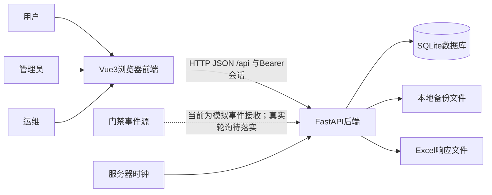
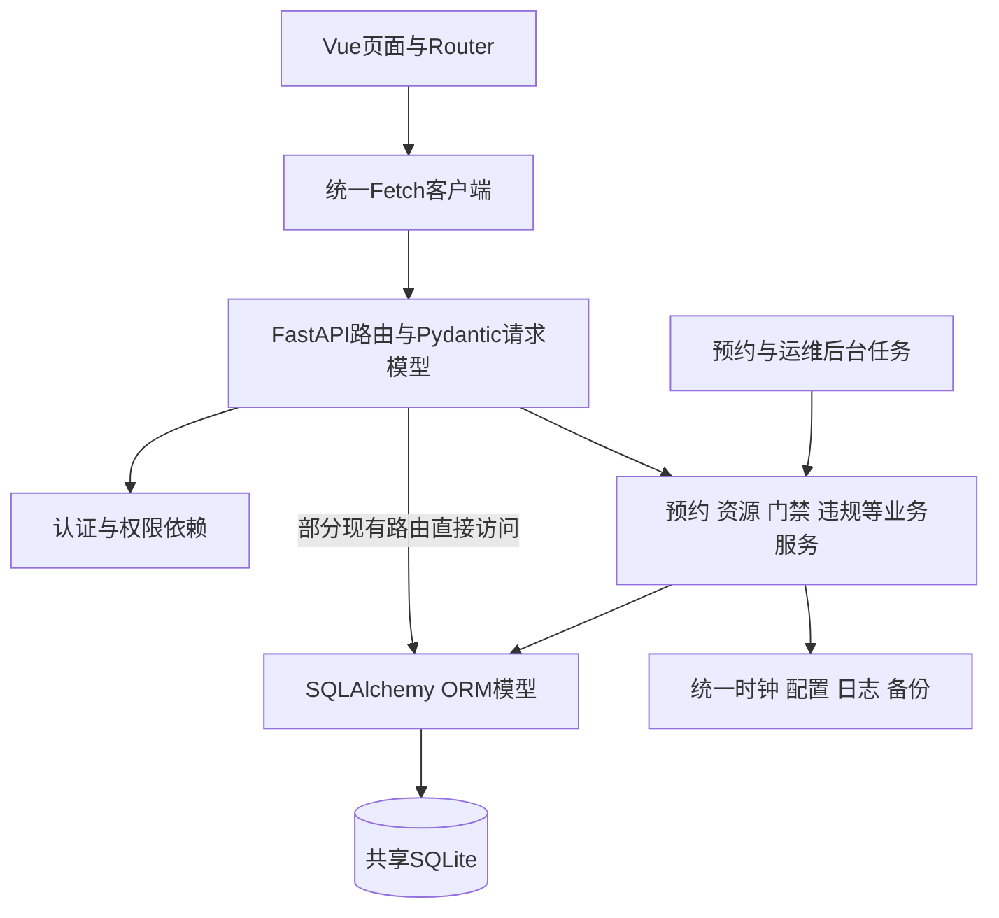
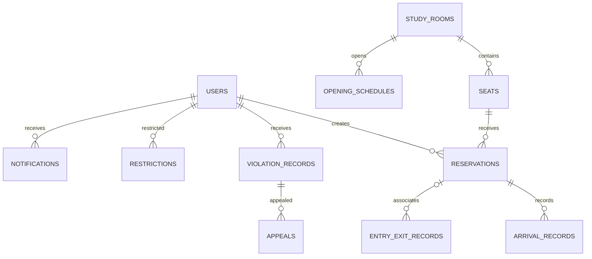
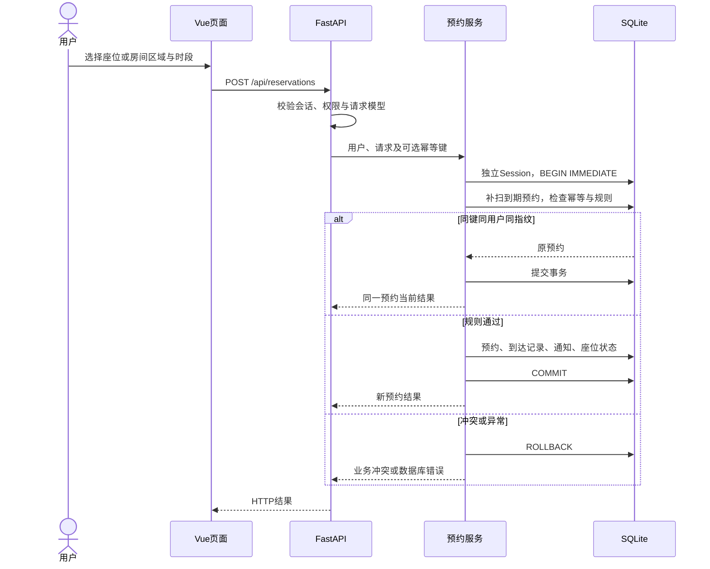

# 智能自习室管理预约系统软件架构设计方案（讨论稿）

| 项目 | 内容 |
|---|---|
| 文档版本 | v2.0 |
| 编制日期 | 2026-11-12 |
| 文档性质 | 基于现有需求、决策记录和代码反向梳理的架构讨论稿 |
| 编制团队 | 全网呼叫奶家人 |
| 队员 | 周俊博、张东岩、方梓安 |
| 适用范围 | 课程项目架构梳理、设计确认及后续基线整理 |
| 代码核查参照 | HEAD：671ca454a8fd4a69e0c7f619a5f540d277b930c0；同时核查2026-11-26本地工作区，工作区并非全部已提交 |

## 1. 文档说明与依据

### 1.1 编制背景

本项目已完成主要功能开发，团队报告系统能够正常运行。前期形成了需求分析成果，后续主要借助AI集中完成实现，架构设计、详细设计和分阶段验证尚未形成完整过程记录。本稿用于补齐架构分析与方案比较，建立需求、决策、代码及已有任务之间的对应关系。

本次未找到可确认为开发前形成的架构讨论原稿，因此本文是**事后反向梳理的讨论稿**。候选方案比较是本次整理时的分析，不代表团队曾在开发前召开过相应会议；本文不补造评审、签字、测试通过或阶段验收历史。

本文只整理架构，不授权修改业务规则、重构系统或更换技术栈。文中“拟采用”“建议”“待核验”表示设计意见；“已有决策”表示半定稿已有明确记录；“当前实现”表示静态检查发现相应代码，不能据此认定需求已经验收通过。

### 1.2 资料优先级与使用方法

| 资料 | 本文用途 | 使用边界 |
|---|---|---|
| [软件需求规格说明书](软件需求规格说明书.md)，简称SRS | 业务范围、FR/BR/NFR、权限、用例及HD决策的主要依据 | 保留原文；内部残留冲突单列记录 |
| [架构确认与决策记录](架构确认与决策记录.md) | 已有架构取舍及ADR-01～ADR-10的主要依据 | 引用已有编号，不自行新增“已接受”ADR，不推定已完成交叉评审 |
| [教师操作指引](架构设计后确认与分阶段实现操作指引_学生版.md) | Q澄清、ADR比较、基线、验证与责任的组织方法 | 按已有代码补齐过程，不倒写开发历史 |
| `backend/app/`、`backend/migrations/`、`frontend/src/`及构建配置 | 确认当前结构、机制、接口和部署约束 | 代码事实不替代业务确认与运行证据 |
| [GitHub Issues](https://github.com/dorian0326/study-room/issues?q=is%3Aissue) | 复用已有任务规划和任务关联 | Issue关闭不等于验收通过；历史描述与现状不一致时保留差异 |
| 其他既有文档 | 必要时作为查找线索 | 不直接继承其中的架构、测试或完成结论 |

本轮检查为资料阅读、目录检查和源码静态审查，未启动服务，未连接运行数据库，未执行自动测试、压测、恢复演练或真实门禁联调。数据库说明以ORM与迁移源码为依据，不表示运行库已升级到对应版本。SRS中已有的历史验收结果作为来源记录保留，本文不将其改写为本轮验证结果。

### 1.3 决策与讨论事项编号

沿用来源中的FR、BR、NFR、HD、Q和ADR编号。第10章新增的 `DISC-01`～`DISC-10` 仅是**本文讨论事项索引**，不替代原有Q，不构成新增已接受ADR。已有记录中的责任人与日期可追溯到原文；本文中的分工与复核安排是本次责任安排，不表示三名成员已实际完成评审。

## 2. 范围、业务约束与架构驱动因素

### 2.1 系统范围

系统为用户提供自习室与座位查询、创建和换座、取消、扫码签到、临时离开、结束使用、个人历史、通知、违规查看和申诉；为管理员提供资源、开放时间、参数、账号权限、违规申诉和统计导出管理；为运维提供日志、门禁记录、备份和运行状态查询。

角色为用户、管理员和运维三类，学生与教师统一为用户，不增加教师特权。依据SRS已有边界，候补及自动转正已由HD-41移出本期；统一身份认证实际对接、收费及硬件采购等非目标不在本稿扩大范围。门禁记录接入属于本期需求，不能因统一身份认证不在范围内而一并排除。

### 2.2 必须保持的业务规则

| 业务约束 | 主要依据 | 架构影响 |
|---|---|---|
| 开放时段06:00～23:30，不跨零点；最多提前1天预约 | SRS HD-34、HD-37及UC-007 | 服务端统一校验日期、开放窗口与时区 |
| 同一座位同一时段至多一条有效预约；每人同一时段仅一个座位 | BR-050及HD-35 | 事务内同时检查座位冲突和本人冲突 |
| 换座只改座位，不改预约日期和时间 | FR-021、HD-36 | 专用命令与请求模型限制可变字段 |
| 开始前大于15分钟取消不违规；开始前不超过15分钟允许取消并记违规；已签到不能取消 | UC-009、BR-030～033、HD-20/25/27/40 | 取消与未到场处罚互斥；禁约不能阻止取消已有预约 |
| 签到窗口为开始前15分钟至开始后15分钟，超窗未签释放 | BR-020～022、UC-010 | 统一时钟、状态竞争处理与后台补扫 |
| 点击暂离后保留30分钟，以重新入馆记录判定返回；未声明而出馆则释放并记违规 | BR-070～072、HD-15、HD-26 | 暂离计时与门禁证据关联，异常接入需降级 |
| 固定14天统计周期、警告不扣减、阶梯无上限；第k档阈值为3+2(k−1)，禁约k天 | HD-17～19、BR-090～099 | 周期与限制独立保存，归档不删除，重复处理去重 |
| 维护强制取消受影响未来未签到预约，只通知、不补偿；已签到者不立即中断 | UC-102、HD-23 | 资源变更、预约、通知与审计保持一致 |
| 通知仅站内；门禁明细管理员不可读 | HD-38、PERM-027、NFR-014 | 通知入库、后端权限及字段最小化 |

表中是需求约束，具体实现差异见第10章。例如取消时间恰好等于开始时刻时，当前代码拒绝取消，不能把“≤15分钟”无限扩展为开始后任意时刻可取消。

### 2.3 质量属性与风险驱动

| 质量关注点 | SRS目标 | 本稿提出的架构回应 | 尚需的证据 |
|---|---|---|---|
| 并发正确性 | NFR-004：超售0次 | 数据库写事务、区间重叠检查、唯一约束与幂等 | 文件型SQLite、多连接并发与提交后对账 |
| 响应和容量 | NFR-002：P95≤2秒；NFR-003：≥200并发 | 短事务、索引、WAL、锁等待与可重试错误 | 明确在线用户/在途请求/写并发口径后隔离压测 |
| 可用性 | NFR-001：月度≥99.5% | 健康检查、任务重试、请求补扫、运维观测 | 月度探测、故障起止与统计口径 |
| 时间准确性 | NFR-006：相对基准偏差≤1秒 | 统一服务端时钟与时区、边界测试接缝 | 可信时间源及主机校时记录 |
| 安全与隐私 | NFR-005/011/014：安全哈希、越权0次、访问可审计 | bcrypt、后端授权、对象归属、门禁HMAC脱敏 | 双用户越权、角色矩阵、访问审计及授权材料 |
| 可维护与可追溯 | NFR-007/008：关键参数可配置、关键操作完整留痕 | 配置模型、迁移、模块职责与审计 | 参数覆盖清单、变更回归、业务事实与日志对账 |
| 故障恢复 | NFR-012：RPO=0 | 事务恢复基础、在线一致性快照、停机恢复流程 | 按故障类型演练并逐笔核对已确认事务 |
| 易用与兼容 | NFR-009/010：核心路径≤3步、主流移动浏览器可用 | Vue页面、扫码及编号输入回退 | 真实移动设备与完整业务路径走查 |

这些数值来自SRS，本文不降低目标。采用SQLite或已有备份模块都不能单独证明达到质量目标。

## 3. 候选方案与架构取舍

### 3.1 总体架构比较

| 方案 | 描述 | 优点 | 代价及适用性 |
|---|---|---|---|
| A：路由主导的分层单体 | 单个后端，业务校验与ORM操作较多放在路由中 | 初期实现直接、部署简单 | 跨预约、门禁、违规的状态变更容易分散，复用与测试边界较弱 |
| B：按业务职责组织的分层单体 | 单个后端部署，API、校验模型、业务服务、ORM与基础设施分层，共享本地事务 | 适合三人协作、跨模块一致性与课程部署，能够延续现有实现 | 需要维护逻辑边界；共享数据库不自动带来严格模块隔离 |
| C：按领域拆分多个服务 | 身份、资源预约、纪律及通知分别部署 | 可独立扩容与发布 | 增加跨服务一致性、消息、认证和运维成本，现阶段缺少拆分收益证据 |

**推荐以B作为整理基线的总体方案**，与已有ADR-01一致。现有代码具备API、services、schemas和models的分层结构，但部分路由直接执行ORM与业务编排，不能写成已经实现严格领域隔离，也不应虚构独立仓储层。后续是否调整组织方式由具体任务决定，本稿不要求为满足图示而重构。

### 3.2 数据库与并发方案比较

| 选择 | 收益 | 限制与讨论结论 |
|---|---|---|
| SQLite＋本地写事务 | 无需独立数据库服务，部署简单；可原子提交跨业务表变化 | 写入主要串行化。保留现状作为代码事实，容量以测试判定 |
| 在现有SQLite上补充乐观锁 | 能表达调用方基于旧版本修改的冲突，回应BR-051 | 需要明确版本对象及条件更新；单条预约版本号本身不能阻止两条新预约的区间冲突 |
| 更换服务型数据库 | 有利于更高写并发及集中运维 | 需要迁移与语义回归，当前无批准且无压测证据支持立即更换 |

ADR-02/03描述当前写锁与幂等机制，ADR-10记录版本字段的演进约束；SRS BR-051仍要求乐观锁。本稿保留此差异，不以推荐方案宣布原需求已变更。推荐先验证当前并发不变量，再明确版本检查的落实范围；任何实现变更另立具体任务。

### 3.3 后台处理与通知方案比较

当前随FastAPI生命周期启动后台协程，维护预约扫尾、备份和日志清理；通知作为同库记录保存。相对于独立调度进程和外部消息系统，该方案部署成本较低，也便于把预约与站内通知放入同一事务。

代价是任务与Web进程共同启停，多进程会重复启动任务，进程重启期间不能持续执行；事件键及状态条件有助于幂等，但不能替代多进程恢复验证。推荐课程部署先采用单后端进程与本地数据库；拆分调度器或引入消息系统作为容量或可靠性证据触发的备选，不列为当前已有能力。

## 4. 系统上下文与逻辑结构

### 4.1 系统上下文视图

身份认证由本系统账号与会话提供，不声称已接学校统一身份认证。门禁图中的虚线表示外部真实连接尚未验证，不代表已运行30秒轮询。站内通知存储在数据库，由浏览器查询展示；不存在已部署的短信或邮件发送服务。

### 4.2 分层组件视图

这是对现有结构的抽象，逻辑模块并非独立部署服务。推荐后续跨模块状态转换通过业务用例编排；现有直接ORM访问如需调整，应按授权范围逐项实施。数据库事务是当前一致性的主要边界，不能在图示中替换为不存在的消息总线或分布式事务。

### 4.3 模块职责与代码映射

以下“职责边界”表示设计归属，不表示当前所有写入口已技术隔离。

| 逻辑模块 | 职责与主要数据 | 当前代码位置（相对项目根目录） | 职责边界 |
|---|---|---|---|
| 身份与权限 | 注册、会话、密码、角色权限；User、Role、Permission、AuthSession | `api/auth.py`、`api/admin_users.py`、`services/auth.py`、`deps.py`、`permissions.py`，均位于`backend/app/` | 身份认证与本人数据过滤分别负责；禁约区别于账号禁用 |
| 资源与可用性 | 房间、座位、区域属性、开放时间、校历、查询状态 | `backend/app/services/availability.py`、`api/admin_config.py`、`api/admin_seats.py` | 资源管理变更必须处理受影响预约，不能只改展示状态 |
| 预约与履约 | 创建、换座、取消、签到、暂离、结束及超时；Reservation、ArrivalRecord | `backend/app/services/reservations.py`、`api/reservations.py` | 统一承担预约状态与占用规则；由门禁和管理流程协同调用或编排 |
| 纪律与申诉 | 违规去重、周期累计、限制、申诉处理 | `backend/app/services/violations.py`、`api/admin_violations.py` | 保留原始事件，撤销限制需有对应依据 |
| 门禁适配 | 脱敏身份、事件去重、延迟识别、预约关联和人工核验 | `backend/app/services/gate.py`、`api/gate.py` | 当前为模拟入口；状态变化需与扫码和暂离规则协调 |
| 站内通知 | 业务事件通知、列表、已读；Notification | `backend/app/services/notifications.py`、`api/reservations.py` | 事件键去重；读取只限本人；通知不能反向决定业务事实 |
| 报表与导出 | 利用率、高峰、违规统计及XLSX | `backend/app/api/reports.py` | 授权后查询聚合；不承担预约写入 |
| 运维与审计 | 审计/登录日志、健康、进程指标、备份与恢复 | `backend/app/api/ops_logs.py`、`api/ops_system.py`、`services/backup.py`、`services/logs.py`、`metrics.py` | 恢复通过CLI；备份文件操作不等同数据库原子事务 |
| 基础设施 | 引擎与事务、时区、环境与业务参数、迁移 | `backend/app/db.py`、`timeutil.py`、`config.py`、`services/settings.py`、`backend/migrations/` | 提供通用机制，不自行决定业务规则 |

模块表中缩写为`api/…`和`services/…`的条目均以同一行明确的`backend/app/`为前缀；前端对应页面位于`frontend/src/views/`，路由位于`frontend/src/router/index.js`。

## 5. 数据架构与一致性设计

### 5.1 主要实体与关联

图为核心关系概览，不是完整物理ER图。身份、配置、日志等表未全部展开。`ArrivalRecord.reservation_id`当前没有唯一约束，因此物理上为一对多；主流程按每预约一条记录使用，不能画成数据库已经保证严格一对一。

区域使用`Seat.zone_type`表达；暂离状态和时间位于`Reservation`，没有独立暂离流水实体；当前座位模型不含用于平面布局的持久化x/y坐标。模型与迁移定义可从[实体模型](../backend/app/models/entities.py)、[枚举](../backend/app/models/enums.py)、[认证模型](../backend/app/models/auth.py)、[配置模型](../backend/app/models/config.py)和[迁移目录](../backend/migrations/versions/)核对。

### 5.2 关键约束

1. 用户标识、预约号、房间内座位编号等使用相应唯一约束；外键和枚举检查约束约束关联与取值。
2. 预约使用半开区间`[start_time,end_time)`。重叠条件为`已有.start < 新.end AND 已有.end > 新.start`，相邻区间不构成重叠。
3. `RESERVED`、`ACTIVE`、`TEMP_LEAVE`为有效占用状态；终态不再占用后续可预约时段。
4. 有效预约部分唯一索引仅覆盖`seat_id + start_time`，不能单独阻止开始时刻不同的重叠预约，必须与事务内区间检查共同工作。
5. 预约幂等键全库唯一，可为空；请求指纹用于识别同键不同内容。门禁使用`source_system + external_id`去重，通知使用事件键去重。
6. 座位表状态用于资源管理及当前显示，按指定时段的可用性还依赖预约和开放规则；不能只看一个`Seat.status`判定未来时段可预约。
7. 时间输入必须遵守带时区契约。`LocalDateTime`按北京时间转换后存储、读出附加时区，不能描述为SQLite原生保存时区信息。

### 5.3 事务边界讨论

| 业务用例 | 应一起成功或回滚的事实 | 当前机制与需注意之处 |
|---|---|---|
| 创建预约 | 资格与冲突检查、Reservation、ArrivalRecord、确认通知、座位状态同步 | 业务独立Session执行立即写事务；认证查询Session不直接升级写锁 |
| 换座 | 原预约关联、新座位冲突检查、原/新座位状态 | 失败保留原预约与原座位；不改时间 |
| 取消/超时 | 预约终态、释放、适用违规和通知 | 取消不再生成未到场违规；需验证重复执行 |
| 暂离/门禁/结束 | 履约状态、到达/结束事实、适用违规及通知 | 现有实现入口分散，统一状态约束需逐场景核对 |
| 维护 | 资源状态、受影响预约、通知和审计 | 座位维护与房间/时段维护存在不同实现入口 |
| 申诉审核 | 处理结果、违规归档或保留、关联限制调整、通知与审计 | 多限制并存时不能无依据解除全部限制 |

本表是用例一致性边界，不声称所有关键操作已经完整写入审计。文件备份、恢复和数据库审计不构成单个原子事务，需另外保留运维操作证据。

## 6. 关键业务流程与状态设计

### 6.1 创建预约与重复提交

当前创建接口优先使用`Idempotency-Key`请求头，其次使用正文`request_key`；正文键按用户ID计算摘要。相同键与不同用户或指纹冲突返回409。头部键重放返回200，正文键重放保持201，并设置重放标记。返回的是同一预约的**当前状态**，不是首次响应的不可变快照。

两种键都不传时当前允许创建，因此不能写成“所有创建必定具备网络重试去重”。客户端同一业务意图重试应保持同一个键，新的意图换键；该约束需在后续接口设计与测试中落实。

锁忙在预约事务封装中映射为503，错误响应可带重试提示；不同路由的异常处理未必完全相同，不能推定全系统具有统一自动重试。

### 6.2 预约状态机

以下为当前代码状态与关键转换的摘要，非完整接口契约。

| 原状态 | 触发 | 条件/结果 | 依据与差异 |
|---|---|---|---|
| 无 | 创建 | `RESERVED` | 冲突、开放规则、禁约及时间校验通过 |
| `RESERVED` | 换座 | 仍为`RESERVED` | 仅修改座位，重新检查冲突 |
| `RESERVED` | 扫码或编号签到 | `ACTIVE` | 本人、正确座位、窗口内且无他人使用 |
| `RESERVED` | 开始前取消 | `CANCELLED` | 按>15或≤15分钟决定是否记迟取消 |
| `RESERVED` | 超窗扫尾 | `EXPIRED` | 释放并记录未到场 |
| 未来`RESERVED` | 维护强制取消 | `ADMIN_CANCELLED` | 只通知、不补偿，不增加用户违规 |
| `ACTIVE` | 声明暂离 | `TEMP_LEAVE` | 记录暂离起点并保留座位 |
| `TEMP_LEAVE` | 有效重新入馆记录 | `ACTIVE` | 按事件时间校验期限 |
| `TEMP_LEAVE` | 主动返回接口 | 当前也可转`ACTIVE` | 与依入馆记录判定的需求差异见DISC-03 |
| `ACTIVE`或`TEMP_LEAVE` | 确认结束 | `COMPLETED`及连续预约链释放 | 已开始段与尚未开始段的处理需分别验证 |
| `ACTIVE` | 未声明而出馆 | `TIMED_OUT` | 释放并记未声明离馆违规 |
| `TEMP_LEAVE` | 超时未返 | `TIMED_OUT` | 释放并记暂离超时 |
| `ACTIVE`或`TEMP_LEAVE` | 预约时段结束未结束使用 | `TIMED_OUT` | 具体违规类型及边界以扫尾规则核验 |

合法重复操作按各接口返回当前结果或冲突；不能笼统声称所有写接口均完全幂等。终态不应被迟到事件恢复为有效占用，需通过竞争测试证明。

### 6.3 签到、暂离与后台扫尾

签到以服务器时间裁决；默认窗口包含开始前15分钟与开始后15分钟两端，同时受预约是否已结束、座位是否被他人使用等条件约束。超窗签到逻辑先提交失效与违规事实，再返回业务错误，避免异常回滚掉已确认的失效事实。

暂离默认保留30分钟，预约结束构成另一截止条件。现有入馆事件处理与主动返回接口都可恢复使用，需明确证据要求，不能将主动返回默认视为真实入馆证明。

后台预约任务默认每60秒扫尾，请求路径还会补做部分到期检查。这意味着状态落库可能存在扫描间隔，并非精确定时到秒；进程停机后的补扫、重复执行、门禁延迟与扫尾竞争需要验证。备份和日志清理后台间隔默认均为0，即关闭，不能写成默认每日自动执行。

### 6.4 门禁接入与降级

当前`gate.py`接收模拟事件，保存事件发生和接收时间、HMAC脱敏用户键、同步状态与关联预约；相同来源事件号重复提交返回首次处理结果。超过300秒的迟到事件不自动变更预约，转人工核验；无法匹配身份或预约状态时保留事件并提示处理。

需求HD-52规定30秒HTTP轮询。当前事件接收逻辑不等于已实现轮询采集、连续失败探测或真实设备联调。模拟接口由运维权限保护，真实接入仍需明确设备身份、协议、授权、超时与故障恢复。

另一个需要明确的差异是：当前入馆事件在匹配未签到预约时会直接置为`ACTIVE`，而需求HD-43规定扫码签到。建议在基线中明确门禁只用于哪些证据、能否代替签到，不把当前代码行为自行升格为新的业务决定。

### 6.5 违规、申诉与维护

纪律服务保存原始违规，按预约与类型检查重复。固定周期以首次违规为起点，周期到期归档；未签退按配置默认每2次折算1次警告，阶梯处罚不扣减累计警告。代码细分了未声明离馆、未到场、未签退、迟取消和暂离超时等事件类型，这不代表重新采用旧版分级处罚体系。

申诉与具体违规、限制关联，管理员处理应保留理由与审计。多个有效限制同时存在时，创建和换座必须检查所有有效限制；批准一项申诉不应无依据解除其他限制。

房间关闭与开放时间调整使用`admin_force_cancel`，座位维护有本地处理逻辑。推荐统一核查三类入口的筛选、通知和审计语义，特别是“未来”边界、已开始未签到、已签到不中断和恢复资源后的展示状态。本稿不要求立即合并实现。

## 7. 接口、前端与权限边界

### 7.1 接口组织

接口统一使用`/api`前缀，浏览器采用HTTP JSON交互，Excel导出返回文件。下面只列架构级代表接口，不替代后续逐接口字段与异常契约。

| 能力 | 当前代表接口 | 主要边界 |
|---|---|---|
| 身份 | `POST /api/auth/login`、`GET /api/auth/me` | 会话认证、密码策略与账号状态 |
| 资源 | `GET /api/rooms`、`GET /api/seats`、`GET /api/seats/{seat_id}` | 按日期时段求可用性，避免泄露占用者身份 |
| 创建/换座 | `POST /api/reservations`、`PATCH /api/reservations/{rid}/seat` | 本人、冲突、幂等与可变字段 |
| 履约 | `POST /api/reservations/{id}/check-in`、`temporary-leave`、`return`、`end`、`cancel` | 后四项为同一路径前缀下的动作；各自状态与时间校验 |
| 历史/申诉/通知 | `GET /api/reservations`、`POST /api/appeals`、`GET /api/notifications` | 本人数据范围，禁止依赖前端过滤 |
| 资源配置 | `/api/admin/rooms`、`/api/admin/settings` | 不同方法分别授权，维护影响需事务处理 |
| 统计 | `GET /api/admin/reports`、`GET /api/admin/reports/export.xlsx` | 统计与导出权限 |
| 门禁 | `POST /api/ops/entry-exit/mock`、`GET /api/ops/entry-exit/records` | 运维权限、脱敏与访问审计 |
| 运维 | `GET/POST /api/ops/backups`、`GET /api/ops/status`、`GET /api/health` | 恢复为CLI能力，不存在已核实的网页在线恢复接口 |

路径中的`{id}`为说明占位，实际参数名以对应路由为准。认证失败、业务失败和参数校验目前存在不同`detail`结构，前端客户端兼容字符串、对象和列表；不能声称所有接口已采用统一业务错误码模型。

### 7.2 前端结构

前端采用Vue3、Vue Router与Vite。页面按认证、预约、签到、通知、违规、管理和运维组织，`frontend/src/api/client.js`统一调用Fetch，`frontend/src/router/guard.js`参与导航授权。开发代理将`/api`转发到本地8000端口，Vite开发端口为5173。

当前Bearer令牌保存在`localStorage`，不是JWT或HttpOnly Cookie方案的证据。前端路由和按钮控制只改善交互，后端仍必须逐请求授权。扫码兼容性、编号回退、错误提示和移动页面需通过实际设备检查，不能仅凭组件存在认定可用性达标。

### 7.3 权限模型

| 能力 | 用户 | 管理员 | 运维 |
|---|---|---|---|
| 查看公开房间与座位 | 可 | 可 | 可 |
| 本人预约与履约 | 可 | 按`reservation:own`可 | 单独运维角色不可 |
| 房间/座位/参数管理 | 不可 | 可，按相应权限 | 不可 |
| 违规与申诉管理、统计导出 | 不可 | 按相应权限 | 不可 |
| 审计日志 | 不可 | 可 | 可 |
| 系统/登录日志及运行状态 | 不可 | 单独管理员角色无相应权限 | 可 |
| 门禁明细、备份 | 不可 | 单独管理员角色不可 | 可 |

依据[权限定义](../backend/app/permissions.py)，身份与角色可多对多组合，最终权限为角色集合的授权结果。表中针对单一角色，不能把“管理员”简单解释为拥有全部权限。本人数据还需通过`user_id`和对象归属过滤，防止替换预约、通知或违规ID越权。

## 8. 部署、配置与运行保障

### 8.1 当前技术构成与部署建议

| 层次 | 已核查技术或机制 | 部署讨论 |
|---|---|---|
| 前端 | Vue3、Vue Router、Vite、Fetch | 开发服务器用于本地联调；正式演示可部署构建后的静态文件 |
| API | Python≥3.11、FastAPI、Uvicorn、Pydantic | 建议先单进程部署，验证后台任务和SQLite行为 |
| 数据 | SQLAlchemy 2.x、SQLite、Alembic迁移0001～0008 | 持久目录、迁移版本与连接参数需要运行核对 |
| 报表 | openpyxl | 按授权范围导出XLSX |
| 认证 | pwdlib bcrypt、服务器端会话 | 令牌摘要存库，敏感配置不提交 |
| 自动检查 | GitHub Actions、ruff、pytest、Vitest、ESLint、Prettier及构建 | 配置存在不代表本轮或远端最新运行已通过 |

当前没有发现需要Redis、消息队列或容器编排才能运行的架构依据，本稿不引入这些依赖。静态站点与API同源、HTTPS和反向代理是部署建议，不声称已在服务器配置完成；当前CORS允许的是本地5173来源，部署时需核对实际访问方式。

### 8.2 配置与运行约束

环境变量使用`STUDYROOM_`前缀。数据库默认位于后端相对目录`data/study_room.db`，备份默认`data/backups`；实际位置取决于工作目录及覆盖配置。SQLite连接代码启用外键、WAL和5000毫秒默认忙等待。

门禁HMAC密钥必须由部署环境提供独立值；非dev/test环境仍使用开发默认值时，配置校验会拒绝启动。业务参数由配置表覆盖默认值，但“关键参数100%可配置”仍需逐条核验，代码中也存在本期上限等固定约束。

主机时钟负责业务时间；统一时区只解决时间解释，不能证明主机已校时。多后端进程会分别启动后台任务并维护各自指标，需另行验证，不能直接按无状态服务任意扩容。

### 8.3 备份、恢复与观测

当前使用SQLite online backup API生成一致快照，默认保留14份；恢复前检查备份完整性，并通过CLI在停服条件下覆盖数据库。建议演练流程为：停止业务与后台任务、保留当前库、检查目标备份、恢复、核对迁移版本、逐笔对账、启动补扫及业务检查。

快照之后的已提交事务可能在介质损坏后丢失，因此周期备份不足以证明RPO=0。应区分进程故障、主机故障与磁盘丢失，不把WAL事务恢复能力直接等同于任意故障下零数据丢失。

`metrics.py`提供进程内请求数、状态码分类、平均和最大耗时，重启后清零，多进程不自动汇总。当前指标没有分位数数据，不能从平均值推导P95，也不能据此证明整月可用率。

## 9. 已有决策、任务与人员追溯

### 9.1 ADR引用

| 已有ADR | 记录中的方向 | 本稿处理 |
|---|---|---|
| ADR-01 | FastAPI＋Vue3＋SQLite分层模块化单体 | 作为总体架构依据，说明当前分层实际程度 |
| ADR-02、ADR-03 | 外键/WAL/忙等待、立即写事务、半开区间、唯一约束与幂等 | 区分已见代码机制与未执行的并发验证 |
| ADR-04 | 八种预约状态 | 建立状态映射，保留门禁与返回路径差异 |
| ADR-05 | 站内通知与事件键去重 | 区分通知入库与用户实际阅读 |
| ADR-06 | 门禁脱敏、迟到/无法匹配转人工 | 不推定真实轮询、设备授权和联调已完成 |
| ADR-07 | 固定14天、无上限阶梯、归档不删除 | 追溯纪律服务，验证周期边界与折算 |
| ADR-08 | 维护只取消未来预约、无补偿、不打断已签到 | 核查三类维护入口与边界 |
| ADR-09 | 在线备份、完整性检查、停机恢复 | 不将恢复能力等同RPO=0 |
| ADR-10 | 版本字段作为演进约束 | 保留与BR-051的实现差距，不视为已批准修改需求 |

### 9.2 团队责任安排

| 成员 | 本项目职责 | 本稿涉及的主要架构责任 |
|---|---|---|
| 周俊博（队长） | 需求分析与统筹；房间/座位查询与实时状态；创建预约、并发幂等、换座、取消、扫码签到与未签释放 | 范围追溯、预约不变量、事务与状态边界、文档整合 |
| 张东岩 | 脚手架与CI；数据库模型；认证、密码与权限；日志、备份、监控；房间、开放时间及参数管理；较多测试与整合工作 | 数据约束、环境与部署、权限安全、恢复和测试证据组织 |
| 方梓安 | 结束与暂离；门禁同步降级；违规处罚申诉；通知与历史；座位布局/导入维护；报表与Excel | 履约联动、门禁证据、纪律周期、维护一致性和统计口径 |

建议交叉复核：张东岩复核周俊博的事务与数据库约束；周俊博复核方梓安的状态与业务规则；方梓安复核张东岩的管理配置对预约和通知的影响。此处为工作安排，不填写虚构的完成日期或评审结论。

### 9.3 需求—代码—Issue关联

| 需求/架构主题 | 主要代码入口 | 已有Issue |
|---|---|---|
| 技术栈、模型与迁移 | `main.py`、`db.py`、`models/`、`backend/migrations/` | [#4](https://github.com/dorian0326/study-room/issues/4)、[#5](https://github.com/dorian0326/study-room/issues/5) |
| FR-001～007身份权限 | `services/auth.py`、`deps.py`、`permissions.py` | [#6](https://github.com/dorian0326/study-room/issues/6)、[#7](https://github.com/dorian0326/study-room/issues/7) |
| 日志、备份与监控 | `api/ops_logs.py`、`api/ops_system.py`、`services/backup.py` | [#8](https://github.com/dorian0326/study-room/issues/8)、[#9](https://github.com/dorian0326/study-room/issues/9) |
| FR-010～013资源查询 | `services/availability.py`、`api/reservations.py` | [#10](https://github.com/dorian0326/study-room/issues/10)、[#11](https://github.com/dorian0326/study-room/issues/11) |
| FR-020～024及BR-050～052 | `services/reservations.py`、`schemas/reservations.py` | [#12](https://github.com/dorian0326/study-room/issues/12)、[#13](https://github.com/dorian0326/study-room/issues/13)、[#14](https://github.com/dorian0326/study-room/issues/14)、[#15](https://github.com/dorian0326/study-room/issues/15) |
| 签到、结束与暂离 | `services/reservations.py`、`services/reservation_worker.py` | [#16](https://github.com/dorian0326/study-room/issues/16)、[#17](https://github.com/dorian0326/study-room/issues/17) |
| 门禁、违规与申诉 | `services/gate.py`、`services/violations.py`、`api/admin_violations.py` | [#18](https://github.com/dorian0326/study-room/issues/18)、[#19](https://github.com/dorian0326/study-room/issues/19) |
| 通知与个人历史 | `services/notifications.py`、`api/reservations.py` | [#20](https://github.com/dorian0326/study-room/issues/20)、[#21](https://github.com/dorian0326/study-room/issues/21) |
| 管理配置、座位与统计 | `api/admin_config.py`、`api/admin_seats.py`、`api/reports.py` | [#22](https://github.com/dorian0326/study-room/issues/22)、[#23](https://github.com/dorian0326/study-room/issues/23)、[#24](https://github.com/dorian0326/study-room/issues/24) |
| 后续补缺与限制说明 | 相关服务、前端页面及质量验证范围 | [#36](https://github.com/dorian0326/study-room/issues/36)、[#37](https://github.com/dorian0326/study-room/issues/37)、[#38](https://github.com/dorian0326/study-room/issues/38) |

除明确写出的`backend/migrations/`外，本表后端缩写路径均以`backend/app/`为前缀。查询时上述Issue均为关闭状态；部分正文引用历史需求编号，本文关联按业务主题核对，不原样继承旧编号含义。Issue #38仍描述门禁缺少五分钟延迟判定，但当前代码已有该分支，历史任务描述不能覆盖当前源码事实。本次不重复创建任务卡或修改Issue。

## 10. 架构讨论事项与差异登记

| 编号 | 冲突/待核验及来源 | 备选与建议 | 影响、责任与状态 |
|---|---|---|---|
| DISC-01 | SRS BR-051、HD-04及UC-007指定乐观锁；ADR-02/10与当前模型采用写锁，未见独立版本条件更新 | A保留需求并补版本方案；B通过正式变更接受当前并发机制。建议先保留需求和差距，核验正确性后决定，不自行选B | 预约并发符合性；周俊博、张东岩；差异已识别，未关闭 |
| DISC-02 | SRS HD-52要求30秒HTTP轮询；当前为mock事件接收，无真实轮询与可用性监测证据 | A完成真实适配；B明确课程演示使用模拟，真实集成另行确认。建议架构保留适配边界，演示结果注明模拟 | 外部接口验收；方梓安、张东岩；真实接入未验证 |
| DISC-03 | SRS HD-15/BR-071以重新入馆记录判返回；`POST …/return`无需门禁证据即可恢复 | A只用有效入馆证据；B经确认允许主动返回作为降级并留痕。建议不得把B默认写成现行需求 | 暂离与违规可信度；方梓安、周俊博；规则与实现差异待处理 |
| DISC-04 | SRS HD-43扫码签到；签到正文可空，门禁入馆也能将预约置ACTIVE；SRS另允许手输编号回退 | A扫码/编号统一身份和座位校验，门禁仅作辅助；B确认额外签到方式。建议区分编号回退与无座位证明签到，不直接认定B已接受 | 签到身份与证据；周俊博、方梓安；差异待核对 |
| DISC-05 | SRS NFR-012为RPO=0，现有周期快照不能覆盖全部故障 | A明确故障模型后补保障；B正式调整目标。建议保留目标，分进程故障与介质丢失演练，不以快照列表代替验收 | 数据恢复；张东岩；目标未证明 |
| DISC-06 | SRS UC-009主流程允许临近开始取消并记违规，验收标准①仍写禁止窗口内拒绝；代码在开始时刻及之后拒绝取消 | 先按原文记录冲突，建议用HD-20/25及明确时间边界整理后续需求勘误；本文不改SRS | 取消边界与测试预期；周俊博；原需求内冲突未消除 |
| DISC-07 | SRS状态汇总与历史名称/数量有残留；当前预约8种、座位6种，暂离放预约层 | A采用预约状态＋座位展示映射；B增加独立座位暂离状态。建议优先讨论A以减少重复事实，但不宣称已消除需求差异 | 状态图与前后端映射；周俊博、方梓安；映射待逐项确认 |
| DISC-08 | NFR-007/008/014要求参数覆盖与完整审计；当前仅确认存在相应模型和写入口 | 按业务动作对账参数、审计和隐私读取；建议特别检查门禁读取、导出、恢复和跨模块状态变更 | 管理与隐私；张东岩、方梓安；覆盖未验证 |
| DISC-09 | 扫尾默认60秒、任务随Web进程启动；备份/清理默认关闭；多进程重复任务无本轮验证 | A单进程与幂等补扫；B独立调度及协调。建议课程部署先A，多进程前另行验证 | 超时释放及时性及运维；张东岩、周俊博；部署建议，待运行核验 |
| DISC-10 | NFR-001/002/003/006指标已有目标，但无本轮压测、长期监控和校时证据 | 保留既定阈值；先固定负载、身份、时钟基准及统计口径，再测试 | 质量验收；张东岩牵头、全组协同；未执行 |

这些事项不阻塞本稿作为讨论材料提交，但会影响后续基线中哪些内容可写“已符合”、哪些需保留限制。未完成测试与需求差异应分别记录：前者表示缺证据，后者表示已发现机制或语义不同，不能统一写成“待测”掩盖。

## 11. 架构验证建议与基线形成条件

### 11.1 最小验证场景

以下为后续建议，不是本次已经执行的测试，也不另建一套替代现有Issue的任务体系。

| 验证主题 | 方法与关键预期 | 责任安排 |
|---|---|---|
| 同座位竞争 | 文件型SQLite真实多连接同时提交同区间及不同起点重叠区间；最终有效占用至多1条，其余明确冲突或可重试失败 | 周俊博实施，张东岩复核 |
| 幂等与回滚 | 同键同内容、同键不同内容、跨用户复用键、无键、写入中途失败；核对预约、到达记录和通知是否残留 | 周俊博、张东岩 |
| 签到与扫尾竞争 | 窗口两端及外侧、预约已结束、座位仍使用、重复签到和超窗；最终状态合法，无重复违规 | 周俊博实施，方梓安复核 |
| 暂离和门禁 | 期限内/外返回、重复/迟到/乱序/无法匹配事件、直接调用返回接口、停机后补扫 | 方梓安实施，周俊博复核 |
| 违规与申诉 | 3/5/7次阶梯、周期边界、未签退折算、重复扫尾、多限制和单项申诉解除 | 方梓安实施，张东岩复核 |
| 维护一致性 | 座位维护、房间关闭、时段缩短并发创建预约；未来预约取消通知，已签到不中断 | 三人按负责模块实施，交叉复核 |
| 权限与隐私 | 三角色及双用户替换ID；管理员门禁明细拒绝；本人历史/通知隔离，读取留痕核对 | 张东岩实施，方梓安复核 |
| 恢复与质量目标 | 隔离库恢复、逐笔对账、任务重启、可信时间比对、固定负载P95；长期可用率另行累计 | 张东岩牵头，全组复核 |

已有`backend/tests/`及`frontend/src/`测试文件可作为准备基础，包含未提交的`backend/tests/units/`。需要按数据库、接口、组件或单元层级辨别测试性质，目录名叫units不代表全部为纯单元测试。本轮未执行这些脚本，不填写通过数或覆盖率。

证据应记录代码版本及工作区差异、环境、合成数据、命令、原始输出、数据库终态和审查结论。真实多连接测试才可支撑并发结论，Mock门禁只能证明模拟条件下的处理逻辑；真实校园接入需单独证明。

### 11.2 转入基线时的处理要求

1. 保持本稿的反向梳理性质，不改写为开发前原始方案。
2. 基线继承SRS与已有ADR支持的明确结论，列清设计约束、当前偏差和未验证质量目标；新增决策必须有实际确认依据。
3. DISC事项如涉及改需求、接口或模型，先明确决定及影响，沿用现有Q/ADR流程记录，不能仅在新架构文档中悄悄覆盖原依据。
4. 具体接口字段、错误、并发与时间边界由后续接口文档细化；阶段计划复用既有Issue，不声称已经按这些阶段完成历史开发。
5. 审查与验收记录由实际参与成员填写或依据真实结果形成；没有执行的项目保留“未执行/待核验”，不填写虚构签字或日期。

## 附录：本稿核查入口

- 业务依据：[SRS](软件需求规格说明书.md)、[架构确认与决策记录](架构确认与决策记录.md)。
- 方法依据：[教师操作指引](架构设计后确认与分阶段实现操作指引_学生版.md)。
- 后端结构：[应用入口](../backend/app/main.py)、[数据库与事务](../backend/app/db.py)、[配置](../backend/app/config.py)、[模型](../backend/app/models/)、[迁移](../backend/migrations/versions/)。
- 核心逻辑：[预约](../backend/app/services/reservations.py)、[可用性](../backend/app/services/availability.py)、[门禁](../backend/app/services/gate.py)、[违规](../backend/app/services/violations.py)、[维护取消](../backend/app/services/admin_force_cancel.py)、[通知](../backend/app/services/notifications.py)。
- 权限运维：[权限](../backend/app/permissions.py)、[备份恢复](../backend/app/services/backup.py)、[指标](../backend/app/metrics.py)。
- 前端构建：[路由](../frontend/src/router/index.js)、[客户端](../frontend/src/api/client.js)、[Vite配置](../frontend/vite.config.js)、[后端依赖](../backend/pyproject.toml)、[前端依赖](../frontend/package.json)、[CI](../.github/workflows/ci.yml)。
- 任务依据：[GitHub Issues](https://github.com/dorian0326/study-room/issues?q=is%3Aissue)。
